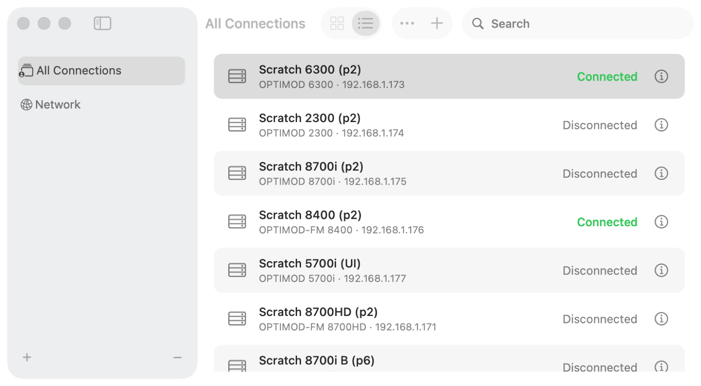

# Open Optimod Remote

Independent open-source control software for Orban OPTIMOD processors: a native Mac app that talks to the processor directly over its own PC Remote network protocol. No Windows, Wine, virtual machine or Orban executable.

**[Download for macOS](https://github.com/marktunzi/open-optimod-remote/releases/latest)**: Developer ID signed and notarized, Apple Silicon, macOS 13 or later, with signed automatic updates. On first launch, allow access to the local network when macOS asks.


## Status

Version 0.3.0 is a **limited-scope release, not yet a complete replacement for Orban's Windows PC Remote**. It controls these models and firmware versions; what exactly was verified per model is in the [0.3.0 compatibility table](docs/releases/v0.3.0.md#compatibility-exactly-what-was-verified):

| Model | Firmware | In this version |
|---|---|---|
| OPTIMOD 5700i | 3.0.1.20 | Settings, presets (recall, save, delete, files), meters, backup and restore, automation, security, diagnostics, System Settings. Verified on a physical processor and on original firmware |
| OPTIMOD 5500i | 3.1.0.2 | Settings, presets (recall, save as, delete), meters, backup and restore, automation, security, diagnostics, System Settings |
| OPTIMOD-FM 8700HD | 1.0.2.161 | Settings, preset recall, meters, System Settings |
| OPTIMOD 6300, 8700i | 4.1.1.19, 1.5.1.11 | Settings, preset recall, meters, System Settings |
| OPTIMOD 2300 | 2.0.3.85 | Settings, recall of user presets, meters, System Settings |
| OPTIMOD-FM 8400 | 3.0.5.7 | Settings, preset recall, meters (UDP), System Settings |
| OPTIMOD 5500 | 1.2.8.24 | Read-only: not yet verified on 5500 firmware ([#1](https://github.com/marktunzi/open-optimod-remote/issues/1)) |
| Other models and firmware | any | Identified, not supported |

Except for the physical 5700i, models were verified against their unmodified original firmware running in a virtual unit, mostly side by side with Orban's original Windows client. Several processors can be connected at once, each in its own tab and session. Full parity with each model's Windows client is the next stage of work ([#17](https://github.com/marktunzi/open-optimod-remote/issues/17)); improvements reach installed copies through the update channel.


## Why this exists

OPTIMOD processors sit at the end of the air chain in radio stations around the world and stay in service for many years. The software to control them from a computer, Orban's PC Remote, runs only on Windows. An engineer on a Mac has to keep a Windows PC around, run a virtual machine, or put Wine or CrossOver between themselves and an on-air processor, just to adjust a setting or watch the meters.

Open Optimod Remote removes that detour. It is a native Mac app that talks to the processor directly over its own network protocol. There is no Windows, no emulation layer and no Orban executable.

Because it controls equipment that is on air, it is deliberately strict:

- it only shows values the processor has confirmed;
- meters are never simulated;
- a failed write is never replayed automatically;
- models without their own parameter profile stay read-only;
- every change is confirmed by reading the processor back, and only actions verified on that exact model and firmware are offered;

It is open source because that knowledge should not live in one person's head or on one workstation. Every further OPTIMOD model is meant to be added the same way. The protocol, the parameter mappings and the verification notes are documented in this repository. A model can be unlocked from its official PC Remote installer ([adding a model](docs/adding-a-model.md)), but only someone with that exact processor can confirm it on hardware. If you run a 5500, an 8700HD or one of the read-only models, your verification is the most valuable contribution you can make. See [Contributing](#contributing).

## How it works

- A Rust service (bundled, loopback-only) owns one PC Remote session per processor: login, file-based synchronization of processing, system and preset documents, writes with readback, preset recall as the original client does it, live meters and automatic reconnection after an unexpected loss.
- Model profiles (parameters, processing pages, Setup pages, meter layouts and gate lamps) are generated from Orban's official PC Remote installers by `scripts/extract_pc_remote.py`; the meters follow each original client.
- The macOS app is native AppKit for Connections, Presets, System Settings and the Tools windows; Meters and Processing Settings are the instrument views, one tab per processor.
- Access codes are stored locally in Application Support with user-only permissions; no Keychain is used. Updates are delivered by Sparkle 2 with an EdDSA-signed feed and archives.

## Install and run on macOS

Download the latest `OpenOptimodRemote-<version>-arm64.dmg` from [Releases](https://github.com/marktunzi/open-optimod-remote/releases/latest), open it and drag **Open Optimod Remote** to **Applications**. The release is signed with a Developer ID and notarized by Apple, so it opens without Gatekeeper warnings. It requires an Apple Silicon Mac with macOS 13 or later. The app starts the local service itself and loads the complete interface in its own window. Allow local-network access when macOS asks so it can reach the processor.

### Build from source

Prerequisites are Rust 1.85 or later, Node.js 22.12 or later, npm and the Apple Command Line Tools. To build, install into `/Applications` and verify the code signature and property list in one command:

```sh
DEVELOPER_DIR=/Library/Developer/CommandLineTools ./scripts/install-macos.sh
```

To build without installing:

```sh
./scripts/build-macos.sh
```

The generated bundle is `dist/Open Optimod Remote.app`, ad-hoc signed for local use.

### Signed and notarized release

```sh
CODESIGN_IDENTITY="Developer ID Application: Your Name (TEAMID)" \
ASC_KEY_ID=... ASC_ISSUER_ID=... \
./scripts/release-macos.sh 0.3.0 9 release-notes.html
```

This builds into `dist/release/VERSION/`: every binary signed with the hardened runtime and a secure timestamp, the app and the DMG notarized and stapled and checked with `spctl`, plus the signed automatic update (a zip of the stapled app and a Sparkle appcast, both signed with the update key, which is read from `SPARKLE_ED_KEY_FILE` or `~/.config/open-optimod-remote/sparkle-ed25519.key` and must match `SUPublicEDKey`) and `SHA256SUMS`. Nothing is published. The App Store Connect API key is read from `~/.appstoreconnect/private_keys/` unless `ASC_KEY_PATH` names another file.



The native Connections window opens on launch. Add a processor once with its name, address, ports and access code. Metadata is saved in `connections.json`; access codes are kept separately in `credentials.json`, both under `~/Library/Application Support/OpenOptimodRemote/`. The credentials file is restricted to the current macOS user and the UI renders saved codes as bullets. No Keychain access is used. PC Remote uses port 6201 and status verification uses port 23 by default. The internal HTTP service binds exclusively to loopback.

For web-development work, run `cargo run --release -p orban-web` from the repository root and open **http://127.0.0.1:5701**. The installed app does not require a separate browser.

## Validation

```sh
python3 scripts/check-docs.py
cargo test --workspace
cargo clippy --workspace --all-targets -- -D warnings
cargo fmt --all -- --check
node --test packages/ui/tests/*.test.ts
npm run build --prefix packages/ui
# Swift: each *Tests.swift with the app sources (Sparkle comes from the first build-macos.sh run)
for test in native/macos/*Tests.swift; do
  swiftc -parse-as-library -swift-version 5 -F target/sparkle-2.10.0 -framework Sparkle \
    -Xlinker -rpath -Xlinker "$PWD/target/sparkle-2.10.0" \
    $(ls native/macos/*.swift | grep -v Tests.swift | grep -v OpenOptimodApp.swift) "$test" \
    -o "/tmp/$(basename "$test" .swift)" && "/tmp/$(basename "$test" .swift)"
done
sh -n scripts/build-macos.sh scripts/install-macos.sh scripts/release-macos.sh scripts/stop-macos.sh
```

The tests use synthetic credentials and independently generated archive vectors. No station presets, device addresses or real credentials are included. See [the preset management and backup verification](docs/verification/2026-09-29-preset-management-backup.md), [the 5500 and 8700HD verification](docs/verification/2026-09-29-5500-8700hd-static-profiles.md), [the native Settings verification](docs/verification/2026-09-20-native-system-settings.md), [the current instrument verification](docs/verification/2026-09-20-instrument-ui.md), [the protocol verification](docs/verification/2026-09-19.md), [the macOS app verification](docs/verification/2026-09-19-macos-app.md) and [the handoff guide](docs/HANDOFF.md).

## Codex skill

The repository includes an installable `optimod-5700i-control` skill under `skills/`. It preserves the verified login, framing, terminal, document, parameter, preset, routing, coupling, metering and hardware-verification knowledge without including device credentials or station data. Copy that directory to `~/.codex/skills/` to install it on a Codex workstation. `skills/optimod-5500-control` and `skills/optimod-8700hd-control` cover the OPTIMOD 5500 and OPTIMOD-FM 8700HD in the same way, including the fields whose wire format differs from what PC Remote displays.

A read-only native diagnostic is available:

```sh
cargo run --release --bin optimod-diagnose -- DEVICE_IP:6201 30
```

It prompts for the access code. A separate hardware check intentionally changes **only display contrast**, verifies current settings, then restores the original contrast:

```sh
cargo run --release --bin optimod-contrast-check -- DEVICE_IP:6201 --temporarily-change-display-contrast
```

Use an appropriate test setup for any processing or routing tests. Never treat a successful TCP write as proof of a device change.

## Contributing

Own code is MIT licensed. The supplied runtime identity artwork and LCD typeface are documented separately in [`packages/ui/public/assets/README.md`](packages/ui/public/assets/README.md) and are not granted under the code license. Do not commit credentials, station configurations, user presets, proprietary executables, firmware images or license files. Reference behavior with precise firmware and software versions. Keep reference data and protocol claims distinguishable from hardware verification and Windows comparison. The app must not silently substitute approximate values or simulated meters.

This project is not affiliated with or endorsed by Orban. Product names identify compatibility targets.
