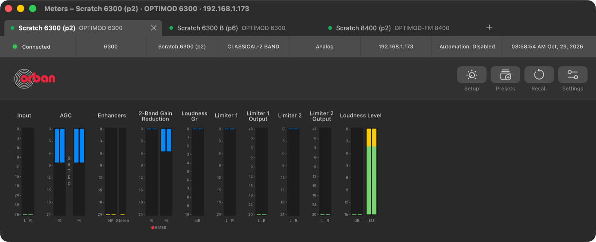

# Open Optimod Remote

**Control your Orban OPTIMOD processors from a Mac. No Windows required.**

## What is it?

Open Optimod Remote is an independent, open-source macOS app for controlling Orban OPTIMOD audio processors. It connects directly to your processors over the network, so you can view live meters, adjust settings and work with presets without running Orban's Windows PC Remote software.

You can connect to several processors at once, with a separate tab and connection for each one.

## Why is it important?

OPTIMOD processors often stay in service for years, but their original PC Remote software is designed for Windows. Mac users otherwise need a Windows computer, virtual machine or compatibility software just to manage a processor.

Open Optimod Remote makes that everyday work possible directly on macOS. It uses the processors' original communication protocols and real values, not simulated meters or audio-processing emulation.

## Who is it for?

Broadcast engineers, radio stations, audio-processing specialists and anyone who manages supported OPTIMOD processors from a Mac.

The macOS app is built for Apple Silicon and macOS 13 or later.

## How does it work?

1. Install the Mac app and allow **Local Network** access when macOS asks.
2. Add your OPTIMOD using its IP address and access code.
3. Connect to see its live meters, processing controls and available settings.
4. Switch between connected processors without disconnecting the others.

The app communicates directly with each processor, reads its current settings and checks changes against the device. Connections can recover automatically after an interruption. No Windows installation or Orban executable is needed.

## Supported models

The current **0.3.0 release candidate** supports the following models and firmware versions. Features vary by model.

| Model | Firmware | Available functionality |
|---|---|---|
| **OPTIMOD 5700i** | 3.0.1.20 | Meters, processing and system settings, presets, backup/restore, automation, security and diagnostics |
| **OPTIMOD 5500i** | 3.1.0.2 | Meters, processing and system settings, presets, backup/restore, automation, security and diagnostics |
| **OPTIMOD-FM 8700HD** | 1.0.2.161 | Meters, processing and system settings, preset recall |
| **OPTIMOD 6300** | 4.1.1.19 | Meters, processing and system settings, preset recall |
| **OPTIMOD 8700i** | 1.5.1.11 | Meters, processing and system settings, preset recall |
| **OPTIMOD 2300** | 2.0.3.85 | Meters, processing and system settings, user-preset recall |
| **OPTIMOD-FM 8400** | 3.0.5.7 | Meters, processing and system settings, preset recall |
| **OPTIMOD 5500** | 1.2.8.24 | Read-only: not yet verified on 5500 firmware |

**Current status:** 0.3.0 is a limited-scope release, not yet a complete replacement for Orban's Windows PC Remote. Some original-client functions are still being added, including improvements to the 8400's Advanced Processing screens. Other models and firmware versions are not yet supported.

See the [detailed compatibility table](docs/releases/v0.3.0.md#compatibility-exactly-what-was-verified) for what has been tested on each model.

## Download and development

Version 0.3.0 is still being tested and **has not been published yet**. See [GitHub Releases](https://github.com/marktunzi/open-optimod-remote/releases) for currently available builds.

To build the current version from source, use `./scripts/build-macos.sh`. Developers can also read [how to add a model](docs/adding-a-model.md) or follow [project progress](https://github.com/marktunzi/open-optimod-remote/issues/17).

The project's own code is [MIT licensed](LICENSE). Some artwork has separate terms. Open Optimod Remote is an independent project and is not affiliated with or endorsed by Orban.
