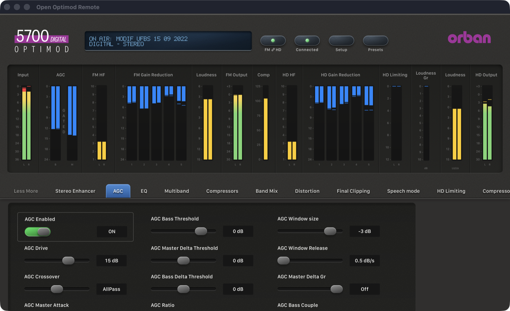

# Phase 1: reliable single-device session (5700i)

> **Evidence status:** synthetic tests for every case below, plus read-only hardware runs on the reference OPTIMOD 5700i (firmware 3.0.1.20, not on air) on 20 October 2026. No setting was written and no preset was recalled during these runs. The Recall continuity fix is documented separately in [Recall keeps the session](2026-10-20-recall-session.md).

## What changed

| Area | Before | Now |
|---|---|---|
| Connecting | Login, then AS, AP and LP/AP from the status (terminal) port. Any failure closed the valid PC Remote session. | The PC Remote login is the connection. AS and LP/AP follow as a separate step. If that fails, the session stays connected with live meters and shows why; Refresh tries again. Writes and Recall stay refused without confirmed documents. |
| Connect duration | Up to 18 s; the macOS Connections window gave up after 8 s. | At most 14 s (4 s login, 4 s AS, 6 s LP/AP); a silent status port costs one 4 s deadline. The native clients wait at least 5 s longer than the service can take, checked by a test. |
| Ending a session | Three slow ticks in a row (about 12 s). | Only transport loss, corrupt framing, or a response boundary unanswered for 20 s. A late boundary is matched to its own request. |
| Closing a session | `218`, then the socket was closed with replies still unread. | `218`, half-close, then read until the unit closes (at most 1 s). |
| Saved access code | Deleted when the host or either port changed. | Kept when only the name or a port changes. Cleared when the IP address or the processor model changes, and the editors then ask for it. |

## The unit refuses connections after an abrupt close

During the first hardware run of 100 connect/disconnect cycles, cycles 0–47 succeeded. From cycle 48 on, every TCP connection to 6201 and 23 timed out. The unit recovered by itself about 1.5 minutes after the load stopped.

Isolated with raw loops, each started on a recovered unit:

| Loop | Result |
|---|---|
| 200 terminal connections (banner, `disconnect`, normal close), 0.5 s apart | all succeeded |
| 100 PC Remote logins with `218` and a close after reading to the end | all succeeded |
| 100 PC Remote sessions with meters on, 2 s of 50 ms polls, `218`, close after reading to the end | all succeeded |
| The app's pattern (session, polls, AS and LP/AP reads, meters, `218`), closed **without** reading the remaining replies | refused after 2 cycles |
| The same pattern, closed after reading until the unit closes | 60 of 60 succeeded |

Closing a socket with unread data makes the Mac answer with a reset while the unit is still sending meter replies. After a few of those, the 5700i stops accepting connections for about a minute. The app's disconnect now reads until the unit closes, bounded at 1 s.

The original PC Remote sends `218`, waits 100 ms and then closes with a reset (static analysis of `5700iPC.exe`). By then the unit has normally closed its side.

## Results against the Phase 1 gate

### Synthetic (every run)

The real session owner is driven through its command channel against a synthetic 5700i (`crates/orban-web`, `FakeUnit`):

- 100 connect/disconnect cycles: 100 logins, 100 meter subscriptions, 100 disconnects, no writes, a new session identity each time.
- Closed status port: connected with live meters and a `sync_error`; a write is refused before anything is sent; a failed Refresh keeps the session; a Refresh after the port returns loads the documents and clears the error.
- Silent status port: connected within the 4 s read deadline plus 1 s.
- A 14 s stall of the PC Remote replies: the session survives without a reconnect. The test fails with the old rule.
- A closed PC Remote port fails the connection cleanly, and the same owner then connects normally.
- Late response boundaries, malformed messages, the disconnect drain, the credential rules and the client timeout budgets each have their own test.

### Hardware (reference 5700i, read-only)

| Gate item | Result |
|---|---|
| 100 connect/disconnect cycles through the backend API (connect, 2 s of meters, disconnect, 1 s apart) | PASS after the disconnect fix: 100 of 100 connected and synchronized, connect 2.33 s average, 2.98 s maximum. Before the fix: 48, then refusals. |
| Independently configured ports (PC Remote on 16201, status port on 10023, through a local proxy) | PASS: connected and synchronized, 76 presets, live meters. |
| Silent status port, then Refresh | PASS: connected in 4.1 s with live meters and a `sync_error`; Refresh in the same session loaded the documents. |
| Closed status port | PASS: connected in 0.09 s with live meters and a `sync_error`. |
| 150 ms extra latency each way on both ports | PASS: connected and synchronized in 4.5 s; meters kept running at the lower rate the latency allows. |
| PC Remote path stalled for 14 s | PASS: connected every second, same session, meters resumed. |
| PC Remote path stalled for 30 s | PASS: the session ended after 21 s with "The processor has not answered for 20 seconds"; a new connection afterwards took 2.2 s. |
| Connection reset | The app detected it within 0.5 s ("Connection reset by peer") and ended the session. Reconnecting depends on the unit: see below. |

### After a connection reset

With a reset on both sides of the path (proxy `SO_LINGER 0` towards the app and the unit), the 5700i accepted TCP connections but did not answer the login for as long as the reconnect attempts continued every 9 seconds (4.5 minutes). Each failed login left another half-open session on the unit: our side showed `FIN_WAIT_2` connections that the unit never closed. After 2 minutes without any traffic, a single login succeeded at once.

A reset of only the app's side, while the unit's side was kept half-open, blocked new connections as well. It cleared about 50 seconds after that half-open connection was released.

Consequence for a future automatic reconnect: it must back off (tens of seconds, growing) rather than retry quickly, or it keeps the unit unavailable. Manual reconnect after a reset works once the unit has been left alone for about two minutes.

The unit's AS (178 fields) and AP (221 fields, `modif UFBS 15 09 2022`) documents were identical to the saved state after all runs.

## Automatic reconnect

A lost PC Remote session is restored automatically, with the waits the unit needs:

- **When it runs.** Only after an unexpected loss: transport loss, corrupt framing or 20 s without an answer. A manual disconnect, a new manual connect, Cancel (a button in every view and `POST /api/reconnect/cancel`) or quitting the app stop it. A failure of the status (terminal) port never starts it; that stays a `sync_error` on a connected session.
- **Schedule.** The first attempt comes 120 s after the loss, then 240, 480 and 960 s, then every 960 s, at most 6 attempts (about an hour). Each attempt is a single login. A login the unit does not finish is closed with a reset, as the original PC Remote closes sessions, so it cannot remain half-open on the unit.
- **Same target.** Same device, address, ports, model and code. It stops if that saved connection was edited or removed, or if the unit refuses the code or reports another model.
- **No replay.** A command sent while the app waits gets "Not connected". The new session has a new identity, so a request still addressed to the old one is refused. Nothing pending is sent again.
- **Controls.** They return only after the normal connect: login, settings read, meters on. The interface shows the reason, the time to the next attempt and the attempt count.

Tested against a synthetic unit with the same schedule shape and short waits (0.6, 1.2, 2.4 s):

- recovery after the wait, with a new session and documents read before connecting; meters resume; no write is sent;
- no reconnect after a manual disconnect, including one made while a reconnect is pending;
- Cancel stops a pending reconnect, and a manual connect afterwards works;
- one login per attempt, each wait as scheduled, no attempt after the limit;
- recovery once the unit answers again after refused logins;
- no replay of a command sent while waiting, or of one addressed to the old session;
- a closed status port and a failed Refresh never start a reconnect;
- a login the unit does not finish is closed with a reset.

The banner was checked in a browser against the service with a lost session: the countdown, the attempt count and Cancel through the real endpoint work. **Not tested on the physical unit**, per instruction: the waits are based on the 2 minutes the reference 5700i needed after a reset (above), and the reset close of an unfinished login on the original client's behaviour.

### Automatic reconnect on the reference 5700i (read-only)

The backend ran with the real schedule, connected through local fault proxies:

| Scenario | Result |
|---|---|
| H1: hard reset on both sides | PASS: loss seen at once; one login 122.5 s later; same on-air document, 76 presets, new session, 168 meter events in 10 s |
| H2: PC Remote path stalled 30 s | PASS: session ended after 21 s; one login 122.1 s after the loss; state and meters restored |
| H3: reset, first attempt meets a silent path | PASS: attempt 1 failed with "Login timed out" at 124 s; next one 240 s later; restored at 365.9 s with two logins in total |
| H4: reset, then Cancel | PASS: no attempt in the following 130 s |

Afterwards the unit's AS (178) and AP (221) fields equalled the saved state.

## Virtual 5700i (original firmware)

The emulator's virtual 5700i runs the unmodified firmware 3.0.1.20 with the control-board CPU at the physical unit's speed. It was used for the same gate on 20 October 2026, after the frame and archive fixes ([Frames the unit cuts or drops](../protocol/5700i.md#frames-the-unit-cuts-or-drops)). Each run used the backend at the commit named, a temporary data folder and local fault proxies; no setting was written.

| Gate item | Build | Result |
|---|---|---|
| 100 connect/disconnect cycles (connect, 2 s of meters, disconnect, 1 s apart) | `77e045d` | 95 of 100. The 5 failures were logins the unit answered `busy` 0.03 to 0.14 s after the previous disconnect. |
| The same 100 cycles | `aea41aa` (one more login 1 s after `busy`) | **PASS**: 100 of 100, connect 2.63 s average, 6.47 s maximum |
| S1 independently configured ports (16201/30023 through proxies) | `aea41aa` | **PASS**: connected in 7.15 s, GREGG on air, 47 presets, meters |
| S2 silent status port, then Refresh | `aea41aa` | **PASS**: connected in 4.29 s with a `sync_error`; Refresh loaded the documents |
| S3 closed status port | `aea41aa` | **PASS**: connected in 0.11 s with live meters and a `sync_error` |
| S4 150 ms extra latency each way | `aea41aa` | **PASS**: connected and synchronized in 4.17 s |
| S5 PC Remote path stalled 14 s | `aea41aa` | **PASS**: connected every second, same session, meters resumed |
| S6 PC Remote path stalled 30 s | `aea41aa` | **PASS**: ended after 21 s; a manual connect then took 2.45 s |
| S7 connection reset, then an immediate manual connect | `aea41aa` | Expected refusal: the unit answered `busy` (HTTP 409). This is the unit's two-minute recovery described above, the same as on the reference unit; the automatic reconnect waits for it (H1). |
| H1 automatic reconnect after a hard reset | `aea41aa` | **PASS** (second run): one login 122.3 s after the loss, new session, GREGG, 47 presets, 183 meter events in 10 s |
| H2 automatic reconnect after a 30 s stall | `aea41aa` | **PASS** (second run): one login 122.4 s after the loss, state and meters restored |

The first H1/H2 run with the same build is recorded as a failure by its own criteria. H1 reconnected after 128.7 s with only 67 meter events in 10 s (the run requires 100). H2 reconnected after 131.1 s, but the status port did not answer, so the session stayed connected with a `sync_error` and no documents. The PC Remote session itself was restored in both cases. The second run, 10 minutes later, passed without any change.

Changes made elsewhere were exercised with the app connected while another client recalled presets on the status port: the session stayed up, and the app read the on-air archive with meters off (`223`, `239`, `222`) after each push, as described in the protocol notes.

## Native macOS app

The app bundle was built from this branch and started with a temporary home folder, so no saved connections were used. Connected to the reference 5700i (read-only):

The automatic-reconnect banner and the `sync_error` message were checked in a browser against the same service; the app window shows the same interface.

## Still open

- A long-duration soak (the 8-hour run belongs to Phase 8).
- The native window was not photographed during an automatic reconnect or with a `sync_error`.
