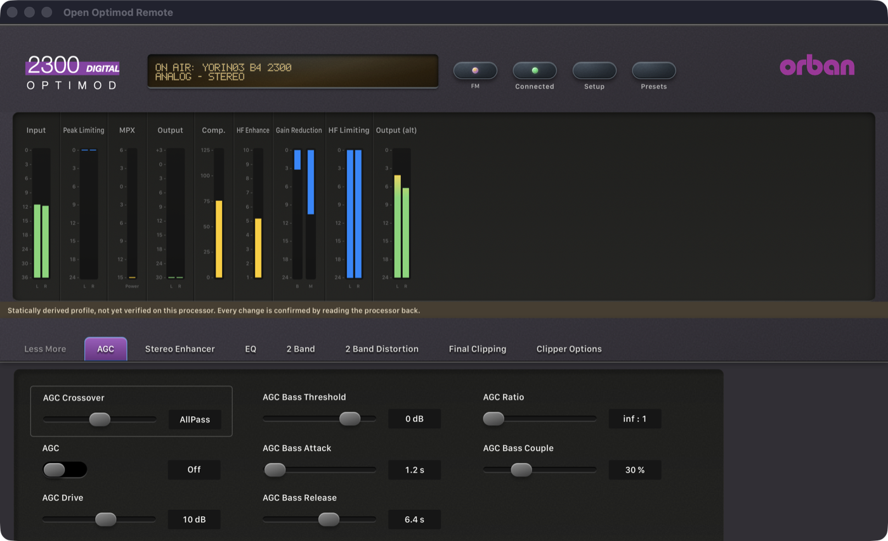
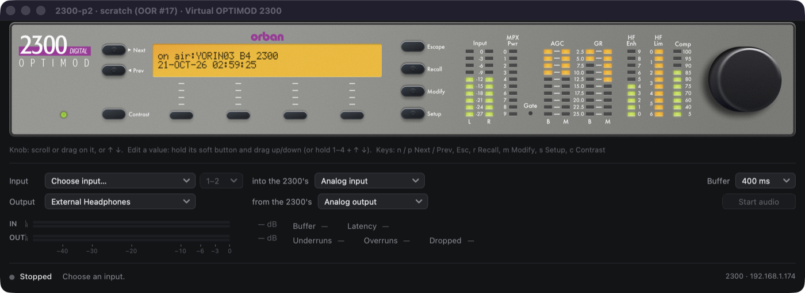

# Phase 2: 2300 2.0.3.85 — 21 October 2026

> **Evidence status:** live tests against the original 2300 firmware 2.0.3.85 running in the Optimod emulator (an isolated scratch unit at 192.168.1.174 without audio devices, a copy of a 2300 unit with access code 1234 and user presets), a recorded session of the original PC Remote 2.0.3.85, and synthetic regression tests. Protocol details: [2300 notes](../protocol/2300.md).

## What changed

- The 2300 is a new model in the app (model and skin `optimod-2300`, logo, model pickers in the interface and the Swift Connections window). It was missing entirely before.
- New profile `profiles/2300/2.0.3.85` from the official installer: 213 parameters (55 confirmed against the factory presets, 109 unobserved), 8 pages: Less More, AGC, Stereo Enhancer, EQ, 2 Band, 2 Band Distortion, Final Clipping, Clipper Options. These match the original client's tabs. This build needed extractor support for its string class (a temporary string, copy and free instead of MFC's CString) and for exception frames at `fs:[0]`. Its constructor, slider binder and curve setter were found by call patterns.
- Protocol: the session number line is optional per model; file messages without a name line and meter records with a one-byte count are accepted; a requested file is matched by the request in flight; the upload has no name line and no end marker.
- Factory Recall is refused on the 2300 (see the notes); user-preset Recall is confirmed by name when the stored document is an older version.

## Gate results

| Item | Result | Evidence |
|---|---|---|
| Connect (3-line login) | PASS | `2300 V 2.0.3.85`, access level 0 |
| Synchronize without a terminal | PASS | YORIN03 B4 2300 (56 fields), 73 system fields, 10 factory + 4 user presets |
| Live meters (protocol) | PASS | 59 values per record |
| Meter mapping | NOT VERIFIED | see below |
| Processing write + readback | PASS | SE AMOUNT 0 → 1.00 → 0 (about 9 s each on the slowed scratch unit) |
| System write + readback | PASS | CONTRAST 2 → 3 → 2 |
| Recall user preset | PASS | YORIN03 B2 2300 and back to YORIN03 B4 2300, 1.1 s, same session |
| Recall factory preset | Refused, by design | clear message; no file sent; session stays connected |
| Synthetic regression | PASS | `the_2300_syncs_without_session_numbers_or_file_names_and_refuses_factory_recall` |

## Open

- **Meters:** the extracted groups (Input, Peak Limiting, MPX, Output, Comp., HF Enhance, Gain Reduction, HF Limiting, Output alt) do not match the unit's own front panel (Input, MPX power, AGC B/M, GR B/M, HF Enhance, HF Limiting, Composite): there is no AGC group, and HF Limiting reads full scale. The meter extraction for this older build needs the original client's meter view to compare against.
- **Factory Recall:** possible only with the client's conversion tables and factory files; out of scope until there is a lawful way to use the user's own installer files.
- Save, Save As and Delete Preset (Phase 3).
