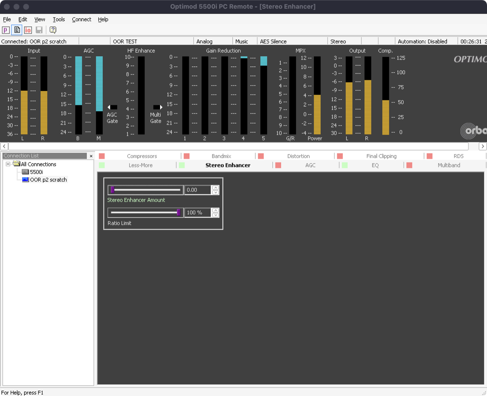
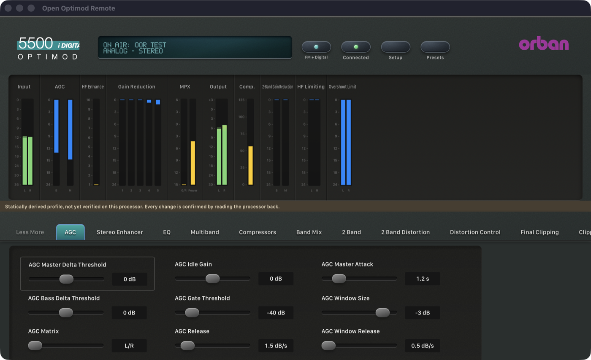

# Phase 2: 5500i 3.1.0.2 — 21 October 2026

> **Evidence status:** live tests against the original 5500i firmware 3.1.0.2 running in the Optimod emulator (an isolated scratch unit at 192.168.1.172 without audio devices), compared with the original Windows PC Remote 3.1.0.2 connected to the same unit. The scratch unit ran at about 0.3× real time because of the machine's load. Protocol details: [5500i notes](../protocol/5500i.md).

## What changed

- New profile `profiles/5500i/3.1.0.2`, extracted from the official installer: 370 parameters (90 confirmed against the factory presets, 213 unobserved, 18 excluded), 13 pages, 10 meter groups. The extractor addresses were found with `scripts/match_pc_remote_functions.py` from both the 5500 and the 8700HD build (identical results).
- An exact `5500i V 3.1.0.2` adapter (statically derived, writes confirmed by readback) with the 5500i opcodes. Settings, presets and readback come from files over the PC Remote session. Only a factory Recall uses the terminal's `RP`.
- The 5500i document family is `5500.`, as the firmware writes it. It was `8300.` (the installer's factory files).
- The logo badge text "i DIGITAL" no longer runs past the badge.

## Gate results

| Item | Result | Evidence |
|---|---|---|
| Connect | PASS | `5500i V 3.1.0.2`, access level 0 |
| Synchronize without the terminal | PASS | 113 processing fields, 138 system fields, 27 factory presets (+ user presets), in about 1 s; no TCP 23 connection |
| Live meters | PASS | 86 values, compared with the original client on the same unit (screenshots below) |
| Processing write + readback | PASS | SE AMOUNT 0 → 3.50 → 0 (2.5 s / 3.5 s), `modif JAZZ` → `JAZZ` |
| System write + readback | PASS | CONTRAST 2 → 3 → 2 |
| Recall factory preset (firmware `RP`) | PASS | ROCK-MEDIUM, JAZZ; firmware JAZZ = client upload JAZZ on 113 of 113 fields |
| Recall user preset (upload + FBh) | PASS | OOR TEST (created with the original client's Save Preset As), 1.4 s, same session |
| Synthetic regression | PASS | `the_5500i_syncs_writes_and_recalls_with_its_own_opcodes` |

## Original PC Remote and the app

## Differences found, not fixed in this phase

- The client's main meter bar shows Input, AGC, HF Enhance, Gain Reduction, MPX, Output and Composite. The 2-band groups (2-Band Gain Reduction, HF Limiting, Overshoot Limit) are on its other meter views. The app shows every group all the time, so in a 5-band preset Overshoot Limit shows values that do not apply. The 8700HD has the same issue. This is meter-view parity work (Phase 3).
- The network settings (`Network.orb55net`) are not read; the original client reads them. Phase 3.
- Save Preset As (an upload with a new name, captured) and Delete Preset are not enabled yet. Phase 3.
