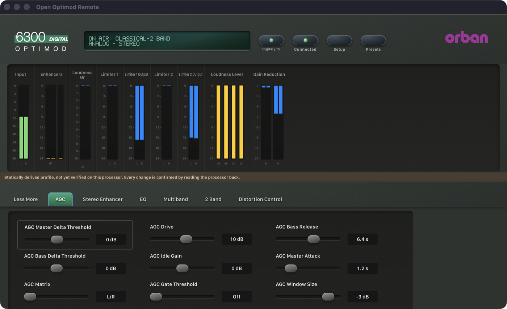

# Phase 2: 6300 4.1.1.19 — 21 October 2026

> **Evidence status:** live tests against the original 6300 firmware 4.1.1.19 running in the Optimod emulator (an isolated scratch unit at 192.168.1.173 without audio devices), and synthetic regression tests. The original Windows PC Remote 4.1 could not be compared: under the machine's load at the time (load average about 20), its Wine bottle's services timed out at start-up and the client exited silently, twice. Protocol details: [6300 notes](../protocol/6300.md).

## What changed

- New profile `profiles/6300/4.1.1.19` from the official installer: 314 parameters (142 confirmed against the 68 factory presets, which are all 6300.50 documents; 118 unobserved; 16 excluded), 10 pages, 9 meter groups. The extractor addresses were matched from both the 5500i and the 8700HD build (identical results).
- The extractor now drops a page that repeats an earlier page's controls exactly, and takes per-build page titles: dialog 380 of the 6300 client is "Compressors". The existing 5500, 5500i and 8700HD profiles are regenerated byte for byte.
- An exact `6300 V 4.1.1.19` adapter with the 6300 opcodes and file sync.
- A user preset named like a factory preset is listed apart, as "<name> (user)".

## Gate results

| Item | Result | Evidence |
|---|---|---|
| Connect | PASS | `6300 V 4.1.1.19`, access level 0 |
| Synchronize without the terminal | PASS | CLASSICAL-2 BAND with 72 fields (130 for a 5-band preset), 100 system fields, 68 factory + 11 user presets |
| Live meters (protocol) | PASS | 111 values, 9.5 to 15.8 records per second on the scratch unit |
| Meter scaling and labels | NOT VERIFIED | statically derived; no comparison with the original client (see above) |
| Processing write + readback | PASS | SE AMOUNT 2.50 → 2.75 → 2.50 |
| System write + readback | PASS | CONTRAST 1 → 2 → 1 |
| Recall factory preset (firmware `RP`) | PASS | ROCK-MEDIUM (130 fields), CLASSICAL-2 BAND (72) |
| Recall user preset (upload + FAh) | PASS | "CRISP (user)" → on air CRISP, 1.5 s, same session |
| Synthetic regression | PASS | `the_6300_syncs_writes_and_recalls_with_its_own_opcodes` |

The pages follow the processing structure: the 2-band preset shows 7 pages; Compressors, Band Mix and Speech Mode appear with a 5-band preset.

## Open

- A comparison with the original client: meters (the Loudness Level lanes are labelled `dB` and `Lk` by the extraction; Limiter 1/2 Output are drawn as reductions), pages and preset operations.
- Save, Save As and Delete Preset (Phase 3).
