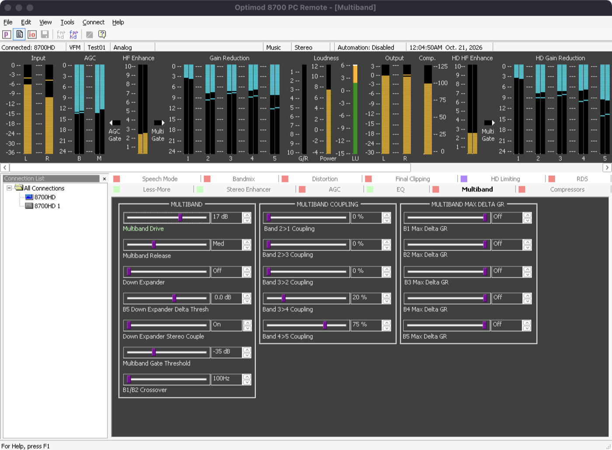
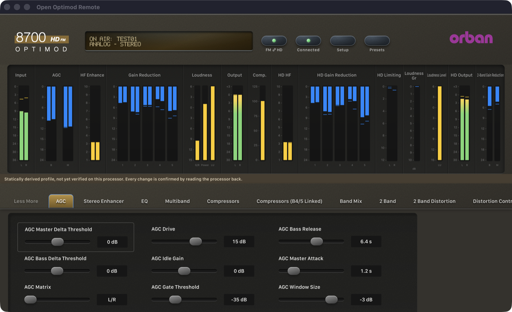
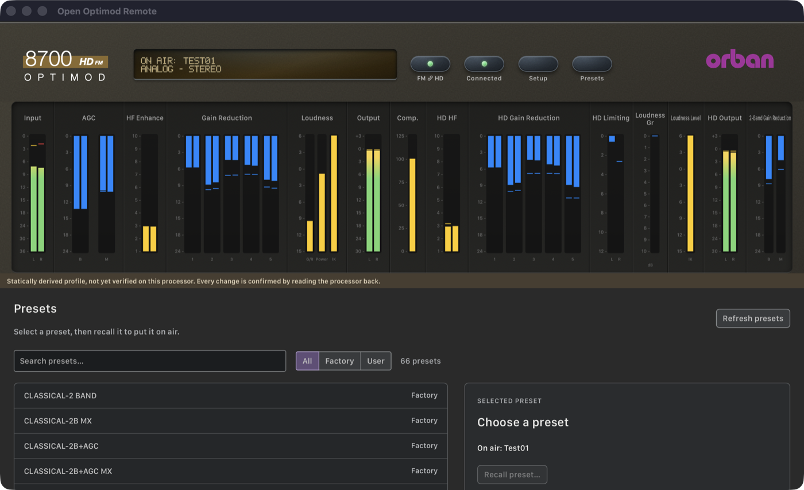

# Phase 2: 8700HD 1.0.2.161 — 21 October 2026

> **Evidence status:** live tests against the original 8700HD firmware 1.0.2.161 running in the Optimod emulator (a virtual unit on the Mac mini, 192.168.1.95, playing audio), compared with the original Windows PC Remote 1.0.2.161 connected to the same unit. Synthetic regression tests for every case. Each change on the unit was restored: the on-air preset Test01 equals its starting state field for field (231 of 231), and CONTRAST is back at 2. Protocol details: [8700HD notes](../protocol/8700hd.md).

## What was wrong

| Finding | Effect before | Now |
|---|---|---|
| The app expected the terminal banner `Orban Optimod-FM 8700HD`; the unit says `Orban Optimod 8700HD V 1.0.2.161`. | "Unsupported terminal model": no settings or presets. | Real banner, also in network discovery. |
| The app sent the 5700i boundary 250 (FAh), which the 8700HD only sends as an answer. | Every meter tick waited until its receive deadline. | F9h/FAh: 18 records per second. |
| Settings and presets came only from the terminal (AS, LP/AP). | — | Setup file (EFh), on-air file (EEh), user preset files (F2h) over the PC Remote session. No terminal session. |
| The setup file repeats `PILOT SYNC`. | "Duplicate field". | An identical repeat is accepted. |
| The firmware saves its files 4 to 7 s after a change. | A readback right after a write would show the old value. | Readback waits for the saved file, at most 15 s. |
| A pushed on-air file is followed by an FAh that answers no request. | The next read ended before its file arrived ("did not send its system settings"). | Counted as one more answer. |
| A recalled user preset is saved again with LF line ends. | That preset disappeared from the list. | LF documents are read. |
| The loudness meter lane was labelled `lK`. | — | `LU`, as in the original client. |

## Gate results

| Item | Result | Evidence |
|---|---|---|
| Connect (PC Remote login) | PASS | `8700HD V 1.0.2.161`, access level 0 |
| Synchronize without the terminal | PASS | Test01, 231 processing fields, 180 system fields, 64 factory + 2 user presets + 1 unsaved, in 0.75 s; no TCP 23 connection |
| 100 connect/disconnect cycles (2 s of meters each) | PASS | 100 of 100 synchronized, connect + sync 0.73 s average, 0.92 s maximum |
| Live meters | PASS | 104 values, 17.8 to 18.1 records per second; every meter channel maps to the client's meter symbol for that index (`o_inputMeterL/R` 1/2, AGC 3/10 and 4/11, bands 5–9/14–18, HD bands 39–48, ITU 412 26, MPX power 103, BS.1770 55/57/58, 2-band 64/65 and 49/50) |
| Processing write + readback | PASS | RDS LEVEL 6.0 → 5.9 % confirmed in 4.6 s (`modif Test01`), restored in 3.5 s (`Test01`) |
| System write + readback | PASS | CONTRAST 2 → 3 in 3.4 s, restored in 4.5 s |
| Recall user preset (upload, as the original client) | PASS | Test01 in 1.5 s, same session, meters continue (88 records in the next 5 s) |
| Recall factory preset (firmware `RP`) | PASS | GREGG and ROCK-MEDIUM in 1.5 s, confirmed by the on-air file |
| Change made elsewhere (push + FAh) | PASS | Synthetic test reproduces the hardware failure without the fix |
| Native macOS app | PASS | Screenshots below |

Regression on this branch: `cargo test --workspace` 125 passed / 0 failed (3 new 8700HD tests), clippy `-D warnings`, fmt, 56 UI tests, UI build, all Swift test programs, docs audit.

## Original PC Remote

The original client, connected to the same unit, showing Test01:

Its File menu offers Recall Preset, Save Preset, Save Preset As, Delete Preset, Backup to PC and Restore from PC. The Edit and Tools menus offer Processing Parameters, Setup, FM→HD Couple/Uncouple, Automation and Security; Help offers 8700 Diagnostics. Its meter bar also shows the AGC and multiband gate indicators.

## Native macOS app

Connected to the same unit, Test01 on air, live meters:

The preset list (64 factory and the user presets of the unit):

## Not done in this phase

- Save Preset, Save Preset As and Delete Preset stay disabled: their file messages have not been captured (Phase 3).
- Backup/Restore to PC, Automation, Security and Diagnostics: not compared (Phase 3).
- The gate indicators are not shown (Phase 3).
- The Presets view opens in the main window, not in a native window (Phases 5 and 6).
- Automatic reconnect uses the 5700i waits; it was not tested on the 8700HD.
