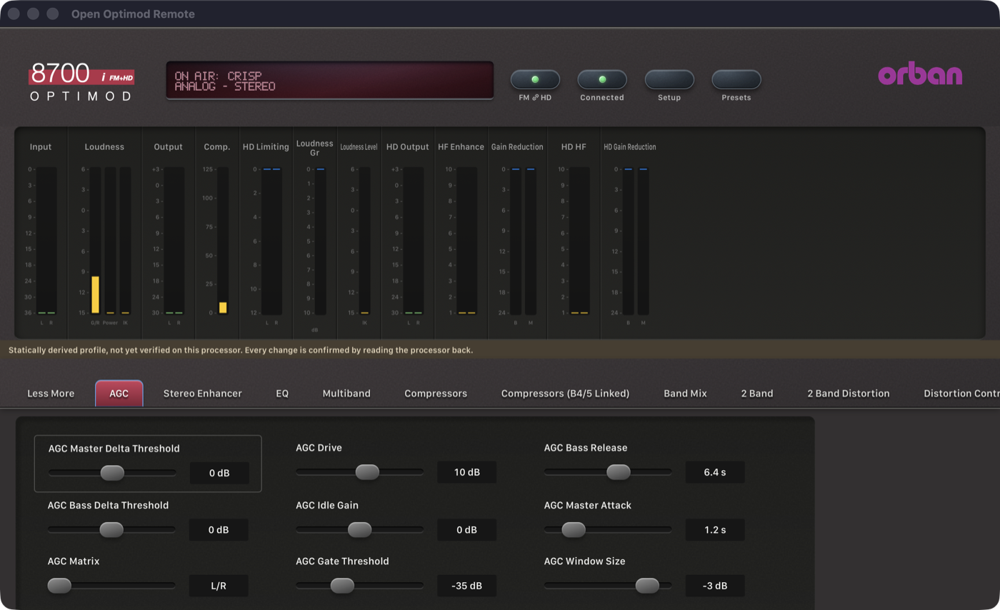

# Phase 2: 8700i 1.5.1.11 — 21 October 2026

> **Evidence status:** live tests against the original 8700i firmware 1.5.1.11 running in the Optimod emulator (an isolated scratch unit at 192.168.1.175 without audio devices, at about 0.3× real time under the machine's load), a captured session of the original PC Remote 1.5.1.11 (connected through its own New 8700i dialog), and synthetic regression tests. Protocol details: [8700i notes](../protocol/8700i.md).

## What changed

- New profile `profiles/8700i/1.5.1.11` from the official installer: 749 parameters (254 confirmed against 644 factory presets of the same document family, 312 unobserved), 25 pages (FM and HD, Xponential Loudness), 12 meter groups.
- An exact `8700i V 1.5.1.11` adapter with the 5500i request scheme, file sync, and cut-frame handling.
- For every file-sync model: a pushed document with LF line ends is read; the document the unit pushed during a Recall no longer replaces the confirmed result afterwards (it showed the previous preset about a second after the Recall).

## Gate results

| Item | Result | Evidence |
|---|---|---|
| Connect | PASS | `8700i V 1.5.1.11`, access level 0 |
| Synchronize without the terminal | PASS | CRISP 247 fields, 212 system fields, 58 factory + 1 user preset |
| Live meters (protocol) | PASS | 112 values |
| Meter mapping | NOT VERIFIED | statically derived; no AGC group, and the group order differs from the 8700HD |
| Processing write + readback | PASS | SE AMOUNT 2.50 → 3.00 → 2.50 |
| System write + readback | PASS | CONTRAST 2 → 3 → 2 |
| Recall factory preset (`RP`) | PASS | CRISP, ROCK-MEDIUM, CRISP; same session; the shown preset stays correct |
| Recall user preset (upload + FBh) | PASS | Test01 |

