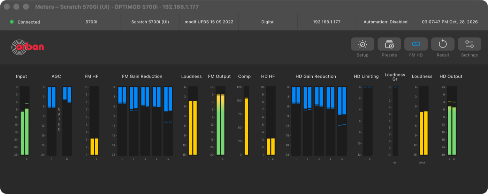
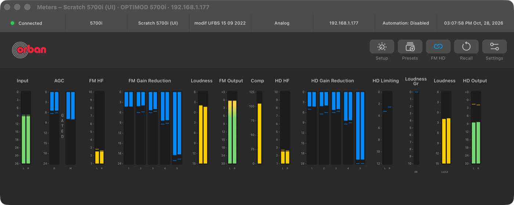
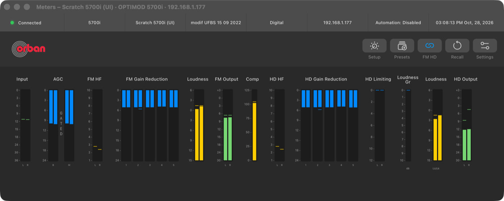

# M1A — 5700i Active Input follows source and fallback changes

> **Evidence status:** run on 28 October 2026 in the real macOS app (test build on port 15701, isolated data) against the scratch virtual 5700i 3.0.1.20 (192.168.1.177). Two input writes on that unit, set back and checked with `AS`; no physical processor was touched.

28 October 2026 · branch `fix/5700i-recall-session` · virtual 5700i (scratch, 192.168.1.177), original firmware 3.0.1.20 · original 5700i PC Remote under CrossOver.

## Problem

The Meters strip shows `ACTUAL A OR D`. After a change of the preferred input it kept the old value until the next full read (open item of the Phase 3–4 close-out).

## Findings on the original firmware

| Question | Result |
|---|---|
| Does the unit push anything when the input changes? | No (PC Remote stream logged during writes of `INPUT A OR D` and `ANALOG FALLBACK`) |
| Is the setup file (240 → 233) current? | Saved ~3 s after a change; `ACTUAL A OR D` in it stays at the value of the last save (file Analog while `AS` and the unit said Digital) |
| Is the input in the meter records? | No; channels 38/62/63 follow silence |
| Live source | Terminal `AS`; equal to the setup file in all 178 fields except `ACTUAL A OR D` |
| Fallback | `INPUT A OR D` Digital + `ANALOG FALLBACK` Yes with a silent digital input → `ACTUAL A OR D` Analog |
| Original Windows client | Shows no active input: Setup › Input = preferred input (radio Digital while the unit used Analog), Remote Interface / Silence = fallbacks; "Input: Analog/Digital" are Tally functions |

## Change

`crates/orban-web/src/main.rs`: after a confirmed change of `INPUT A OR D`, a fallback or a silence setting, the session owner reads `AS` at once; while a fallback is on it reads again after `SILENCE DELAY` + 1 s and then every 10 s. No reads with every fallback off. File-sync models are not affected. Test: `the_active_input_is_read_again_after_an_input_change`.

## Native app (test build, port 15701)

| Step | Result |
|---|---|
| Connected, strip shows Digital |  |
| `INPUT A OR D` Digital → Analog (the System Settings write) | Strip shows **Analog after 0.45 s**  |
| Back to Digital | Strip shows **Digital after 0.52 s**  |
| Session | 1 login, 2 writes, 1 meter reader, same session ID |
| Unit side (netlog, TCP 23) | `AS` at the change, +4 s (silence delay 3 s + 1 s), then every 10.0–10.2 s with Digital Fallback on |

The unit ended in its starting state (Digital, Analog Fallback No, Digital Fallback Yes), checked with `AS`.

## Checks

`cargo test --workspace` (136), clippy, fmt: PASS.

## Not covered

A fallback caused by real silence on the preferred input: the virtual unit feeds its host audio into whichever input the firmware uses, so its preferred input never goes silent while audio runs. The read path is the same (the 10 s `AS` read), but the switch itself was only seen with a silent digital input and no host audio.
