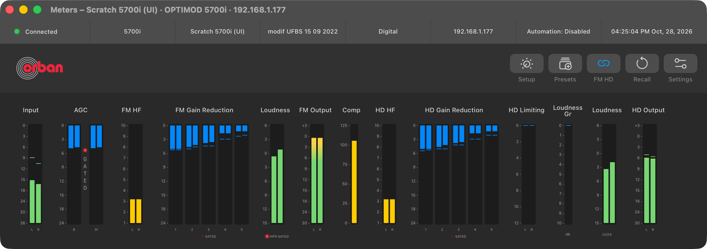
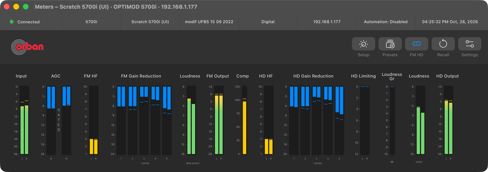
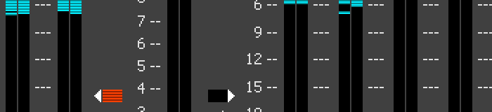
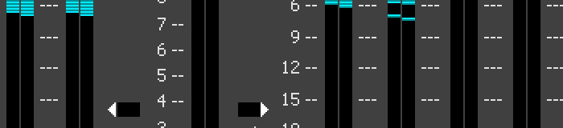
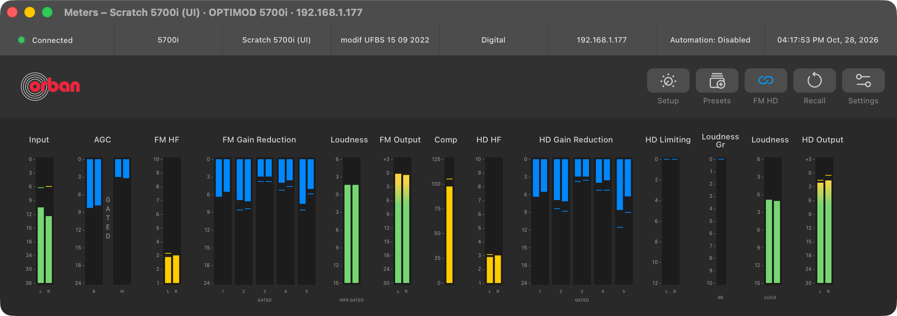

# M1B — 5700i meter ballistics, gate lamps and loudness colours

> **Evidence status:** run on 28 October 2026 in the real macOS app (test build on port 15701, isolated data) and the original 5700i PC Remote under CrossOver, one after the other against the scratch virtual 5700i 3.0.1.20 (192.168.1.177) with live audio. Two processing writes on that unit, set back and read back; no physical processor was touched.

## Findings in the original client (`5700iPC.exe`, SHA-256 `63def9bb…`)

| Question | Answer | Where |
|---|---|---|
| How does the client move a bar? | Every meter record sets each bar straight to the firmware value. No smoothing, no client-side hold or release. | bargraph `SetPos` 0x442d70, called for every meter from 0x444440 |
| Where does the peak marker come from? | The record accessor returns two values per channel: bank 1 (bar) and bank 2 (peak marker). The paint routine draws a 2-pixel marker at the bank-2 position. | 0x4b8eb0 (`+0x3c` bank 1, `+0x1fc` bank 2), paint 0x4429f0 |
| Is bank 2 a peak hold? | Yes: in 5,658 record pairs, bank 2 ≥ bank 1 on every metered channel (the only exception is channel 66, which is not metered). | unit netlog |
| How often does the client poll? | It sends the next request when the answer arrives: median 55 ms, p10 36 ms, p90 67 ms. The app polls at a median of 51 ms. | unit netlog, both clients |
| Which channels drive the gate lamps? | AGC Gate (control 253) = 62, FM Multi Gate (265) = 63, HD Multi Gate (280, or 275 in 2-band dialog 373) = 38, MPX Pwr Gate (281) = **111**. 38/62/63 were only candidates before; 111 was not a candidate. | dialog 247 init 0x44671d–0x446f9c, dialog 373 init 0x44543b–0x4459d1 |
| When is a lamp lit? | The lamp is a two-step bargraph with table {100, 0}: lit for any value above 0. The firmware sends 0 or 127. | 0x443f00, table 0x58cf80 |
| Loudness (LU) colours | Bitmap 397 (16 × 181) is amber in its top 33 rows and green below. It is drawn unscaled on a 162-pixel control, so the top 33/162 of the bar's travel is amber (about +1.9 LU on the client scale). The bar's value table (0x58b120) is the app's `loudness` curve, entry for entry. | dialog 247 controls 3481/3504, 0x444190 |

## Change

- `crates/orban-web/src/main.rs`: the meter stream carries bank 2 as `peaks` with bank 1's `values`. Before, bank 2 was dropped.
- `packages/ui/src/meters.ts`: `MeterMotion` shows each record as it arrives (the client's behaviour). Peak markers use the firmware peaks. A model without bank 2 keeps the old 900 ms lane hold. Groups carry a `gate` channel.
- `packages/ui/src/MeterStrip.tsx`: gate lamps are red LEDs (Mark, 28 October: "gated moet een rode led worden"): dark red when open, lit red with a glow when gated. AGC keeps the Figma frame's vertical GATED under its LED. FM/HD multiband and MPX power show LED + label under their lanes. Loudness bars are amber in the top 33/162 and green below, in the app palette.

## Results

| Check | Result |
|---|---|
| App, gates lit (ch 62 = 127, ch 111 = 127, 63/38 = 0) | AGC and MPX LEDs lit, multiband dark  |
| App, gates open | all LEDs dark  |
| Client, ch 62 = 127 in the records before and after the screenshot | AGC Gate lamp red  |
| Client, ch 62 = 0 | lamp black  |
| App peak markers | firmware bank 2  |

To light the AGC gate with music, `GATE THRESH` and `MB GATE THR` were raised from −35 to −15 dB on the scratch unit, then set back to −35 and read back. `HD MB GATE THR` could not be written because HD is coupled to FM, so the HD multiband LED was only seen dark. Its code path is the same as the FM LED's.

Checks: `cargo test --workspace` (136), clippy and fmt PASS; UI tests (`node --test`, 70) and `tsc -b` PASS.

## Not covered

- FM and HD Multi Gate (63/38) lit: they did not gate with the music at −15 dB.
- The client's Loudness section also has G/R (value 26, peak 60) and MPX Power (110) bars. The Figma Meters frame has no such bars, and they are not added here.
- The client draws loudness as one bar (58, or 55 for HD) with a white peak marker at 59 (56). The Figma frame shows them as two lanes, which stay as they are.
