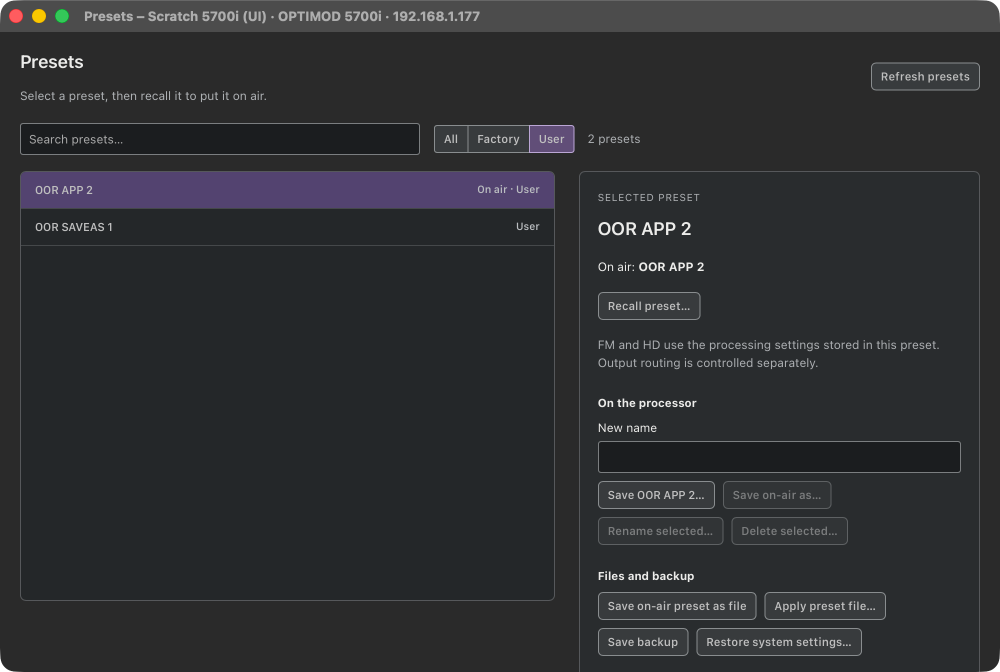
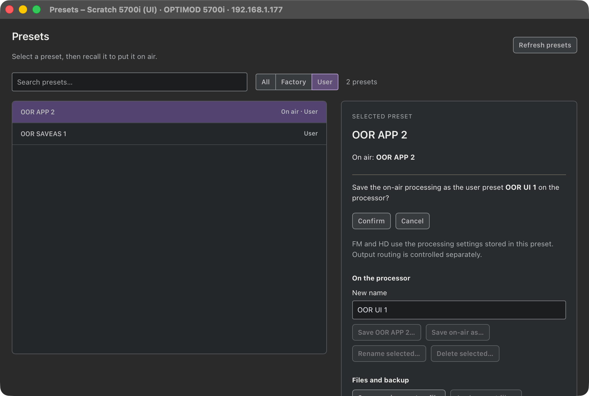
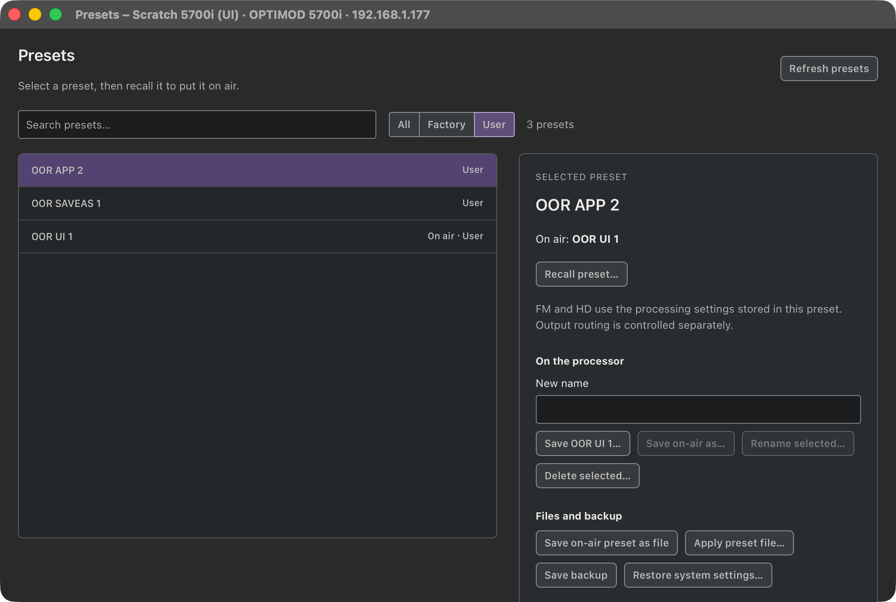
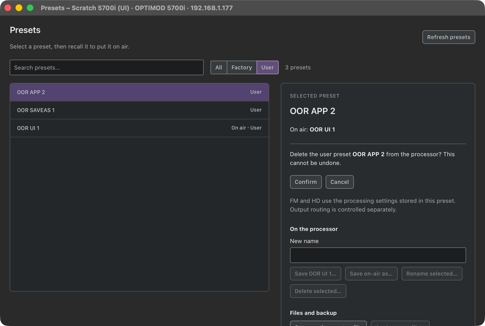
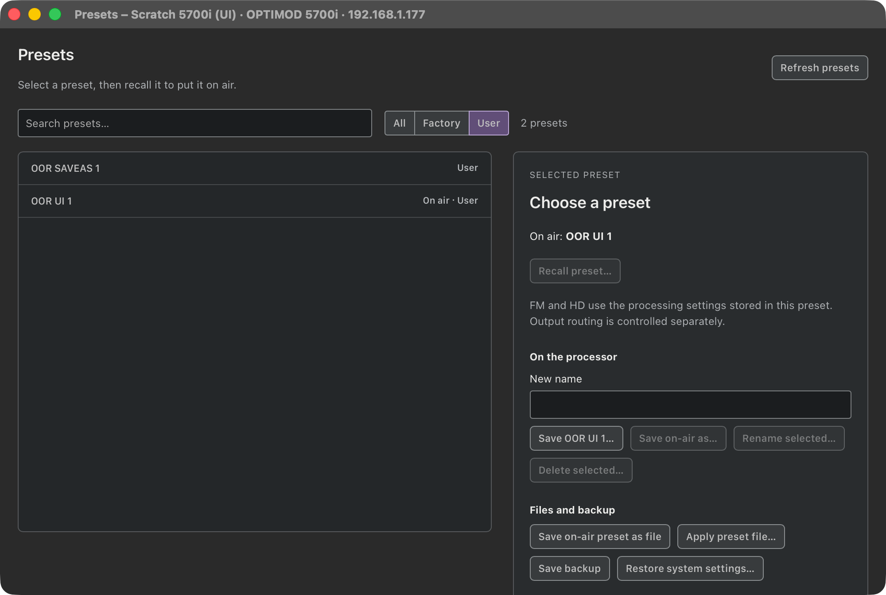

# M1C — 5700i Save Preset, Save Preset As and Delete Preset

> **Evidence status:** run on 28 October 2026 on the scratch virtual 5700i 3.0.1.20 (192.168.1.177, original firmware, live audio). First the original 5700i PC Remote under CrossOver, then the real macOS app (test build on port 15701, isolated data), one session at a time. No physical processor was touched.

## The original client (captured on the unit's network log, archives decrypted with the access code)

| Client action | On the wire | Unit result |
|---|---|---|
| Connect | 243 → one 231 file per file on the unit (user presets, `MODIF …` working copies twice, `SETUP.ORB57SETUP`) | — |
| File › Save Preset As "OOR SAVEAS 1" (a Save As file dialog into the connection's folder) | one 229 upload, no file name: the on-air document with LF line ends, `Preset Name=<OOR SAVEAS 1> size=306`, `Preset File Name= <OOR SAVEAS 1.orb57user>`. The 222 field lines are identical to the on-air file. | on air `OOR SAVEAS 1`, stored as `OOR SAVEAS 1.ORB57USER` |
| File › Save Preset (after a change; "already exists, replace?" → Yes) | the same upload under the same name, with the changed value (`GATE THRESH` −34) | replaced, on air unmodified |
| File › Save Preset with nothing changed | nothing | — |
| File › Delete Preset "OOR DEL 1" (file dialog, then "Are you sure…?" → Yes) | 237 `OOR DEL 1.orb57user\n` | the file is gone from the next 231 list |

## Changes

- `adapter.rs`: `WIRE_5700I` reads user presets with 243/231 and saves and deletes with the client's messages (`preset_file_delete: Some(237)`). Other adapters that shared the 5700i's wire values now use `WIRE_PC_REMOTE`, unchanged. Capability `preset_store`/`preset_delete` is on for the 5700i.
- `main.rs`: the terminal list is merged with the unit's preset files (user presets and `modif` working copies told apart, case-insensitive). Save/Save As uploads the terminal `AP` document renamed as the client does, after checking it against the app's confirmed state. Delete sends 237. The result is confirmed by a fresh list, and for a save also by the preset being on air without changes.
- `Presets.tsx` / `preset-state.ts`: a **Save NAME…** button replaces the on-air user preset, as the client's Save does. Names with `\ / : * ? " < > |` are refused, because they are file names on the unit.
- `DeviceWindows.swift`: test hooks `click KIND LABEL` and `type KIND FIELD TEXT` drive the real window.

## Defects found and fixed on the way

1. The unit answers a 229 upload with an unrequested 251. Uncounted, it made the next file read end before the files came, and the list showed no user presets. It is now counted as a sent boundary.
2. Building the upload from the on-air file (239) stored the value from before the last change, because the unit writes that file a few seconds later: GATE THRESH −34 was saved instead of −33. The upload now comes from the terminal `AP`, which is current. Right after a write, `AP` still names the preset without `modif `, so names are compared without that prefix.

## Results in the app

| Step | Result |
|---|---|
| Preset list after connect | 46 factory presets, the same names as the client's installer files; user presets `User`; working copies hidden as unsaved  |
| Save As "OOR APP 2" (API) | 200 in 1.3 s; unit on air `OOR APP 2`, listed |
| Change GATE THRESH to −31, then **Save OOR APP 2** | 200 in 1.5 s; terminal `AP`: `Preset Name=<OOR APP 2>`, `GATE THRESH -31` |
| Recall OOR SAVEAS 1, then OOR APP 2 | OOR APP 2 comes back with −31 |
| Window: type "OOR UI 1", **Save on-air as…**, Confirm |   on air OOR UI 1 |
| Window: select OOR APP 2, **Delete selected…**, Confirm |   gone from the unit's list |

Checks: `cargo test --workspace` (137), clippy and fmt PASS; UI tests (70) and `tsc -b` PASS.

## Left on the scratch unit

The test presets `OOR SAVEAS 1` and `OOR UI 1`, with `OOR UI 1` on air. Before the test the unit had `modif UFBS 15 09 2022` on air, a working copy that cannot be recalled. GATE THRESH in the on-air preset is −31.
