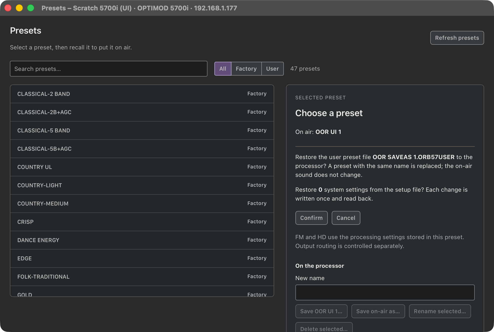
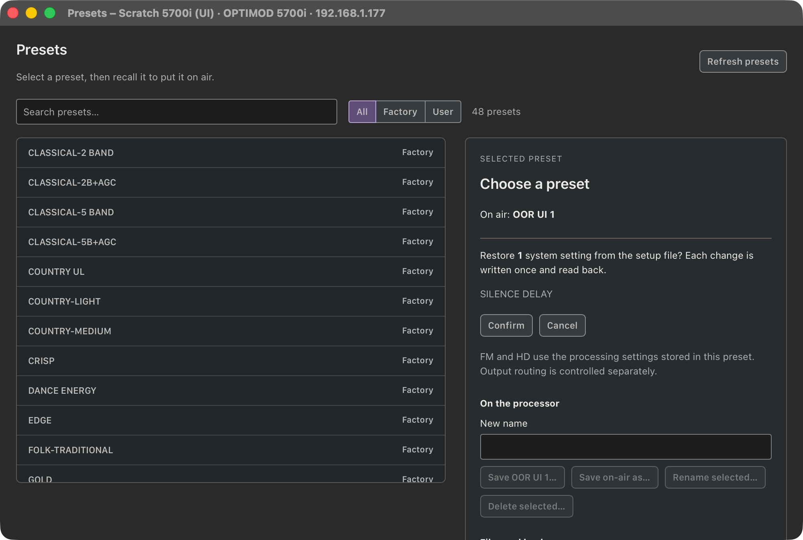
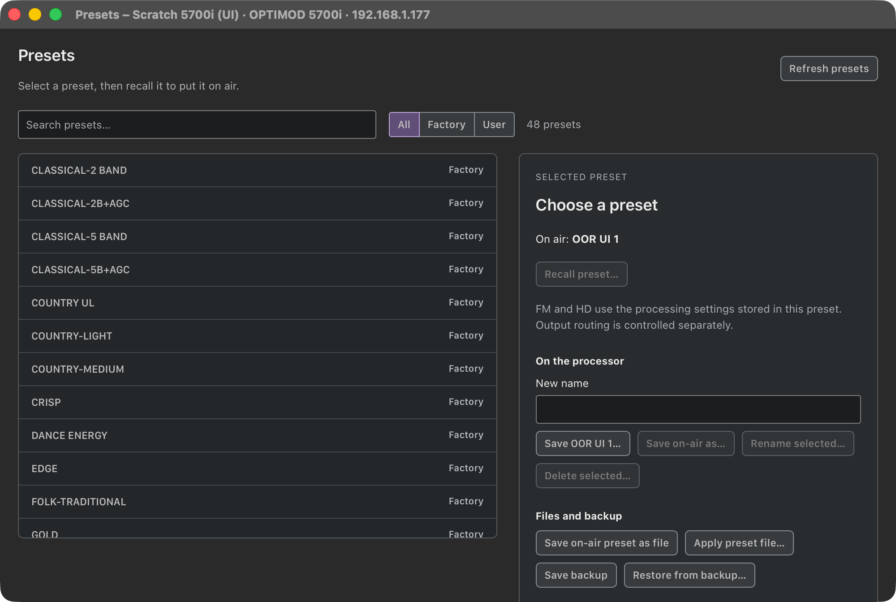

# M1D — 5700i Backup to PC and Restore from PC

> **Evidence status:** run on 28 October 2026 on the scratch virtual 5700i 3.0.1.20 (192.168.1.177, original firmware). First the original 5700i PC Remote under CrossOver, then the real macOS app (test build on port 15701), one session at a time. No physical processor was touched.

## The original client

| Client action | What it does |
|---|---|
| File › Backup to PC | Asks for the format (plain text, encrypted with the session password, or with another password). It requests 240 (setup), 243 (user preset files), 241 and 242, then writes `Setup.orb57setup` and every user preset file the unit sends, `MODIF …` working copies included, into `<connection>\backup`. It also exports its own connection list as `5700i_registry_backup.reg` (client data, not unit data). |
| File › Restore from PC | A file dialog (`*.orb*user`, `*.orb`) in that folder. Each chosen file is sent as **231**: `<FILETIME low>\n<FILETIME high>\n<name>\n<size>\n` + the archive sealed with the session code, followed by 222. Restoring `Setup.orb57setup` uses the same message. The unit applies it and pushes its new setup about 16 s later. |

The unit answers each 231 (and 229) upload with an unrequested 251.

## The app

- **Save backup** (Presets window) asks for a place with the native save panel. It saves the unit's setup file and every user preset file, byte for byte as the client's plain-text backup. The files come in a zip whose folder opens in Finder.
- **Restore from backup…** opens the native open panel (multiple files) and takes the setup file and any `.orb57user` files, from this app's backup or the client's backup folder:
  - User preset files go up as 231, as the client sends them, with the file's own modification time. The result is confirmed by the unit's preset list. The on-air preset does not change.
  - The setup file is restored field by field with readback (the existing verified path). Network settings and the clock are never changed, which is a deliberate difference from the client's whole-file upload.
- Fixed on the way: the device windows had no open or save panel. Save backup, Save on-air preset as file, Apply preset file and Restore did nothing in the native Presets window. They now use native panels (`DeviceWindows.swift`). Test hooks `files PATH|PATH` and `saveto FOLDER` answer the next panel.

## Results

| Step | Result |
|---|---|
| App backup vs the client's plain-text backup, same unit state | all 6 files byte-identical (`Setup.orb57setup`, `OOR SAVEAS 1`, `OOR UI 1`, three `MODIF` copies) |
| Save backup in the window | zip saved through the save panel  |
| Delete OOR SAVEAS 1, restore it from the **client's** backup file (API) | 200 in 0.97 s, listed again, on air unchanged |
| Delete OOR SAVEAS 1, restore it plus the setup file from the **app's** backup in the window | confirmation , listed again |
| SILENCE DELAY 3 → 4, then restore the setup file in the window | 1 change shown ; after Confirm, SILENCE DELAY 3 in the app and in the terminal `AS`  |

Checks: `cargo test --workspace` (137), clippy and fmt PASS; UI tests (72, including the zip read back by the system `unzip`) and `tsc -b` PASS.

## Not covered

Encrypted client backups (session password or another password) are not read: choose the plain-text format in the client.
