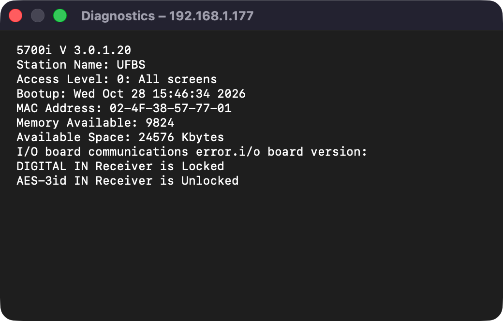

# M1E — 5700i Diagnostics (and the Automation and Security file formats)

> **Evidence status:** run on 28 October 2026 on the scratch virtual 5700i 3.0.1.20 (192.168.1.177, original firmware). First the original 5700i PC Remote, then the real macOS app (test build on port 15701). No physical processor was touched.

## Diagnostics

The client's *Tools › 5700i Diagnostics* shows the text the unit sends as opcode 205 in answer to the client's login message (204 with the access code). It sends nothing when the dialog opens. The app logs in with the terminal-style `connect` exchange, so during its first sync it sends 204 with the code once, the same message the client sends. The session stays the same (one session on the unit, meters and writes continue).

The app's **Open Optimod Remote › Diagnostics…** (native window) shows that text, line for line equal to the client's dialog:

## Automation and Security (captured, not yet implemented)

| Client | On the wire |
|---|---|
| Automation (read) | 242 → 235 `Automation.orb57autom`: one block per event, from `Preset Name=<auto_event_00>` to `End Preset<end>`, with `AUTO SET HOUR/MINUTE/SECOND/DAY/MONTH/YEAR`, `SUNDAY` … `SATURDAY` (S/M/T… = on), `SET BY DAY/WEEK` (`DAY` = daily) and `AUTOMATION EVENT` (a preset name or a function such as `Exit Test`, `Bypass`, `Stereo`, `Mono-L`, `Mod. Reduction 1`, the delay in/out functions). |
| Automation › Done | 235 upload: `<FILETIME low>\n<FILETIME high>\nAutomation.orb57autom\n<size>\n` + archive. `AUTOMATION ENABLED` is a setup field. |
| Security (read) | 241 → 230 `Password.orb57pas`: one line per passcode, `C:<CODE>String:<access level>`, levels "All screens" … "Presets". The automatic lock (`SECURITY TIMEOUT`) is a setup field. |

The scratch unit holds one test automation event (daily 00:00, *Exit Test*), made with the client.

Checks: `cargo test --workspace` (137), clippy and fmt PASS.
