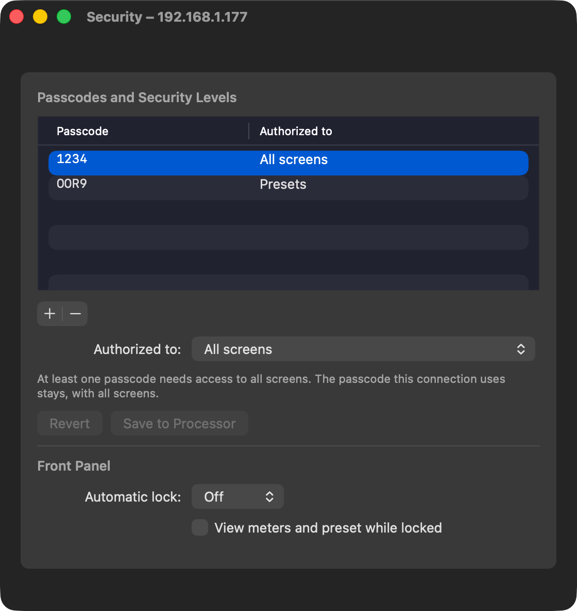
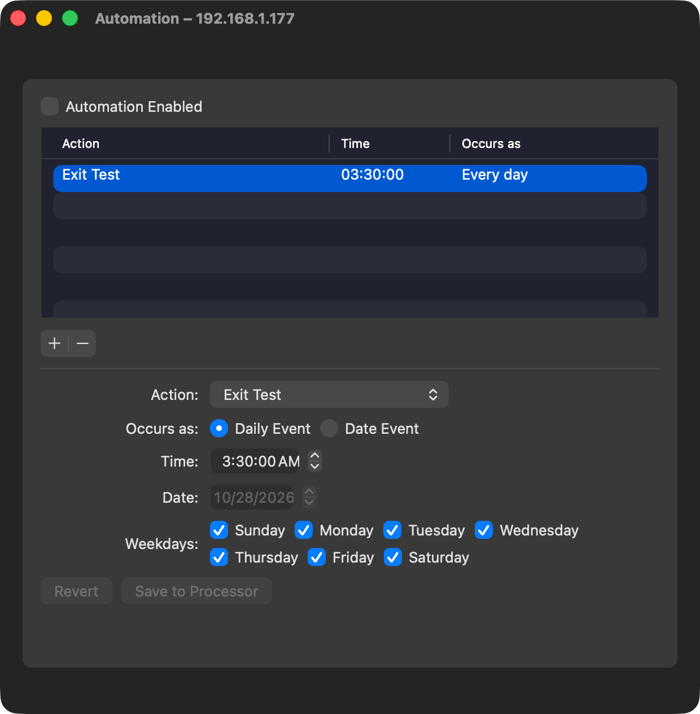
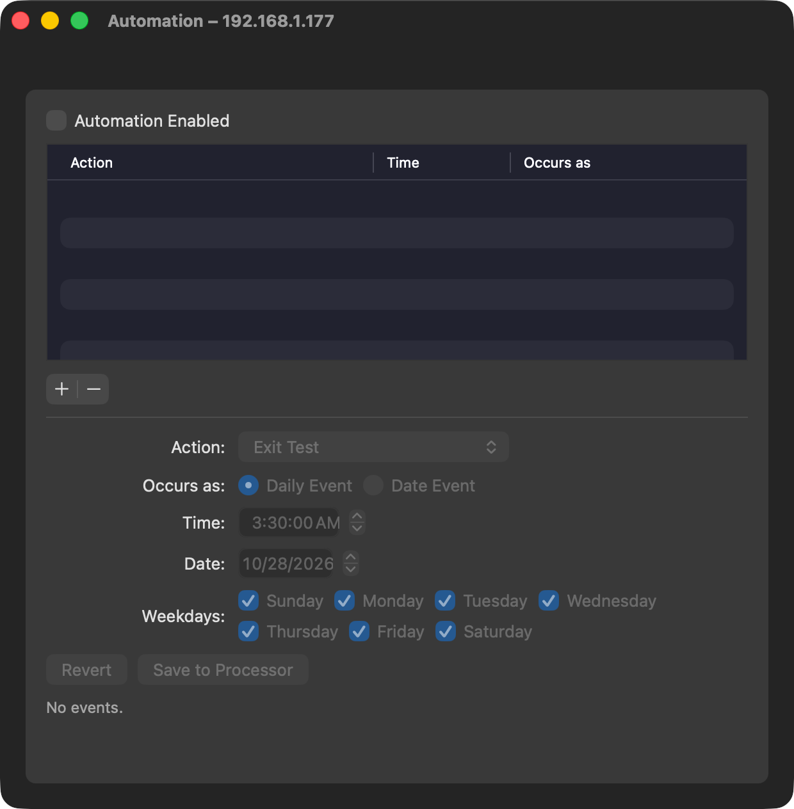

# M1F — 5700i Automation and Security (native windows)

> **Evidence status:** run on 28 October 2026 on the scratch virtual 5700i 3.0.1.20 (192.168.1.177, original firmware). Formats captured from the original 5700i PC Remote; the app tested in its real native windows (test build on port 15701). No physical processor was touched; the scratch unit ends with one passcode and no automation events, as before.

## The original client (captured)

| Action | On the wire |
|---|---|
| Read automation | F4h (244), then 242 → 235 `Automation.orb57autom` (no answer without events). The unit leaves 241 and 242 unanswered without the 244 first. |
| Save automation (Done) | 235 `<FILETIME low>\n<FILETIME high>\nAutomation.orb57autom\n<size>\n` + archive: one block per event (`auto_event_NN`) with time, date, weekdays (`S`/`M`/… on, `_` off), `SET BY DAY/WEEK` `DAY` (daily) or `DATE`, and the action. |
| Delete the last event (Done) | 237 `Automation.orb57autom\n` |
| Read passcodes | 244, then 241 → 230 `Password.orb57pas`: `C:<CODE>String:<level>;D:<n>;`, six levels |
| Save passcodes (Done) | 230 without a name (`0\n0\n\n<size>\n` + archive), plus setup writes of `SECURITY TIMEOUT` and `VIEW METERS` |

Unlike 229 and 231, these uploads get no boundary answer of their own. The unit takes the file a moment after the upload, so the app reads it back until it matches (at most 10 s).

## The app

- `crates/orban-web/src/automation.rs` and `security.rs` parse and render the files. Both captured files render byte for byte (tests).
- `/api/automation`, `/api/security` (GET reads the unit's file, POST replaces it as the client does and confirms by readback). A passcode file without the connection's own passcode at full access is refused, so the app cannot lock itself out.
- **Open Optimod Remote › Automation…** and **› Security…** are native AppKit windows (`ToolsWindows.swift`, the System Settings canvas and card): a table with + / −, native pop-ups, date pickers and check boxes, Save to Processor / Revert. Automation Enabled, Automatic lock and View meters write their setup fields directly. A first web version was replaced on Mark's instruction (native panels only).

## Results (native windows, driven through the window's own controls)

| Step | Result |
|---|---|
| Security: add OOR9 at "Presets", Save | unit file holds 1234 (all screens) + OOR9 (Presets)  |
| Security: remove OOR9, Save | unit file holds 1234 only |
| API: a file without the session's passcode | refused |
| Automation: new event, Exit Test, 03:30:00 daily, Save | unit file holds that event  |
| Automation: delete it, Save | 237 sent, unit has no automation file  |
| Events made with the client (one daily without Sunday, one on a date) | read by the app as the client shows them |

Checks: `cargo test --workspace`, clippy, fmt; UI tests and `tsc -b` PASS.
