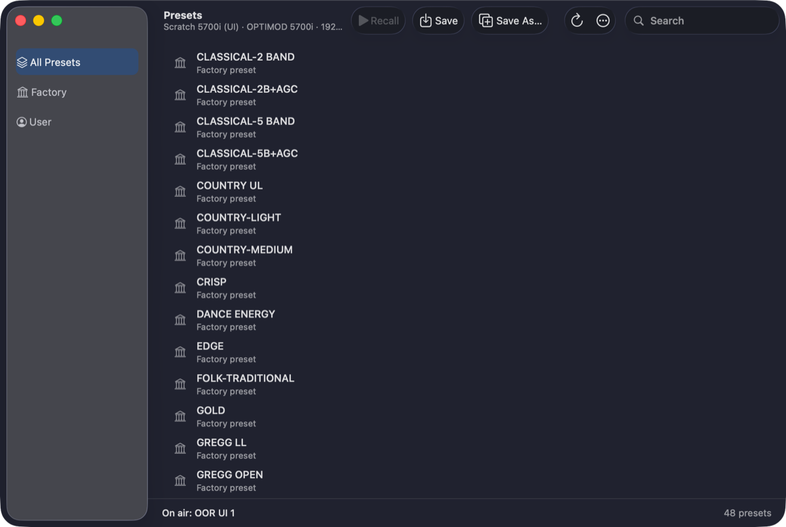
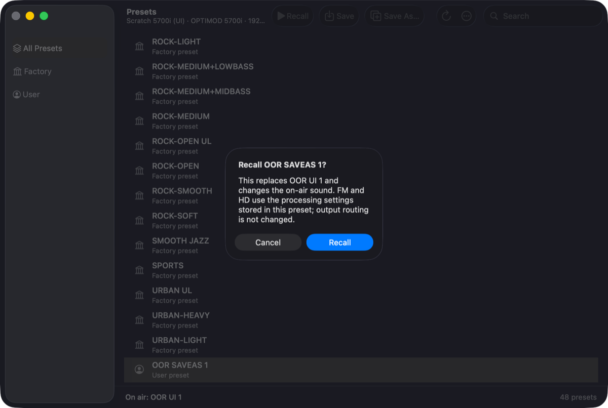
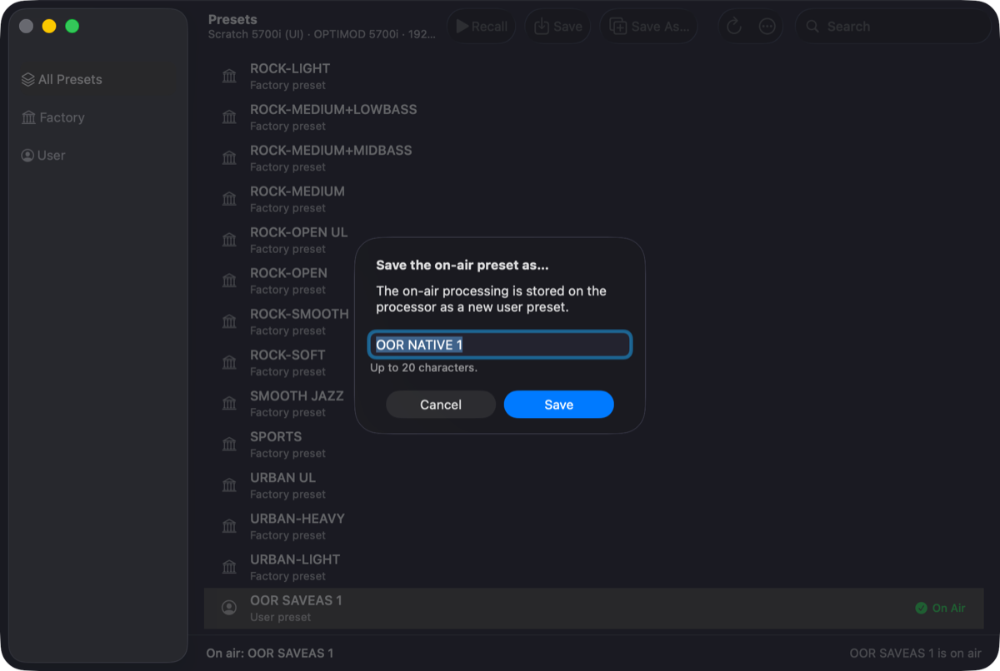
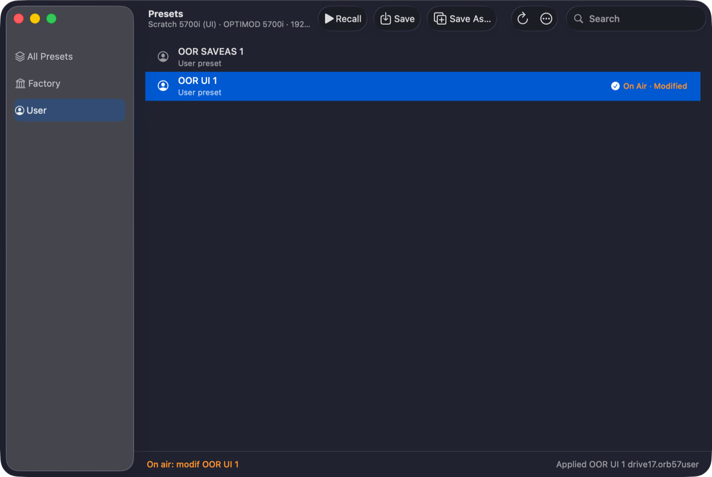
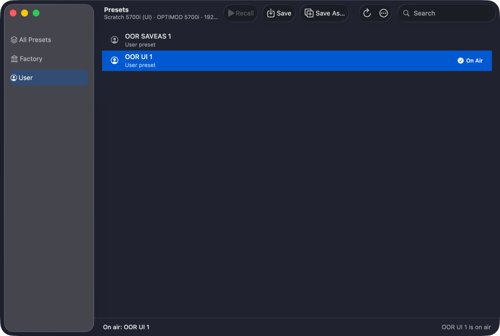
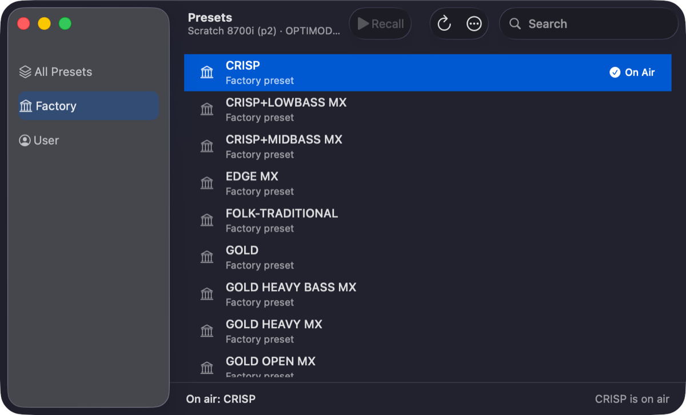

# M1G — Presets as a native window

> **Evidence status:** run on 28 October 2026 in the real native app (test build on port 15701, isolated home) against the scratch virtual 5700i 3.0.1.20 (192.168.1.177) and the scratch virtual 8700i 1.5.1.11 (192.168.1.175), both original firmware. Every step was driven through the window's own controls (test hook `presets …`) and confirmed by the service's readback of the unit. No physical processor was touched. The 5700i ends on OOR UI 1 (AGC DRIVE 15) with the user presets OOR SAVEAS 1 and OOR UI 1, as before.

Mark (28-10): "PRESETS moet NATIVE SCHERM WORDEN". The Presets web workspace no longer opens in the app: **Presets…** (⇧⌘P), the Presets and Recall buttons on the Meters page and a remembered open window all open `PresetsWindow.swift`, an AppKit window per processor (like System Settings). The web page stays for browser mode only.

## The window

- Sidebar All Presets / Factory / User, search, a table with the On Air badge (orange "On Air · Modified" for a modified on-air preset).
- Toolbar: **Recall** (Return, or double-click), **Save** (replaces the on-air user preset, as the 5700i client's Save), **Save As…**, Refresh, and ⋯ with Rename…, Delete…, Apply Preset File…, Save Current Preset as File…, Back Up…, Restore… The row context menu has Recall, Rename and Delete; the Delete key deletes after asking.
- Save and Save As appear only when the firmware stores presets (`preset_store`); the 8700i window has Recall only.
- Every write asks first in a native sheet. Names are checked as the client checks them (20 characters, 18 on the 5500; no brackets, no `modif `, no existing name); Save stays disabled until the name is valid.
- The window follows the service's revision: a recall on the front panel, the terminal or another client appears without a click. It belongs to one processor: another connected processor opens its own window, a disconnect shows "… · Offline".

## Results

| Step | Result |
|---|---|
| Open on the 5700i | 48 recallable presets (3 unsaved entries hidden), on air OOR UI 1  |
| Recall OOR SAVEAS 1 → confirm | sheet , unit on air OOR SAVEAS 1 |
| Save As: `OOR UI 1`, `GREGG OPEN` | refused ("A preset with this name already exists." / "A factory preset has this name."), Save disabled |
| Save As `OOR NATIVE 1` |  unit user list + OOR NATIVE 1, on air |
| Rename OOR NATIVE 1 → OOR NATIVE 2 | unit list OOR NATIVE 2, on air |
| Delete while on air | refused (no sheet) |
| Recall OOR UI 1, Delete OOR NATIVE 2 | unit list OOR SAVEAS 1, OOR UI 1 |
| External change AGC DRIVE 25 → 26 | window shows `modif OOR UI 1` without a click |
| Save | on air OOR UI 1, value 26; after recalling away and back still 26; restored to 25 and saved |
| Save Current Preset as File | `OOR UI 1.orb57user` |
| Back Up | zip with Setup.orb57setup + 6 preset files |
| Delete OOR SAVEAS 1, Restore (backup folder) | sheet lists the 6 preset files, "setup matches"; OOR SAVEAS 1 back on the unit |
| Apply the preset file (no differences) | applied, on air unchanged |
| Apply a copy with AGC DRIVE 17 | unit value 17, window `modif OOR UI 1` ; Recall OOR UI 1 → 15 |
| Terminal `RP OOR SAVEAS 1` | window on air OOR SAVEAS 1 within ~4 s; recalled back  |
| Disconnect / reconnect | "Scratch 5700i (UI) · … · Offline", list empty; back after reconnect |
| Switch to the 8700i | the 5700i window closes, an 8700i window opens; Recall only  |
| 8700i Back Up | JSON backup (`pc-remote-8700i-1.5.1.11`, 59 presets) |
| 8700i Recall GREGG OPEN, then CRISP | both confirmed by the unit |

## Fixed on the way

- After **Apply Preset File** the service kept the old on-air name; the unit reports `modif NAME` (seen with `/api/refresh`). The service now names it `modif …` when the file changed anything, so Recall of the original preset is offered again (`apply_preset`, main.rs).

## Tests

`PresetsAPITests` (filter, Save/Save As/Rename/Delete rules, name checks, backup sorting, CRC-32 and ZIP layout), `PresetsWindowTests`, `DeviceWindowsTests`, `SystemSettingsSpecTests`: passed. `cargo test -p orban-web`: 76 passed. `cargo fmt --check`, `cargo clippy -p orban-web -D warnings`: clean.
