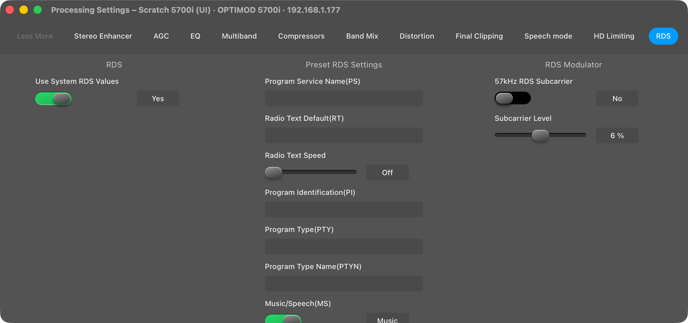
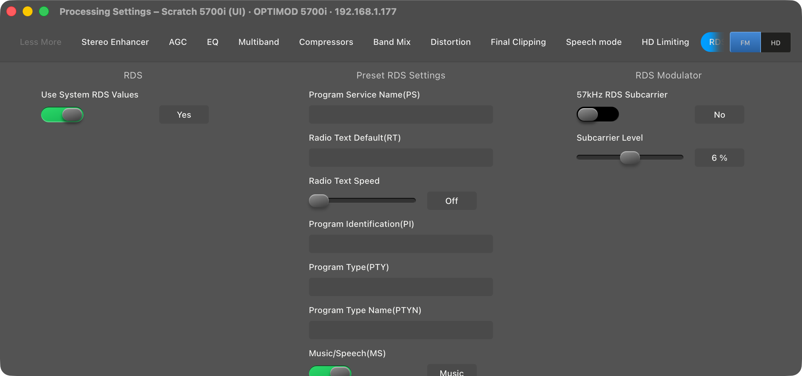

# M1H: 5700i FM/HD Couple/Uncouple and the missing Processing controls

> **Evidence status:** run on 28 October 2026 in the real macOS app (test build on port 15701, isolated data) against the scratch 5700i 3.0.1.20 (192.168.1.177, original firmware), compared with the original `5700iPC.exe` on the same unit (CrossOver bottle "Optimod 5700i", entry `5700i-p2-ui`). Every test write was restored; the unit is back on `OOR UI 1` with FM→HD coupled.

## Couple / Uncouple

The client's Uncouple (menu 33046) and Couple (33043) each send one write and show no dialog:

| Client | Wire (unit netlog) | App |
|---|---|---|
| Uncouple | `23 HD COUPLING;1;String:<Indepen.>;1;` | the FM HD button in the Meters/Processing header sends the same bytes; readback `Indepen.`, FM/HD path selector appears |
| Couple | `23 HD COUPLING;0;String:<FM->HD>;1;` | same bytes; readback `FM->HD` |

## Processing controls the app did not show

All fields of the on-air document were compared with the client's dialog bindings (binder calls and `DDX_Text` of every processing dialog).

| Client page | Missing in the app | Cause | Now |
|---|---|---|---|
| Distortion Control, 2 Band Distortion | `B3 CLIP THRSH` | the static conversion conflicted with factory presets, so the extractor dropped it, although the hardware-verified profile has it | placed; write 0 → 0.25 dB → 0 dB with readback |
| Final Clipping, Final Clip (MX) | `MPX PWR OFFSET` | same | placed; write −12.00 → −11.75 → −12.00 dB with readback |
| **RDS** (dialog 406, last tab of the client's sheet) | the whole preset RDS page | dialog not in the extractor's list; text boxes are bound by `DDX_Text`, not by a binder | new page: Use System RDS Values, Program Service Name (`RDS DYNAMIC PS`, 255), Radio Text (`RDS RADIO TEXT`, 128), PI (4), PTY (2), PTYN (`RDS PROGRAM NAME`, 8), EAS (64), DPS speed/timeout, RT speed, MS/DI/TP, RDS Modulator box (57 kHz subcarrier, level) |

Text boxes behave like the client's: the firmware value `undefined` shows empty, an emptied box writes `undefined`, maximum lengths from `DDV_MaxChars`. Client and app sent byte-identical frames for PTYN: `RDS PROGRAM NAME;0;UserString:<OORTEST>;1;` and, cleared, `UserString:<undefined>`; the app's readback confirmed both.

Fields the client binds to no dialog stay hidden (`CLIP W2`, `FC HEADROOM`, `HD BASS CLIP`, `HD BASS CLIP SHAPE`, `HD MULTIBAND CLIP`, `HD SPEECH BC THR`, `RDS EAS TIME`).

## Checks

`cargo test --workspace`, 73 UI tests (new: RDS page text boxes, nested group box, the two placed sliders), UI build, documentation audit: PASS.
