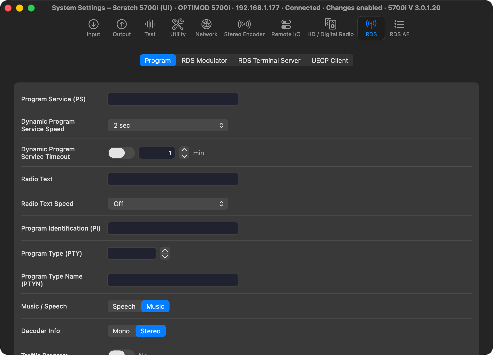

# M2A: 5700i System Settings against the client's 11 Setup tabs

> **Evidence status:** run on 28 October 2026 in the real macOS app (test build on port 15701, isolated data) against the scratch 5700i 3.0.1.20 (192.168.1.177, original firmware). Every test write was restored and read back.

## Binding comparison

Every Setup dialog of `5700iPC.exe` (binder calls per dialog) was compared with the fields of the native System Settings window (`SystemSettingsSpec.swift`).

| Client tab | Missing in the app | Now |
|---|---|---|
| Utility | *External AGC in use* (`STUDIO CHASSIS`) | Utility › Processing, first item |
| RDS | the *UECP Client* box: Site Address (`RDS UECP SITE`, 0–1022), Encoder Address (`RDS UECP ENCODE`, 0–62), Active, UDP, TCP / UDP Port (`RDS UECP PORT`) | RDS › UECP Client |
| RDS | text boxes showed the firmware's `undefined` and had no length limit | shown empty and written back as `undefined` when emptied, as the client does; limits from the client's `DDV_MaxChars`: PS 255, RT 128, PI 4, PTYN 8, EAS 64 |
| RDS | IP Port allowed 65535 | 1–65534, the profile's range |
| Test | `XTALK TEST` | not on this unit (not in its document), so not shown |
| Nielsen (dialog 408) | `RATINGS …` | not one of the client's 11 tabs; not shown |

## Writes with readback (one per tab, each restored)

| Tab | Field | Write | Readback |
|---|---|---|---|
| Input | DI REF LEVEL | −10.0 → −9.5 dBFS | PASS |
| Output 1 | AO1 LEVEL | 0 → 0.1 | PASS |
| Output 2 | DO2 LEVEL | 0 → −0.1 | PASS |
| Stereo Encoder | PILOT LEVEL | 12.0 → 11.9 % (12.1 refused: outside the range) | PASS |
| Test | MOD LEVEL | 91 → 90 % | PASS |
| Utility | STUDIO CHASSIS | No → Yes | PASS |
| HD Digital Radio | HD BW | 15 → 16 kHz | PASS |
| RDS | RDS UECP SITE | 0 → 5 | PASS |
| RDS AF | AF 1 | Off → 87.6 MHz | PASS |
| Remote Interface / Silence | fallback | — | PASS in [M1A](2026-10-28-m1a-active-input.md) |
| Network | — | read only | — |

## Checks

`SystemSettingsSpecTests` (140 controls; new: UECP and STUDIO CHASSIS present): PASS.
