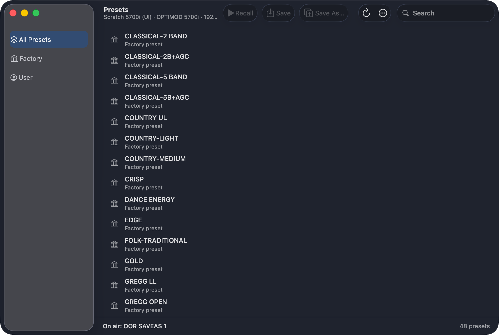

# M3A: 5700i access levels as the original client applies them

> **Evidence status:** run on 28 October 2026 against the scratch 5700i 3.0.1.20 (192.168.1.177, original firmware) in the real macOS app (test build, port 15701). Two test passcodes (levels 2 and 5) were added through the app's Security window function and removed afterwards; the unit ends with its single full-access passcode and `OOR UI 1` on air.

Before: any level other than 0 made the whole app read only, so a "Presets" passcode could not even recall.

## The client's rules (5700iPC.exe 3.0.1.20, menu update handlers)

| Level (Security dialog name) | Recall | Modify, Couple, Apply file | Save / Save As / Delete | Setup | Automation | Security | Backup / Restore |
|---|---|---|---|---|---|---|---|
| 0 All screens | ✓ | ✓ | ✓ | ✓ | ✓ | ✓ | ✓ |
| 1 All screens except Security | ✓ | ✓ | ✓ | ✓ | ✓ | — | ✓ |
| 2 All screens except Modify and Security | ✓ | — | — | ✓ | ✓ | — | — |
| 3 Presets, Modify, Save, Memory and Automation | ✓ | ✓ | ✓ | — | ✓ | — | — |
| 4 Presets and Automation | ✓ | — | — | — | ✓ | — | — |
| 5 Presets | ✓ | — | — | — | — | — | — |

Handlers: Recall 0x4382e0 (≤5), Save 0x437ef0 / Save As 0x437a00 / Delete 0x438af0 (≤3, not 2), Setup 0x438cb0 (≤2), Automation 0x43abd0 (≤4), Security 0x43aca0 (0), Backup 0x43ad70 / Restore 0x43add0 (≤1); Diagnostics has no check. The service enforces the same table (`orban-protocol/src/access.rs`) and reports it as `access`; each window enables its controls from its own right. Other models keep "level 0 = everything, otherwise read only" until their clients are compared.

## Runs

| Login | Check | Result |
|---|---|---|
| level 5 | `access` = recall only; AGC Drive write, MOD LEVEL write | both refused by the app, nothing sent |
| level 5 | Recall `OOR SAVEAS 1` | PASS, the firmware recalls at level 5 |
| level 5 | native Presets window | Recall enabled, Save and Save As disabled |
| level 2 | AGC Drive write | refused |
| level 2 | MOD LEVEL 91 → 90 → 91 % | PASS with readback |
| level 0 | recall `OOR UI 1`, remove the test passcodes | PASS |

