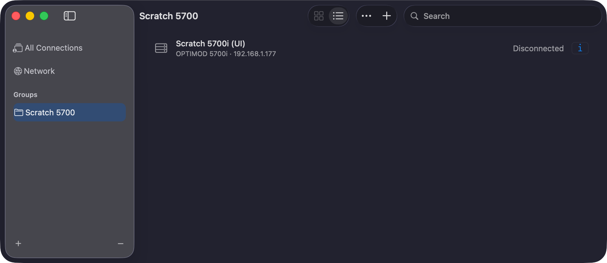

# M3B: connection groups as in the original client

> **Evidence status:** run on 28 October 2026 in the real macOS app (test build on port 15701, isolated data). No processor was touched; the test groups and the throwaway entry were removed afterwards.

The original client's Connection List files connections under groups (New Group / Rename Group / Delete Group). Its rules, from `5700iPC.exe` strings: a name may not contain `\ / : * ? " < > |`; a group or connection with the same name may not exist ("A Group or Alias with this name already exists"); Delete Group asks *"Are you sure you want to remove the group "%s" and all its contents?"* and removes its connections too.

| Function | Mac app | Result |
|---|---|---|
| New Group | Connections › ⋯ › New Group… | PASS; `Bad/Name` and a name already used by a connection refused with the client's reasons |
| File a connection under a group | connection editor › Group | PASS; the group's sidebar row lists only its connections (screenshot) |
| Rename Group | right-click the group row › Rename Group… | PASS; its connections follow |
| Delete Group | right-click › Delete Group… | PASS; the group and its connection (and saved access code) removed after the client's confirmation; the active connection is disconnected first |
| Groups survive a restart | `connections.json` `groups` | PASS (unit test) |

Groups are one level deep; the client's tree can nest groups inside groups.

## Checks

`cargo test` (new: group create/rename/delete/reopen), ConnectionsAPITests, ConnectionsWindowTests: PASS.
