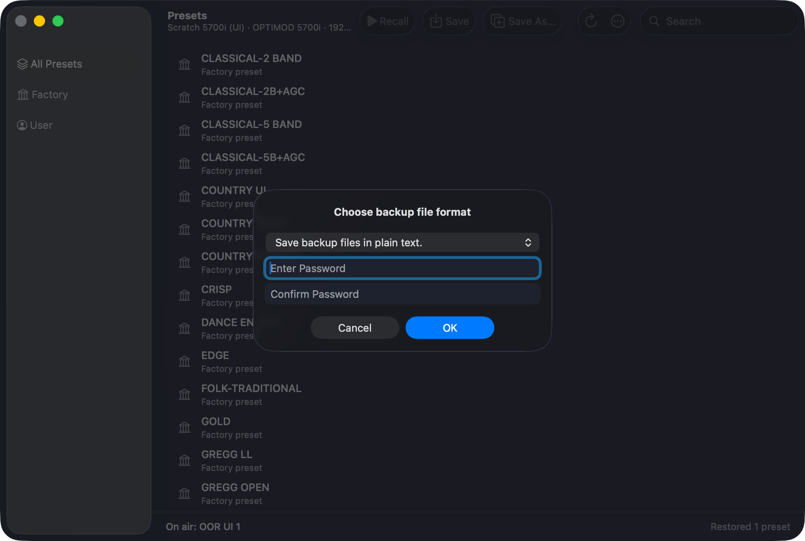

# M4A: encrypted backups as the original client writes them

> **Evidence status:** run on 28 October 2026 against the scratch 5700i 3.0.1.20 (192.168.1.177, original firmware): an encrypted backup made by the original `5700iPC.exe`, then the real macOS app (test build, port 15701) restoring it and making its own. The restore replaced user presets with identical copies; the unit's state is unchanged.

## The client's format

File › Backup to PC asks *Choose backup file format*: plain text, *Encrypt backup files with current session password*, or *with password entered below*. A backup encrypted with the password `OORBK` (7 preset files, `Setup.orb57setup`, a 16-byte `Automation.orb57autom`) decrypts with the unit's own file cipher (`archive::decrypt`, AES key = the password repeated, IV first, CBC with ciphertext stealing) and that password; not with the session's access code. Every decrypted file starts `OptimodVersion=<5700.51>`; the empty automation list is the IV alone.

## The app

| Step | Result |
|---|---|
| Presets › ⋯ › Restore from Backup…, the client's `OORBK` backup folder | the session's access code does not open it → *This backup is encrypted* asks for the password |
| wrong password | *That password does not open this backup*, asks again |
| `OORBK` | decrypted; the setup file matches the unit ("nothing to restore there"); 6 user preset files listed |
| Restore | PASS, "Restored 1 preset" (single file) and the full set |
| Presets › ⋯ › Back Up… | the client's three formats (screenshot); the password boxes count only for the third |
| Back Up, *current session password* | zip with `Setup.orb57setup` and 6 preset files, each encrypted; an independent decrypter (Python, AES) opens them with the access code `1234` |
| service round trip (encrypt → decrypt) | identical text |

Plain-text backups and restores are unchanged ([M1D](2026-10-28-m1d-backup-restore.md)).

## Checks

`cargo test`, clippy, PresetsAPITests, PresetsWindowTests: PASS.
