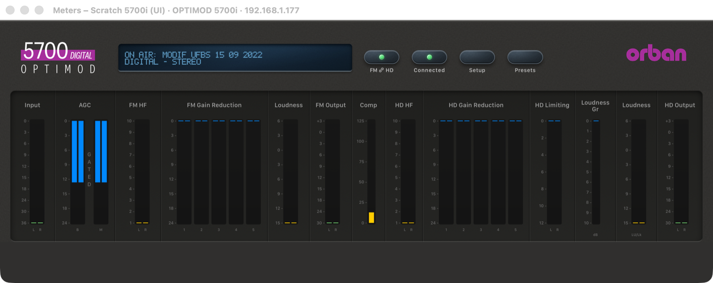
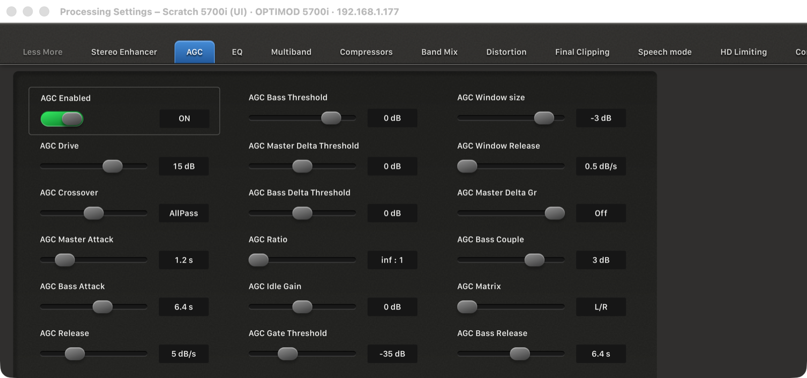
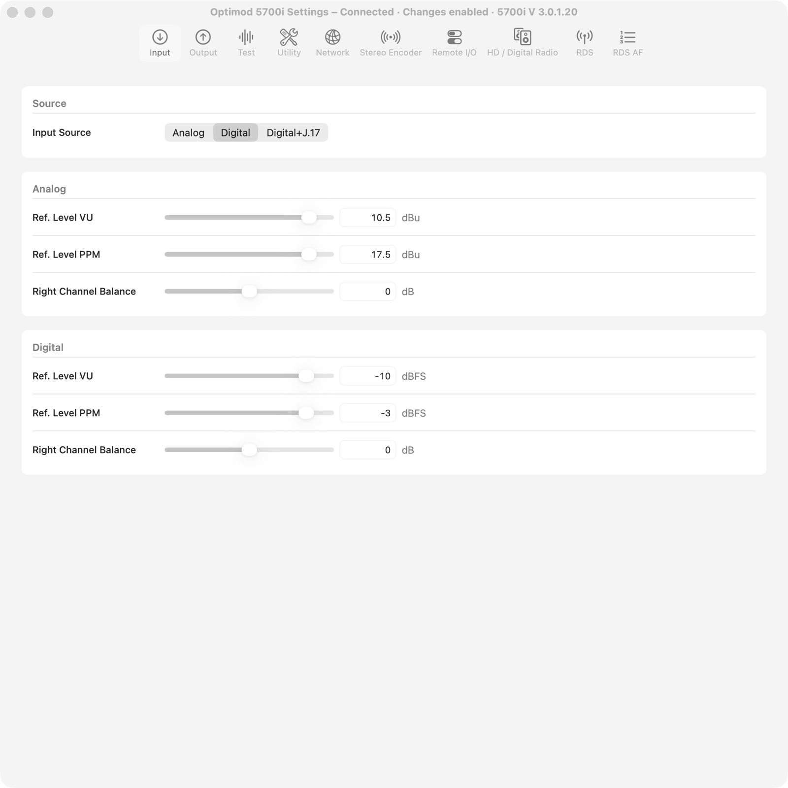
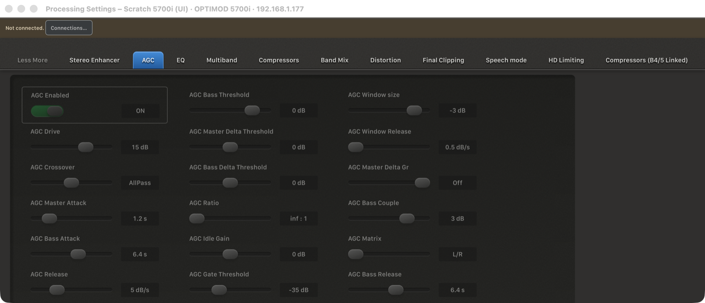
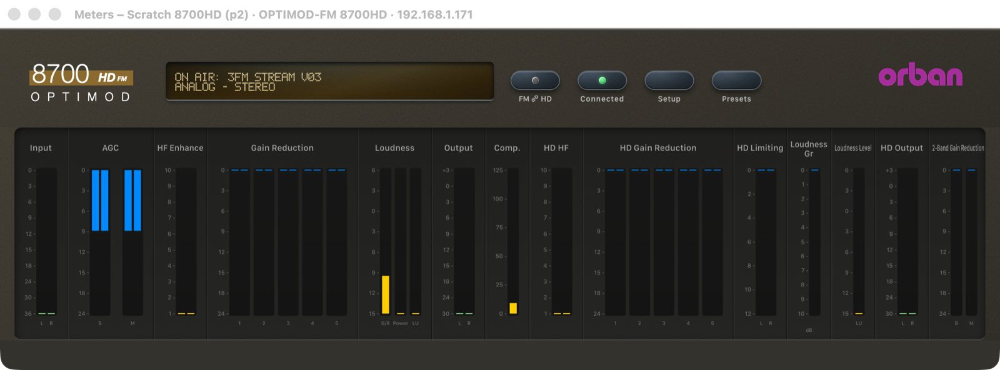
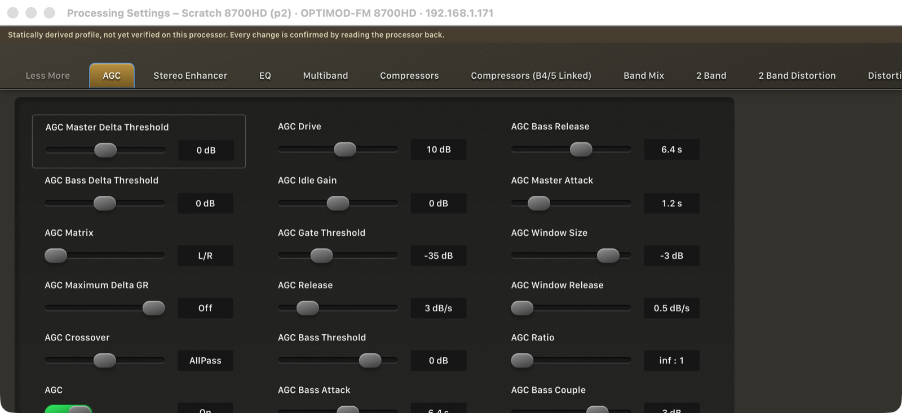
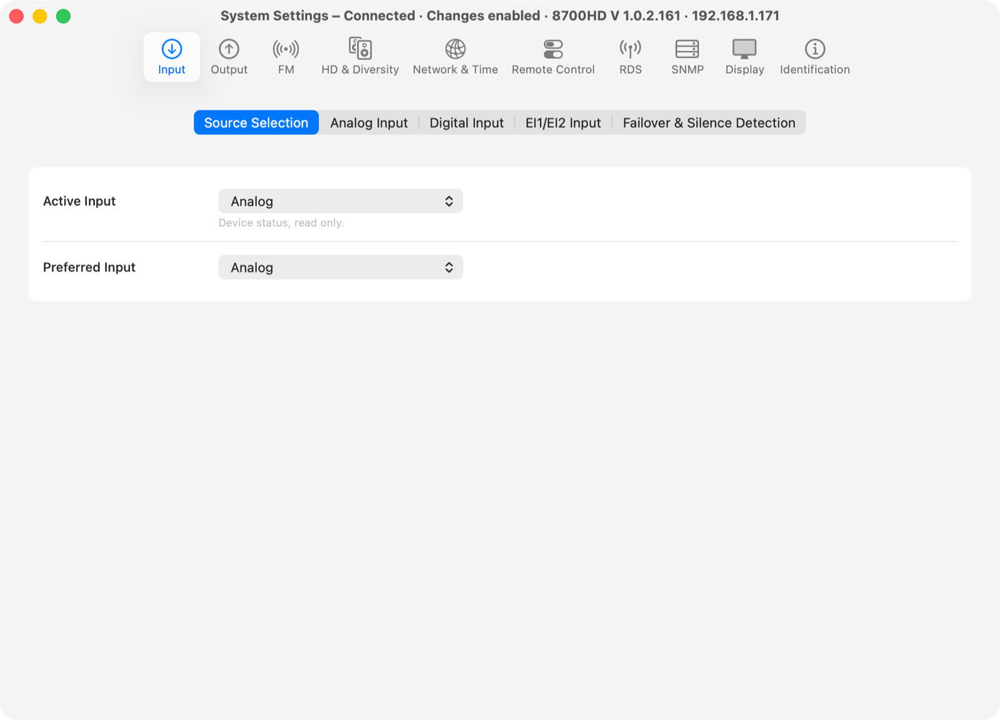

# UI Phase 2: separate native windows on one device session

> **Evidence status:** run in the real macOS app (test build on port 15701, isolated data) on 28 October 2026 against two virtual units with original firmware and no audio devices: a scratch 5700i 3.0.1.20 (192.168.1.177, made from the reference unit's documents) and the scratch 8700HD 1.0.2.161 (192.168.1.171). No setting was written and no preset was recalled. The window actions were the same AppKit calls as the title bar and the Window menu (`performClose`, `miniaturize`, `setFrame`), sent through the app's test hook, so the operator's mouse was never used.

## What changed

| Area | Before | Now |
|---|---|---|
| Windows | One web window held header, meters and every workspace. Closing it quit the app and ended the session. | **Meters**, **Processing Settings**, **Presets** and **System Settings** are separate native windows. Each opens, closes, minimizes, moves and resizes on its own. Closing every window keeps the processor connected; Quit ends the session cleanly. |
| System Settings | A native window for the 5700i, the web Setup workspace for other models. | Always the native window: the 5700i worksheet, or for every other model the System fields of its own profile, with native controls. Fields without a verified definition, status fields and text fields are read-only. |
| Device scope | Pages followed whichever processor was connected. | Each window belongs to one processor (its saved connection, else its address, never a port). A window of another processor shows no data. Window positions are kept per processor and window kind. |
| One device stream | One owner and one meter stream already existed in the service. | Unchanged. `GET /api/diagnostics` counts logins, meter polls, meter frames and device writes, and how many windows read the meter stream; reading it sends nothing to the processor. |

Phase 6 replaces the single session with one session per processor. Until then, connecting a different processor closes the old processor's windows and opens the same kinds for the new one; a disconnect alone keeps every window, which resumes on reconnect.

## Lifecycle runs

Each step was held for 4 s; polls/s is the rate of the one meter poll (20 Hz nominal on a loaded machine).

| Step (5700i) | Windows | Meter readers | Polls/s | Logins | Writes |
|---|---|---:|---:|---:|---:|
| start | Meters, Processing | 1 | 17.8 | 1 | 0 |
| close Meters | Processing | 0 | 18.8 | 1 | 0 |
| reopen Meters | Meters, Processing | 1 | 18.8 | 1 | 0 |
| minimize / restore Processing | Meters, Processing | 1 | 19.0 / 17.0 | 1 | 0 |
| resize Meters, resize Processing | Meters, Processing | 1 | 18.2 / 19.2 | 1 | 0 |
| close / reopen Processing | Meters, Processing | 1 | 17.8 / 19.0 | 1 | 0 |
| System Settings (native 5700i) | + System Settings | 1 | 19.0 | 1 | 0 |
| open / close Presets | + Presets | 1 | 18.2 / 18.8 | 1 | 0 |
| close Meters and Processing | System Settings | 0 | 19.5 | 1 | 0 |
| reopen Meters and Processing | all three | 1 | 18.5 / 19.0 | 1 | 0 |

The same run on the 8700HD (12–14 polls/s): close/reopen, minimize/restore and resize of every window, then **all windows closed** (the app keeps running, session connected), then reopened. Result for both: the same session ID throughout, 0 extra logins, 0 writes. Only the Meters window reads the meter stream; Processing, Presets and System Settings add no reader. A window reopened at its last position and size.

Device switch: with the 5700i connected and its native System Settings open, a disconnect kept all windows (subtitle "· Offline", controls disabled). Connecting the 8700HD closed the 5700i windows and opened Meters and Processing bound to the 8700HD, at the last positions of their kind.

## Screenshots

5700i Meters and Processing Settings, each its own window on the same session:

5700i native System Settings, and Processing Settings while the processor is offline:

8700HD Meters and Processing from its own profile, and its native System Settings from its own System fields:

## Checks

`cargo test --workspace` (135 passed), `cargo clippy --workspace --all-targets -- -D warnings`, `cargo fmt --all -- --check`, 61 UI tests, the nine Swift test programs (including the new `DeviceWindowsTests`) and the documentation audit: all PASS.

## Open

- The Meters window keeps a minimum width of 1133 pt: the meter lanes have fixed reference widths, and a narrower window would hide meter groups. The Figma layout (Phase 3) makes it responsive.
- Meters and Processing Settings still use the per-model skins. Phase 3 and 4 give every model the same Figma visuals and colours.
- Native System Settings for models other than the 5700i reads every System field; writes go through the same confirmed readback as before but were not exercised in this run. Text fields stay read-only until text writes are verified per model.
- The browser mode keeps its combined page, including the Setup workspace.
