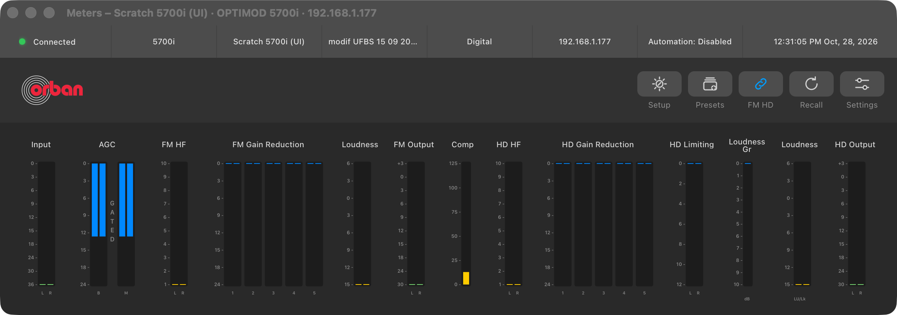
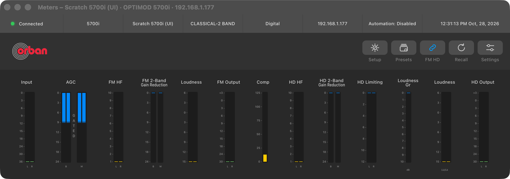
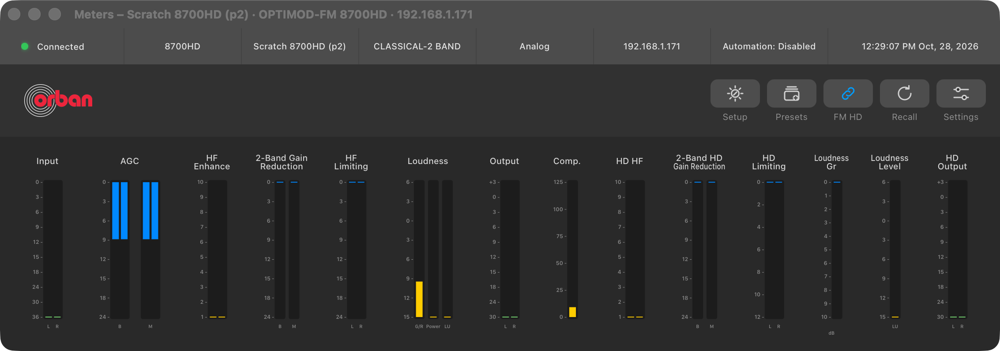
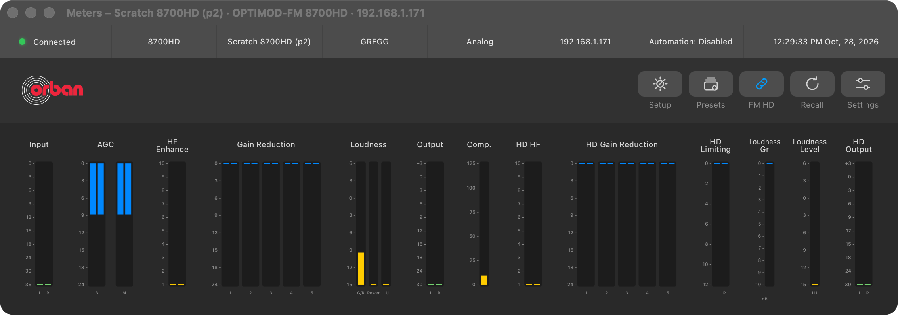
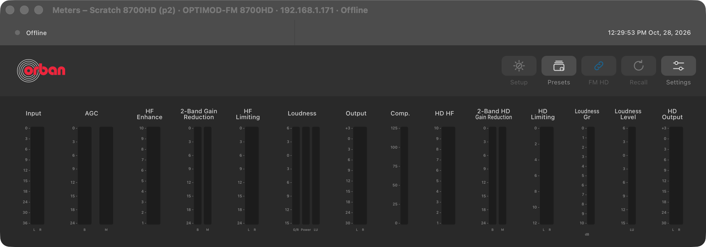
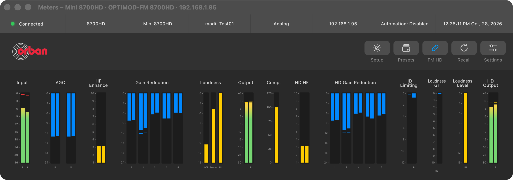
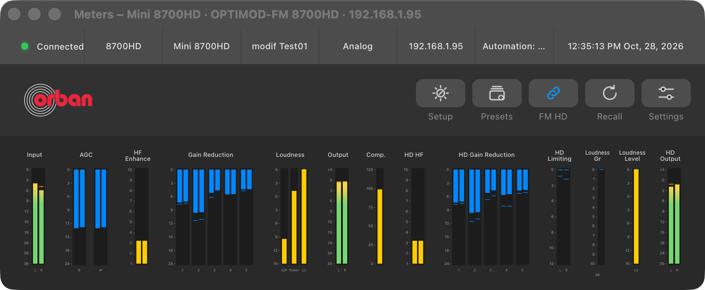
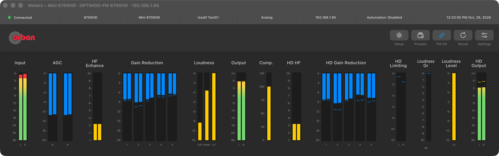

# UI Phase 3: the Figma Meters window

> **Evidence status:** run in the real macOS app (test build on port 15701, isolated data) on 28 October 2026. Structure changes were tested on two virtual units with original firmware and no audio devices: the scratch 8700HD 1.0.2.161 (192.168.1.171) and the scratch 5700i 3.0.1.20 (192.168.1.177). Live audio was tested read-only on the 8700HD on the Mac mini (192.168.1.95, `Test01` on air, playing its stream): no setting was written and no preset was recalled there. Both scratch units were restored afterwards: the 8700HD by recalling its own `3FM STREAM V03`, the 5700i by putting back a copy of its unit folder taken before the test.

Design: [Meters frame 150:2690](https://www.figma.com/design/SuuJ8vDRPnxEOPflDeYL7c/Optimod?node-id=150-2690), 1133 × 370.

## What changed

| Area | Before | Now |
|---|---|---|
| Look | The per-model instrument skin with its own header. | The Figma window for every model: status strip (connection, model, connection name, on-air preset, input, address, automation, clock), action bar (Setup, Presets, FM HD coupling where the model has it, Recall, Settings) and the flat meter panel. Only the meter groups, labels and scales come from the model. |
| 2-band and 5-band | Every meter group of a model was drawn at once: the 8700HD showed *2-Band Gain Reduction* next to its 5-band *Gain Reduction*, the 5700i showed its 5-band bars in 2-band presets. | Each band group shows only while its structure is on air, read from the processor's own on-air document: a 5-band document carries `B1 ATTACK`, a 2-band document `2B DRIVE` (HD: `HD B1 ATTACK`, `HD 2B DRIVE`). Before the document arrives no band group is drawn. The 2-band groups take the place of the 5-band ones. |
| Size | Fixed reference widths; the window could not be narrower than 1133 pt. | The meters scale evenly with the window (minimum 760 × 300) and spread over a wider window; text is never stretched. |
| States | — | Connected (green; dimmed until the first meter frame), Reconnecting (yellow), Connection lost (red, the error as tooltip), Offline (grey, only the processor's model, name and address stay). |

### Evidence for the structure rule

Factory presets of each model, `Preset Type` against the fields in the file:

| Model | `TWOBAND PRESET` | `MULTIBAND` / `LOW LATENCY` |
|---|---|---|
| 8700i | 5 of 5 have `2B DRIVE` and `HD 2B DRIVE`, none has `B1 ATTACK` | 53 of 53 have `B1 ATTACK` and `HD B1 ATTACK`, none has `2B DRIVE` |
| 8700HD | 10 of 10 the same | 131 of 131 the same (two foreign files in the unit's folder left out: a 6300 preset, and an old 8700 user preset that carries both) |
| 5700i | 6 of 6 the same | 88 of 88 the same |
| 5500i | 6 of 6 have `2B DRIVE`, none `B1 ATTACK` | 47 of 47 have `B1 ATTACK` |
| 6300 | 12 of 12 the same | 57 of 57 the same |

The 2300 has no 5-band structure and keeps every group. The 8400 already switched on its own `2B/5B SWITCH`.

Which groups follow the structure:

| Model | 5-band only | 2-band only |
|---|---|---|
| 5700i | FM Gain Reduction · HD Gain Reduction | FM 2-Band Gain Reduction (values 64/65) · HD 2-Band Gain Reduction (49/50) |
| 8700HD, 8700i | Gain Reduction · HD Gain Reduction | 2-Band Gain Reduction · HF Limiting · 2-Band HD Gain Reduction |
| 5500i, 5500 | Gain Reduction | 2-Band Gain Reduction · HF Limiting · Overshoot Limit |
| 6300 | Gain Reduction | 2-Band Gain Reduction |
| 8400 | Multiband | 2 Band · HF · PWR |

The 5700i's 2-band value numbers come from the static PC Remote extraction; they were seen at rest on the scratch unit (no audio) and still need a live-audio check in 2-band.

## Runs

| Step | Result |
|---|---|
| 8700HD scratch, `3FM STREAM V03` (5-band) | 5-band groups only; no 2-band group |
| Recall `CLASSICAL-2 BAND` in the app | on air after 1.6 s; document 122 fields, `2B DRIVE` and `HD 2B DRIVE` present, no `B1 ATTACK`; window shows 2-Band Gain Reduction, HF Limiting and 2-Band HD Gain Reduction in place of the 5-band groups; same session |
| Recall `GREGG` through the unit's terminal (outside the app) | app follows within 2 s; 5-band groups back |
| Recall `CLASSICAL-2 BAND` through the terminal, disconnect, reconnect | Offline keeps the window; after the reconnect the 2-band view is correct |
| 5700i scratch, Recall `CLASSICAL-2 BAND` | document 115 fields, 2-band markers present; FM and HD 2-band groups replace the 5-band ones |
| Mini 8700HD, live stream | 72 meter frames in 4 s, input values 35–121; every group moves; screenshots at 1133, 800 and 1500 pt wide |
| Window lifecycle on the live session (close/reopen/minimize/restore/resize Meters, close/reopen Processing, System Settings) | same session throughout, 0 extra logins, 0 writes, one meter reader while Meters is open, 0 while it is closed; 17.5–18.5 polls/s |

## Screenshots

5700i at the Figma size, 5-band and after a Recall of a 2-band preset:

8700HD after a 2-band Recall in the app, after a 5-band Recall from outside the app, and offline:

Live audio on the mini's 8700HD at 1133, 800 and 1500 pt:

## Comparison with the Figma frame

At 1133 pt the 5700i window matches the frame's structure: status strip (41 pt), action bar with the logo and five 56 × 32 pt buttons (82 pt), and the meter panel with the frame's 13 groups, titles (FM HF, FM Gain Reduction, Loudness, FM Output, Comp, HD HF, HD Gain Reduction, HD Limiting, Loudness Gr, Loudness, HD Output), scales and lane labels, on the frame's flat #292929 panel. Other models keep their own group names and scales from their PC Remote (for example the 8700HD's *HF Enhance*, *Output*, *Comp.*).

## Checks

`cargo test --workspace` (135 passed), `cargo clippy --workspace --all-targets -- -D warnings`, `cargo fmt --all -- --check`, 64 UI tests (new: structure visibility for the 5700i and for the 5500i, 6300, 8700HD and 8700i profiles), the UI build, the nine Swift test programs (`DeviceWindowsTests` now checks the Meters size) and the documentation audit: all PASS.

## Open

- 5700i 2-band meter values (64/65, 49/50) with live audio.
- 6300, 2300 and 8700i meter labels and scales against their original clients (model phases 10–12).
- The browser mode keeps the instrument skin and its combined page.
