# UI Phases 3 and 4: closing the open checks

> **Evidence status:** run on 28 October 2026 in the real macOS app (test build on port 15701, isolated data) and in the **original Windows PC Remote clients** (unmodified, CrossOver), both against virtual units running original firmware: the scratch 8700HD 1.0.2.161 (192.168.1.171), 8700i 1.5.1.11 (192.168.1.175) and 5700i 3.0.1.20 (192.168.1.177). Recalls and writes were made only on these scratch units; each was put back afterwards (unit folder restored, or its own preset recalled). The original clients were driven only through their own Win32 messages, never the Mac's mouse. At 13:38, while this work ran, someone else switched the scratch 8700HD to Loopback 2 → 4 with a `Test01` preset on air; from then on the app only read from it and later checks moved to the 8700i.

Phase 3 and 4 left three checks open. All three are now done, and each found a real difference that is fixed.

## 1. MX pages against the original client

The original 8700HD PC Remote was connected to the scratch 8700HD (its own *Connect › New 8700* dialog), and presets were recalled through its own *File › Recall Preset*. The tabs and the dialog behind each tab, read from the client's window tree:

| Preset | `MX SWITCH` | Client tabs (FM) | Dialog behind *Distortion* / *Speech Mode* / *Final Clipping* |
|---|---|---|---|
| `3FM STREAM V03` (5-band, every MX field present) | 0 | … Speech Mode, Bandmix, Distortion, Final Clipping | Distortion Control · Speech Mode · Final Clipping (standard) |
| `CLASSICAL-5 BAND` | 0 | the same | standard |
| `GREGG MX` | 1 | the same tab names | **MX** Distortion Control · **MX** Speech Mode · **Final Clip** |
| `CLASSICAL-2 BAND` | 0 | … 2 Band, **2B Distortion**, Final Clipping | 2 Band Distortion · Final Clipping |
| `CLASSICAL-2B+AGC MX` | 1 | … 2 Band, **Distortion**, Final Clipping | **MX 2 Band Distortion** · **Final Clip** |

So the client keeps the tab names and swaps what is behind them, and only `MX SWITCH` = 1 decides it; MX fields in a document are not enough (the 5700i reports them with `MX SWITCH` 0 in all 221 of its factory presets). It never showed the *Compressors (B4/5 Linked)* dialog in any of these presets.

**Found and fixed** (`6827bd0`): the app showed MX pages whenever any of their controls was in the document — next to the standard pages, and on processors without MX. Now MX pages show only while `MX SWITCH` is 1, and then replace the standard ones under the client's tab names (*Distortion*, *Speech mode*, *Final Clipping*; non-MX 2-band: *2B Distortion*). The extractor had dropped the MX *Final Clip* dialog (244) of the 8700HD and 5700i as a subset of *Final Clipping*; it is kept now. *B4/5 Linked* shows only with its own field `B4/5 DELTA REL`.

In the app on the 8700i (`CLASSICAL-5B MX`, `CLASSICAL-2B MX`, `CLASSICAL-2 BAND`, recalled through the app): the same tab sets, with the MX dialogs' controls behind them.

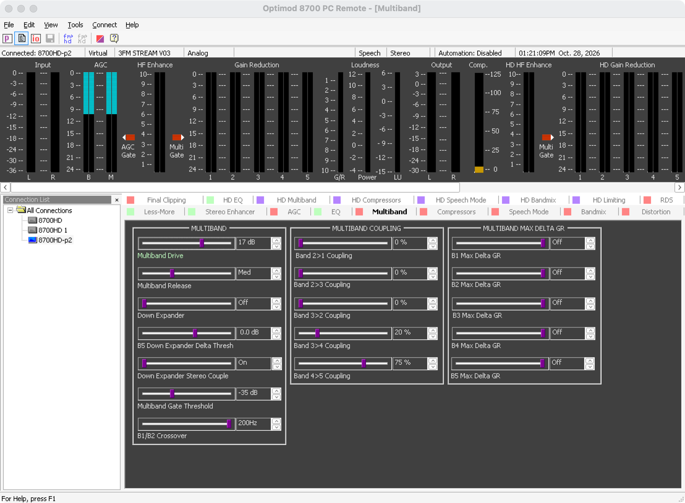

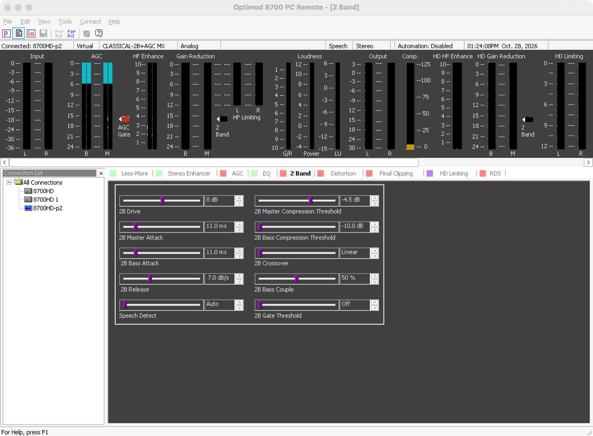
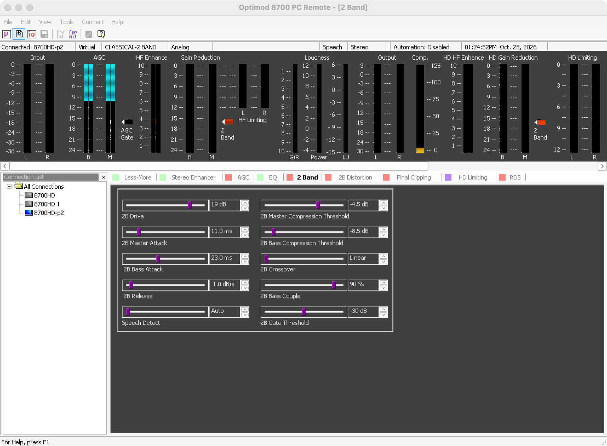
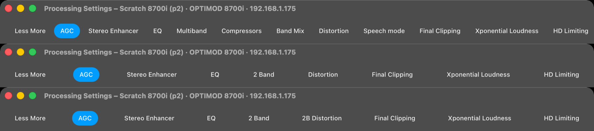
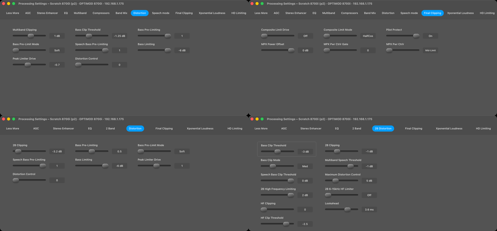

## 2. Every Processing page in the running app

Every tab of the 8700HD (`CLASSICAL-5 BAND`) and the 8700i (three structures) was pressed in the running app (`tab KIND N` test hook = a click on the tab) and captured at the Figma size, then compared with frame 150:3651 — the only Processing frame in the Figma file (the AGC page); the other pages follow its components.

| Found | Fixed |
|---|---|
| Extracted pages listed controls in the order the client binds them, which jumps around the dialog; the 8700HD AGC page did not read like the Figma frame. | Controls of extracted pages follow the client's dialog column by column — for the AGC page exactly the Figma order. The page switch stays first. (`07910c8`, `c9324ec`) |
| Group titles lost their acronyms (*Lf Shelf Equalizer*, *Max Delta Gr*). | *LF Shelf Equalizer*, *HF Contour*, *Max Delta GR*. |
| Long choices ended in an ellipsis (*18 dB/…*). | A tighter type for long values (*12 dB/oct*). |
| The outlined switch box was drawn around any first control (*Bass Clip Threshold*). | Only the page's on/off switch gets it. (`f8553cb`) |
| A page taller than the window (8700HD Equalizer, six groups) pushed the tab bar away. | The tab bar stays; only the page scrolls; groups sit closer so most pages fit 1133 × 500. |
| The "statically derived profile" line under the controls. | Removed everywhere (Mark: it must be right, not annotated). |
| The action-bar icons were redrawn approximations. | The five icons are the paths exported from the design file (nodes 150:2755, 2759, 2763, 2767, 2771). (`983a5e9`) |

Meters (Mark's instructions during the run): meters are drawn at their real size and spacing, never scaled or spread; a smaller window scrolls; the Meters window opens wide enough for its model's meters (the page reports the size, `c9324ec`, `b60d5d1`).

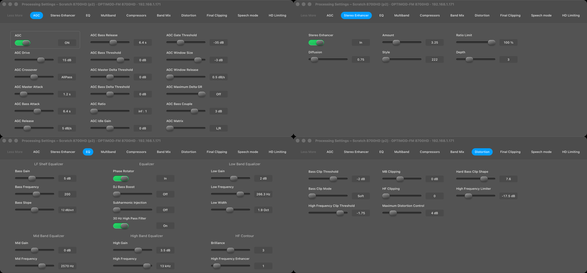
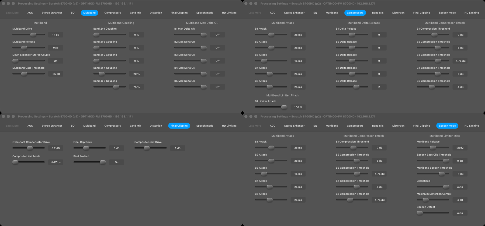
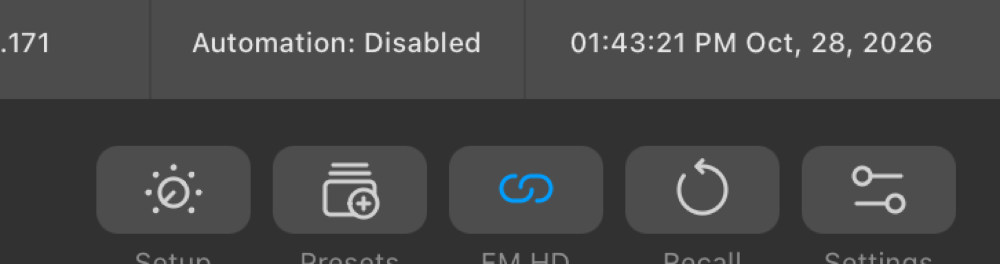
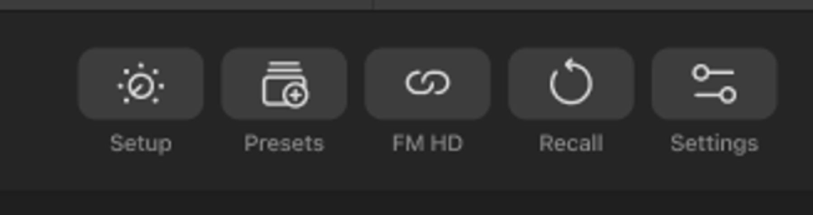
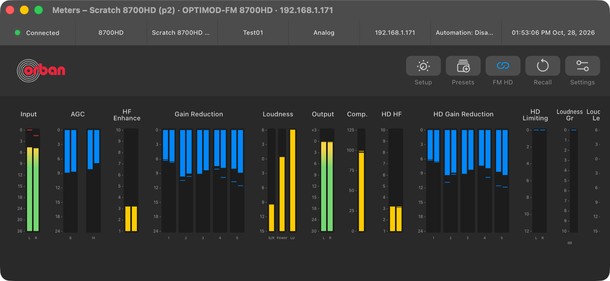

## 3. 5700i 2-band meters with a live signal

The scratch 5700i ran with the emulator's noise generator on its analog input (`--signal noise`, −12 dBFS, no audio device), `INPUT A OR D` set to Analog and `CLASSICAL-2 BAND` on air. The original 5700i PC Remote 3.0.1.20 was connected to the same unit (its own *New 5700i* dialog). Because the unit takes one PC Remote session at a time and the 2-band release (1 dB/s) makes the readings drift, the values were read **at the moment of each client screenshot** from the unit's own network log (the meter frames it sent to the client), and the client's bars were measured in pixels (lane 323 px, 0.3 % per pixel):

| Reading | Client bar B / M (FM) | Values 64 / 65 | Client HD B / M | Values 49 / 50 |
|---|---|---|---|---|
| 1 | 15.2 % / 52.3 % | 13.7 / 51.2 | 15.2 % / 51.1 % | 12.9 / 50.2 |
| 2 | 17.6 % / 48.6 % | 16.2 / 48.2 | 17.6 % / 48.6 % | 16.3 / 48.2 |
| 3 | 17.6 % / 49.8 % | 16.4 / 48.3 | 17.6 % / 48.6 % | 16.2 / 47.4 |

(The master threshold was lowered on the scratch unit so B and M differ clearly.) The client draws the values linearly, B = 64 and M = 65, HD B = 49 and M = 50 — what the app does. The AGC bar (value 3 = 42) reads 41.2 % in the client.

**Found and fixed** (`c635e21`): the client's 2-band view also draws **HF Limiting** (values 21/22, L/R) next to the 2-band gain reduction; the app's 5700i meters lacked it. It is there now, only in 2-band.

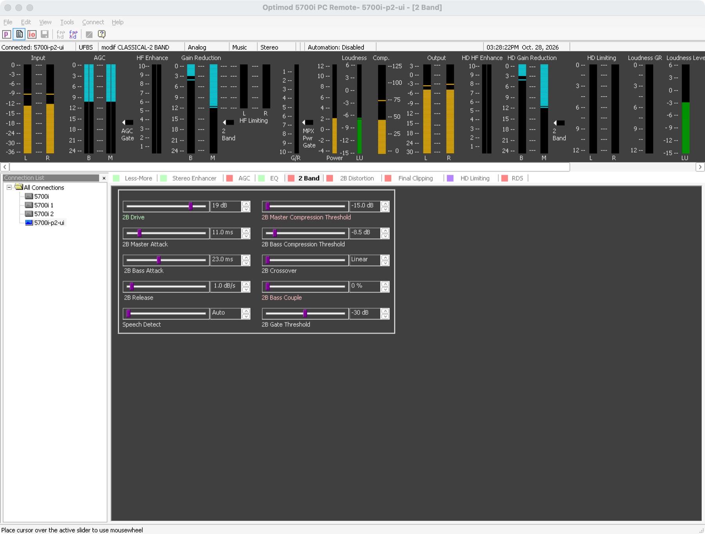
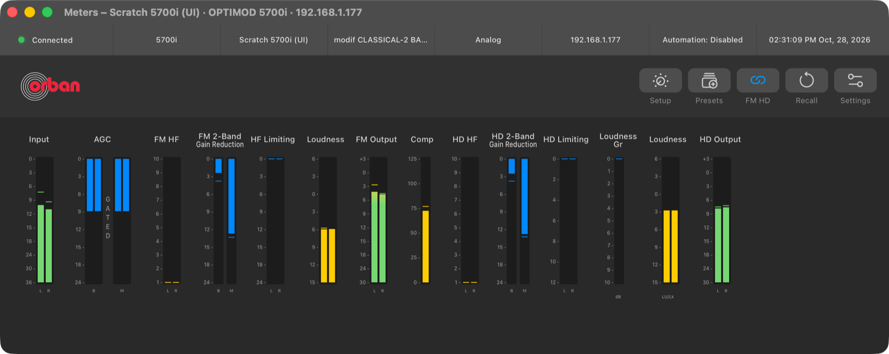

## Checks

`cargo test --workspace`, clippy, fmt, 69 UI tests (new: MX switch matrix of the client, an MX 5700i's single tabs, linked compressors, reading order, the 5700i 2-band HF limiter), the UI build, the Swift test programs and the documentation audit: all PASS.

## Open

- The *Active Input* status (`ACTUAL A OR D`) in the Meters strip refreshes only with the next full document read after a change of the preferred input.
