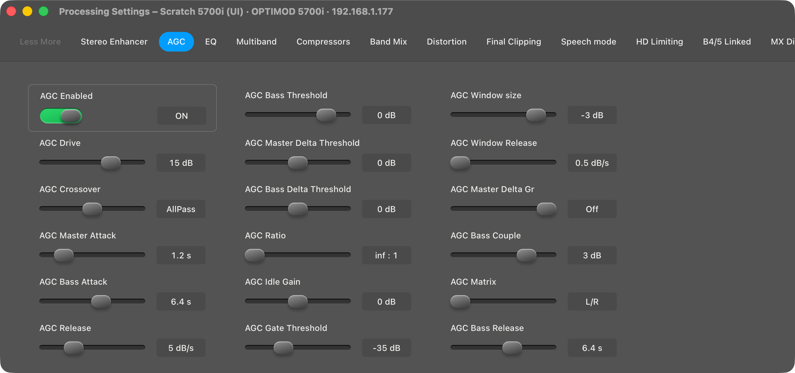
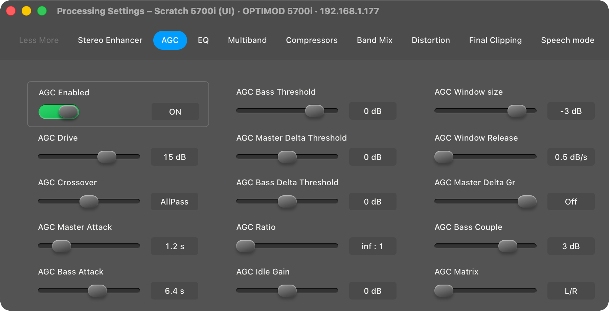
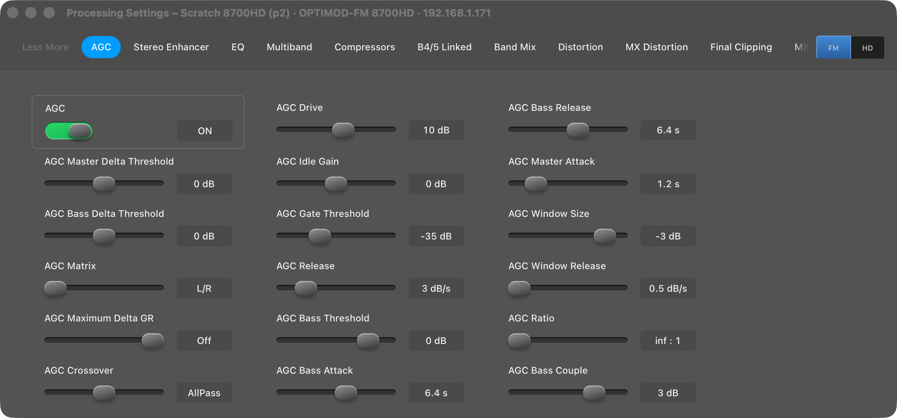
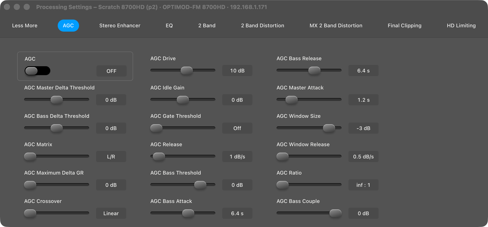
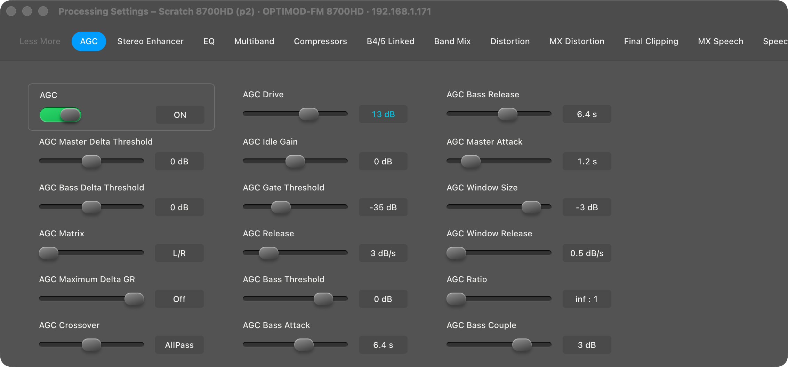

# UI Phase 4: the Figma Processing Settings window

> **Evidence status:** run in the real macOS app (test build on port 15701, isolated data) on 28 October 2026 against the scratch 8700HD 1.0.2.161 (192.168.1.171) and the scratch 5700i 3.0.1.20 (192.168.1.177), original firmware, no audio devices. One processing write and two Recalls were made on the scratch 8700HD; it was left on its own unmodified `3FM STREAM V03`. Nothing was written to the 5700i.

Design: [Processing Settings frame 150:3651](https://www.figma.com/design/SuuJ8vDRPnxEOPflDeYL7c/Optimod?node-id=150-3651), 1133 × 500.

## What changed

| Area | Before | Now |
|---|---|---|
| Pages per structure | A page showed when *any* of its controls was in the on-air document. The 8700HD showed *2 Band* and *2 Band Distortion* in a 5-band preset, because they share `MB GATE THR` and `SPEECH THR` with it. | 2-band pages (title with *2 Band*) show only while the document has `2B DRIVE`; 5-band pages (Multiband, Compressors, B4/5 Linked, Band Mix, Distortion, Speech Mode and their MX forms) only while it has `B1 ATTACK`; HD pages use `HD 2B DRIVE` / `HD B1 ATTACK`. The same rule as the Meters window (Phase 3). The 5700i's built-in pages follow it too. |
| Controls | A control without a field in the document was drawn empty and disabled. | Only controls in the on-air document are drawn. |
| Order | The PC Remote's dialog order. | The same, with the page's on/off switch first in the outlined box, as in the design (*AGC Enabled*). |
| Tab bar | Long titles; the bar overflowed and cut tabs. | Short names in the design's style (EQ, B4/5 Linked, Distortion, MX Distortion, MX Speech, Speech mode; full title as tooltip), spread over the width. A model with more pages than fit scrolls the bar; the FM/HD choice stays pinned at the right edge. |
| Evidence note | A yellow banner above the tabs. | A quiet line under the controls; the design has no banner. |

## Runs

| Step | Result |
|---|---|
| 5700i, 5-band preset, AGC page at 1133 × 500 | tab order and control order of the Figma frame (Less More, Stereo Enhancer, AGC, EQ, Multiband, Compressors, Band Mix, Distortion, Final Clipping, Speech mode; AGC Enabled, Drive, Crossover, Master Attack, Bass Attack, Release, …); after them the pages this unit adds (HD Limiting, B4/5 Linked, MX) |
| Same at 900 pt | three columns, no clipping |
| 8700HD, `3FM STREAM V03` (5-band, MX, FM/HD independent) | no 2-band page; FM/HD selector visible while the tab bar scrolls |
| Write AGC Drive 10 → 13 dB | confirmed by readback in 7.0 s; value shown in the design's cyan as modified; preset `modif 3FM STREAM V03` |
| Recall `CLASSICAL-2 BAND` | pages Less More, AGC, Stereo Enhancer, EQ, 2 Band, 2 Band Distortion, MX 2 Band Distortion, Final Clipping, HD Limiting; no 5-band page |
| Recall `3FM STREAM V03` | back to the unit's own preset, unmodified |
| Meters and Processing open together; close/reopen, resize to 900 pt and back, minimize/restore Processing | same session, 0 extra logins, 0 writes, one meter reader (Meters only) |

## Screenshots

## Checks

`cargo test --workspace` (135 passed), clippy, fmt, 65 UI tests (new: 2-/5-band pages of the 8700HD with shared fields, control filtering and switch order), the UI build, the nine Swift test programs and the documentation audit: all PASS.

## Open

- Tabs were switched in the app only through the page state; the other pages were checked with the same filter in the tests and in the 2-band/5-band tab bars, not one by one on screen.
- Whether the original clients show *Distortion Control* and *MX Distortion Control* side by side in an MX preset is not checked; both are in the MX document and both are shown.
- Writes on models other than the 8700HD and 5700i follow their model phases (8–14).
