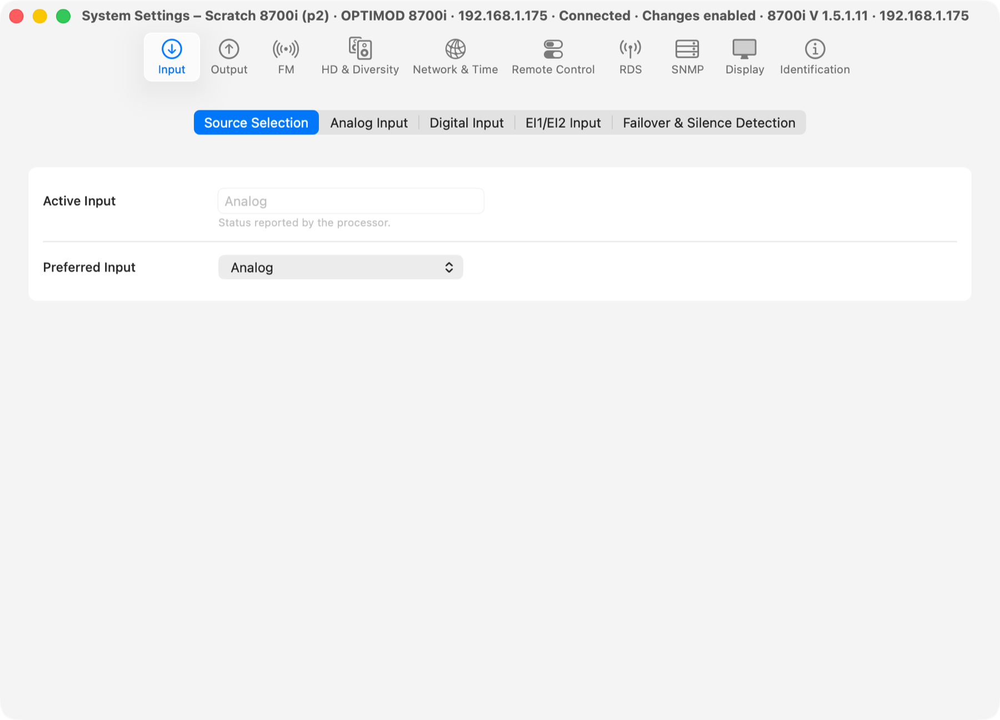
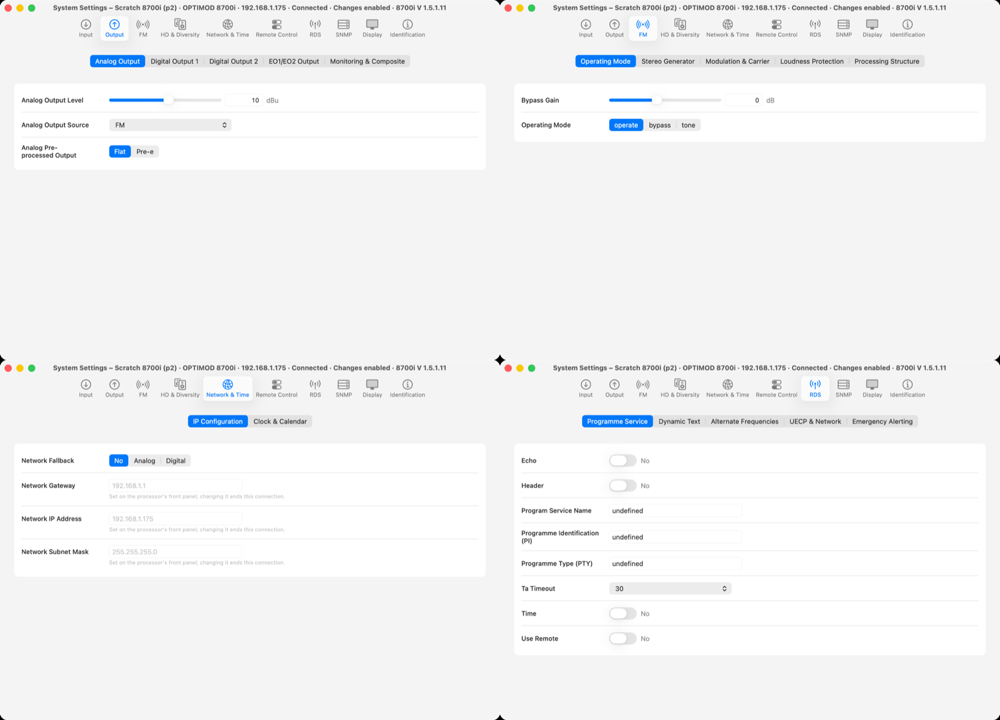
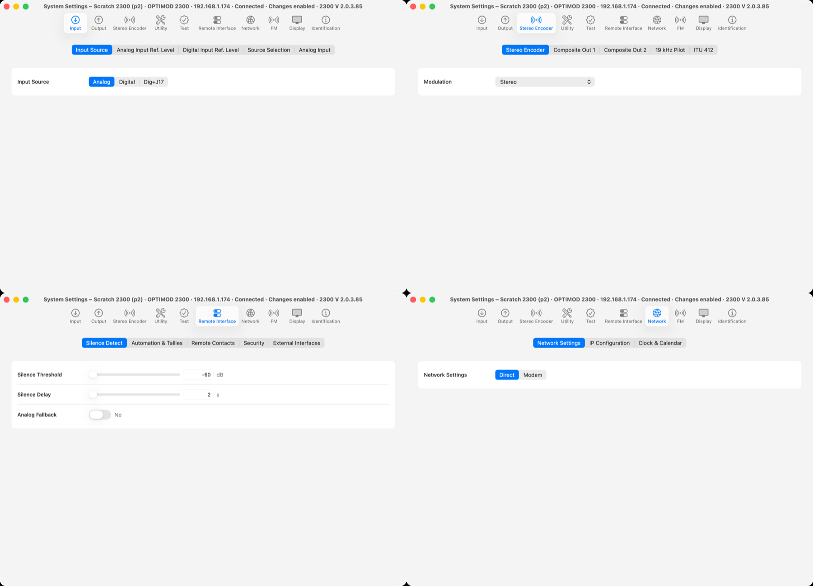
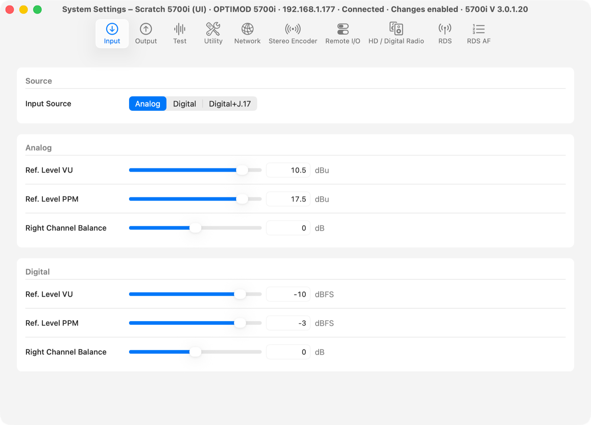

# UI Phase 5: native System Settings per processor

> **Evidence status:** run on 28 October 2026 in the real macOS app (test build on port 15701, isolated data) against virtual units running original firmware, without audio devices: the scratch 8700i 1.5.1.11 (192.168.1.175), 2300 2.0.3.85 (192.168.1.174) and 5700i 3.0.1.20 (192.168.1.177). Every write was made on these scratch units, confirmed by reading the processor back, and set back; the unit folders were restored afterwards. No physical processor was touched.

## What changed

| Area | Before | Now |
|---|---|---|
| Pages | Every System field grouped by name patterns shared by all models. | The original client's **own Setup pages** where they can be extracted from its dialogs — titles, labels and group boxes (8700HD: 14 pages, 2300: 7; `system-layouts.json`). Fields the processor reports that are on no client page follow in groups, and join the client page of the same subject (Network & Time → *Network*, Remote Control → *Remote Interface*). The 5700i keeps its hand-made worksheet. |
| Values | A field without a verified definition showed an empty, disabled picker with "not verified for this firmware". | Controls come only from that model's own definitions (the 8700i's input choices include Dante 1/2, the 5700i's do not). A field whose values cannot be named exactly is not shown. No evidence disclaimers. |
| Text | All text read-only. | Names (Station ID, RDS, SNMP, MP3 server) are typed and confirmed by readback. The connected unit's own network address and the remote-contact functions stay read only, with the reason. |
| Device scope | One window, not bound to a processor; it loaded once. | One window per processor (its saved connection), frame kept per processor. It follows the app's single state reader — the service's document revision — so a change made elsewhere (another window, the front panel, another client) appears without polling or a connection of its own. Another processor connected shows this window *Offline*, never that processor's data. Phase 6 can open several side by side. |
| Errors | — | A stale value is refused (*This setting changed elsewhere*); an unconfirmed write shows what the processor holds and is logged. |

The 8700i, 5500i and 6300 clients build their Setup dialogs through routines the extractor does not know yet, so those models use the grouped profile fields (model 9, 10 and 12 phases can add their client pages).

## Runs

| Step | Result |
|---|---|
| 8700i: open System Settings next to Meters and Processing | own window, subtitle with the processor; 10 tabs from its 212 System fields |
| 8700i: Preferred Input Analog → Digital through the service, window untouched | confirmed by readback in 7.0 s; the window showed *Digital* on its own; set back to Analog (6.9 s) |
| 8700i: Station ID → `OOR P5`, then a stale write, then back | 5.7 s confirmed; stale write refused with 409; restored (6.8 s) |
| 2300: client pages | Input, Output, Stereo Encoder, Utility, Test, Remote Interface, Network (client titles and group boxes), then FM, Display, Identification |
| 2300: Analog pre-emphasis Flat → Pre-e → Flat; Analog OUT 10.0 → 10.1 → 10.0 dBu | each confirmed by readback in 6.4–6.7 s |
| 2300: show Meters, Processing, System Settings; close and reopen Settings; minimize/restore Processing; close/reopen Meters | same session, 0 extra logins, 0 extra writes, one meter reader |
| 5700i: System Settings | the 5700i worksheet, bound to the processor |

## Screenshots

## Checks

`cargo test --workspace`, clippy, fmt, 69 UI tests, the UI build, the Swift test programs (`DeviceWindowsTests` now covers client-page sections, reading order, read-only status and text policies) and the documentation audit: all PASS.

## Open

- Client Setup pages for the 8700i, 5500i and 6300 (their binder routines), and the 8400's own setup screens.
- The 8700HD client pages were not exercised live: the scratch 8700HD was in someone else's use.
