# 8400 Processing Settings: processing categories instead of numbered pages

> **Evidence status:** run on 29 October 2026 in the real macOS app (test build on port 15701, isolated data) connected to the scratch 8400 (virtual unit, original 3.0.5 firmware, 192.168.1.176). Both structures were shown on the unit: 2-band (factory preset CLASSICAL-2B+AGC) and 5-band (`2B/5B SWITCH` written to 5band). Afterwards CLASSICAL-2B+AGC was recalled again, unmodified, and the unit was stopped.

## Cause

`profiles/8400/3.0.5.7/layouts.json` had the client's numbered Advanced Modify pages with `groups: []` and every control at `x: 0`: the 8400 PC Remote builds them as PEG list screens without group boxes. `groupProcessingPage` therefore made one group per page, and the CSS hides the heading of a single group. Advanced Modify 6 and 7 also had no structure condition, so they appeared in 2-band, where page 7 repeated the clipping controls of 2-band page 5.

## Fix

- `scripts/extract_8400.py` `APP_PAGES`: explicit grouping per client page and structure, after the Advanced Modify headings of Orban's 8400 V3.0 worksheet (Stereo Enhancer, AGC, Equalizer, Multiband, MB Attack/Rel, Band Mix, Two Band, Clippers) and in the client's row order. The extractor stops when a control is missing, unknown or placed twice.
- Pages 6 and 7 hold 5-band-only controls (worksheet: Band Mix, HardClipShape) and are now 5-band only.
- `layouts.json` pages carry `sections`; `groupProcessingPage` uses them instead of coordinates. Parameter IDs, ranges, protocol and other models are unchanged (`parameters.json` and `system-layouts.json` regenerate byte-identical).
- Processing Settings tab bar (all models): tabs sit from the left, 4 pt apart, instead of spread over the width; the FM/HD selector stays at the right.
- Choice buttons (AGC Ratio, Bass Clip Mode, Lookahead) share one row in equal widths.
- Device tab strip: a tab added to a window that does not resize stayed in a zero-width strip (constraint set after the layout pass). Seen during this run; fixed in `DeviceTabs.swift`.

| Structure | Tabs |
|---|---|
| 5-band | Less More · Stereo Enhancer · AGC · EQ · Multiband · Dynamics · Band Mix · Coupling · Clipping |
| 2-band | Less More · Stereo Enhancer · AGC · EQ · Two Band · Clipping |

HD functions sit with their category: HD Equalizer (EQ), HD De-Ess (Multiband), HD Limiter (Clipping).

## Runs

| Check | Result |
|---|---|
| 2-band, every tab at 1133 × 568 | PASS: headings readable, no clipping or overlap; long pages scroll under the tab bar |
| 5-band, every tab at 1133 × 820 | PASS (after two CSS corrections found here: one-section pages kept their heading, Band Output spans two columns) |
| Every control exactly once per structure | PASS: UI test `the 8400 shows Less-More and the processing categories…` and the extractor check |
| UI suite | 75/75 pass; `tsc -b` clean |
| Swift | DeviceWindowsTests pass |
| Rust | workspace pass (the 8400 meter-port test needs UDP 16540 free: it failed while the test app was connected, passed after disconnecting) |

## Screenshots

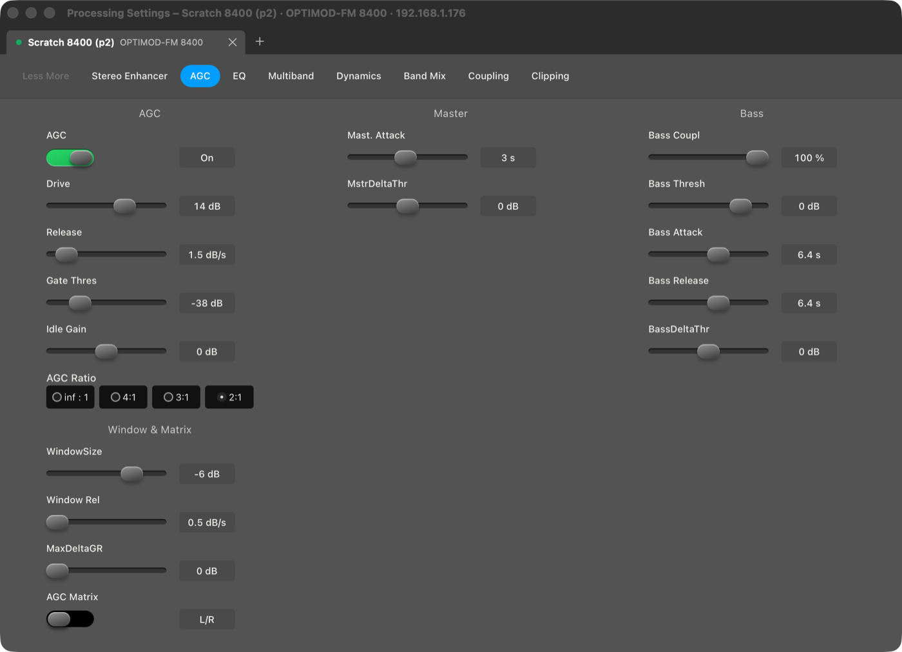
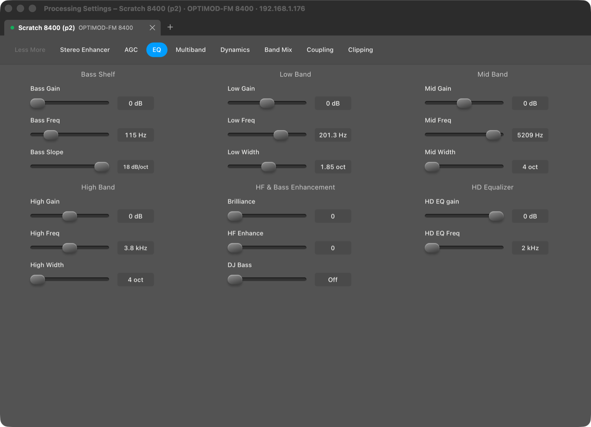
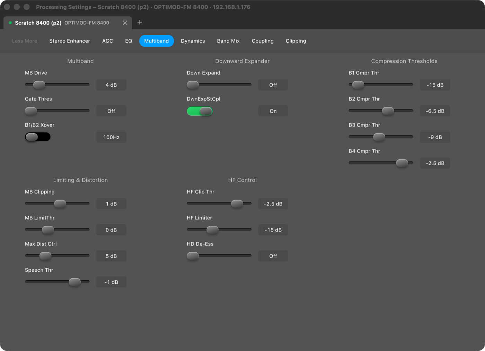
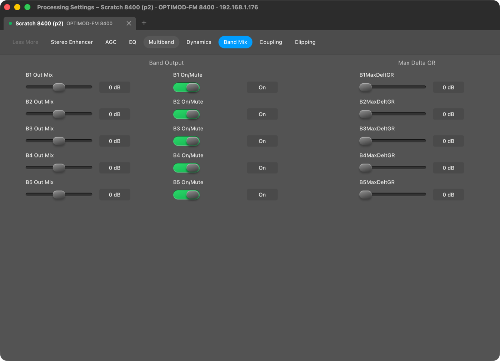
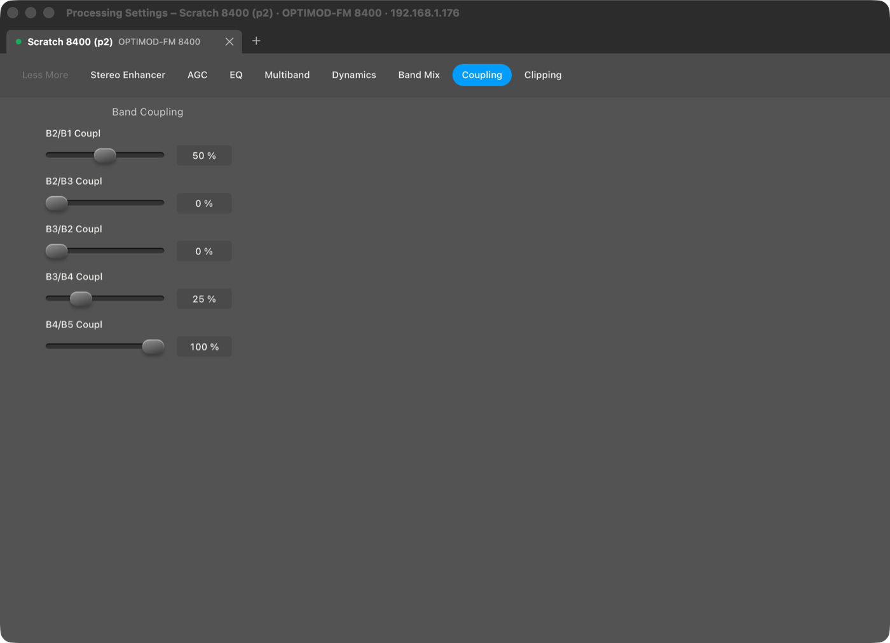
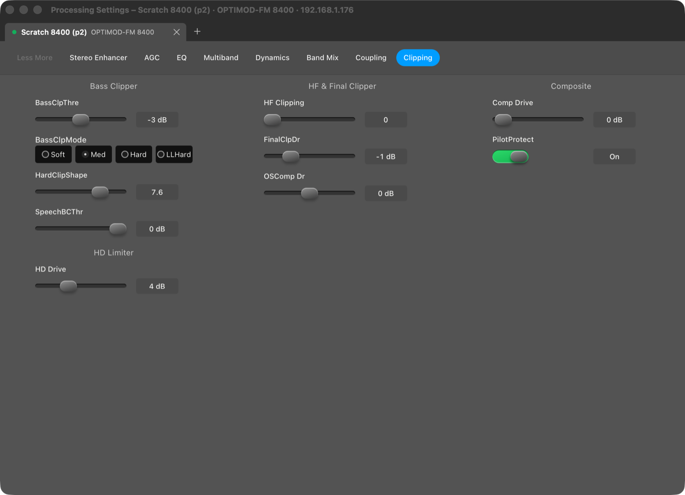
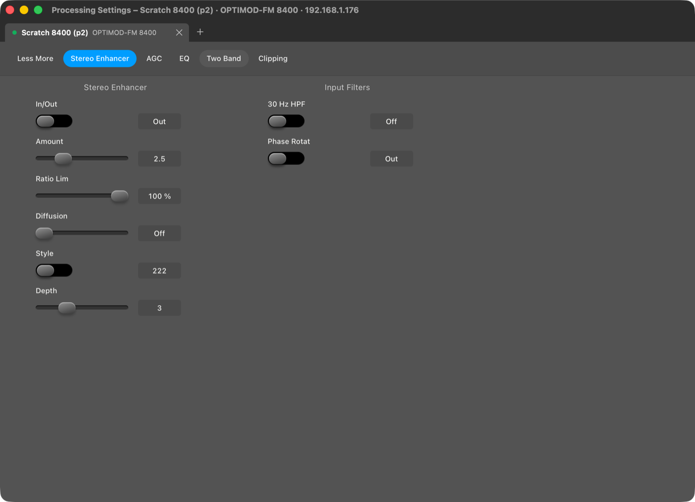
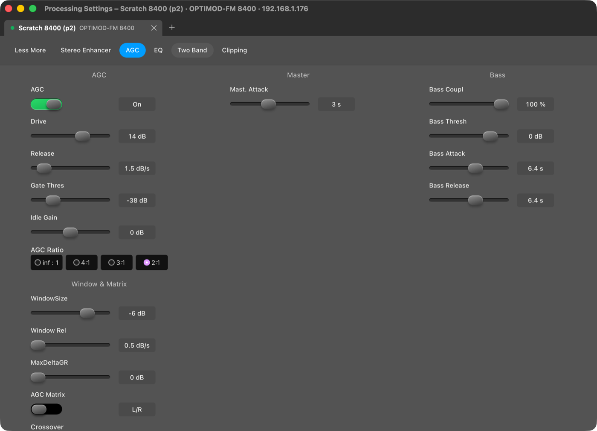
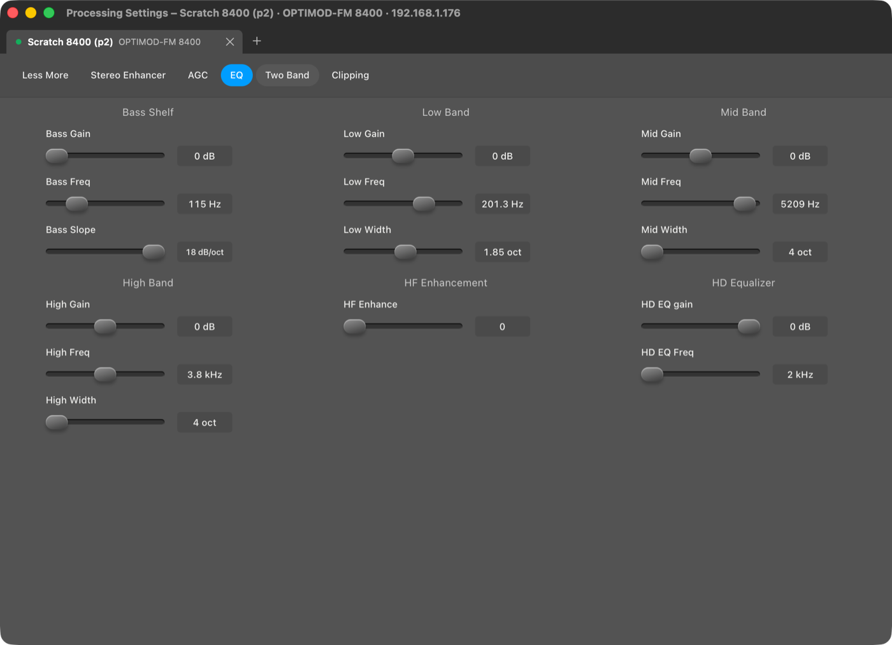
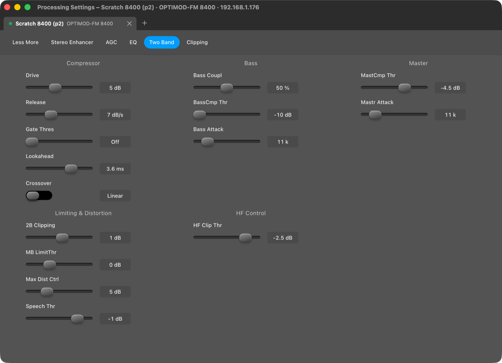
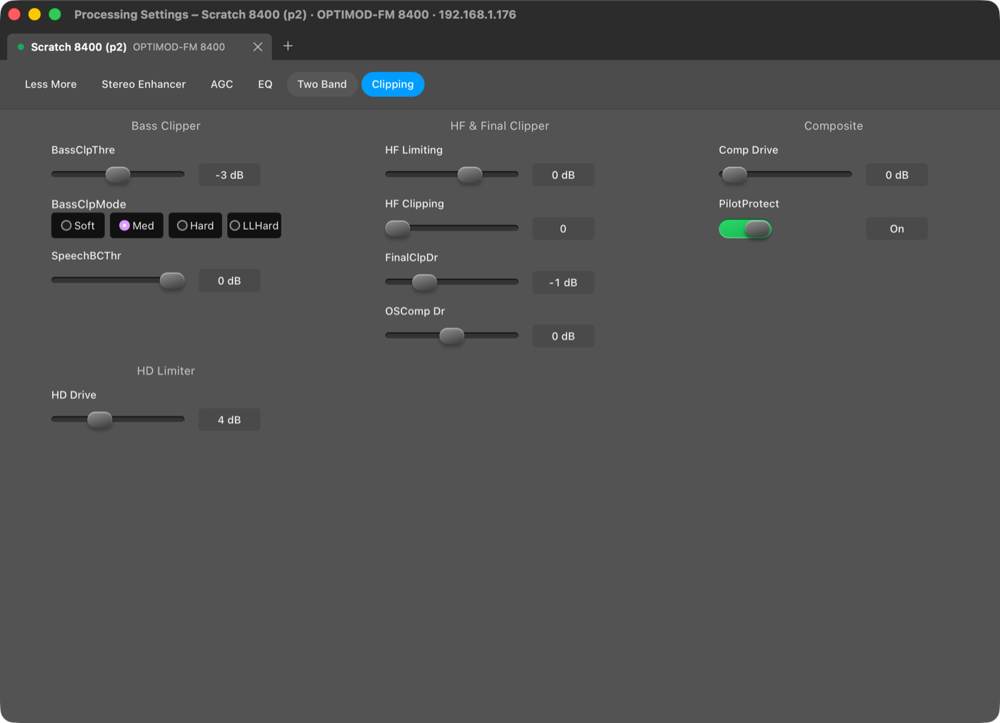

## Update signing key

- The Sparkle private key is only in `~/.config/open-optimod-remote/sparkle-ed25519.key` (file 0600, folder 0700), outside the repository.
- Git history: all 1,344 blobs of the repository (every branch, after a fetch) searched for the key; not found. No copy in `dist/`, `target/` or the Phase 8/9 rig either. It was never exposed, so it was not rotated.
- `.gitignore` now excludes `*.key`, `*ed25519*` (except `.pub`), `*.p8`, `*.p12`, `*.pem`.
- `scripts/check-update-key.sh`: checks location, permissions, ignore rule, that the key matches `SUPublicEDKey`, and that Sparkle's `sign_update` signs and verifies with it, without printing key material. Run: OK.
- `scripts/backup-update-key.sh [FOLDER]`: AES-256 encrypted disk image (default iCloud Drive/Open Optimod Remote), passphrase typed in macOS dialogs. The passphrase is the owner's, so this backup is made by Mark.
- `release-macos.sh` already read the key from `SPARKLE_ED_KEY_FILE` (default the location above); unchanged apart from a pointer to both scripts.
