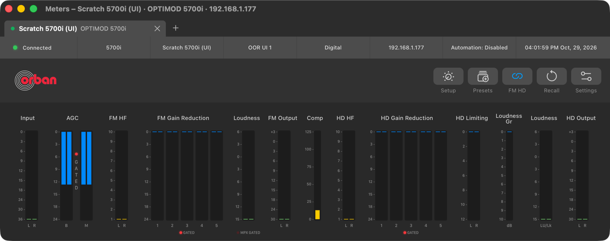
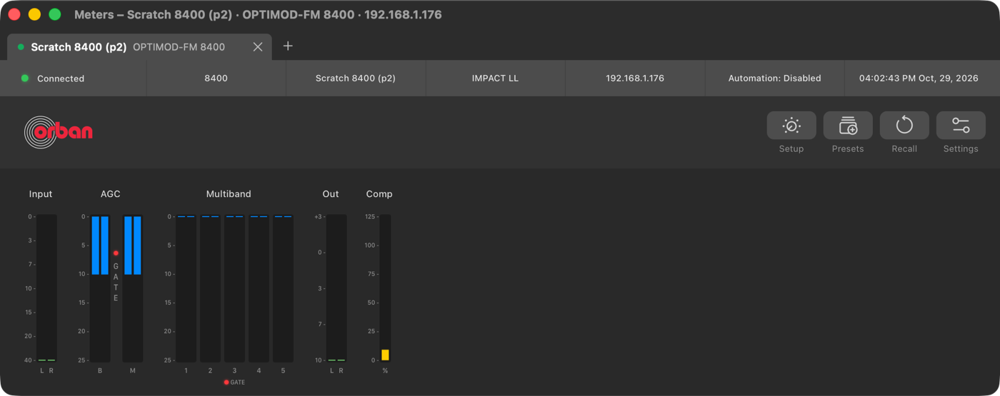

# Phase 10: model-by-model verification matrix

> **Evidence status:** 29 October 2026, branch `fix/5700i-recall-session`. "Firmware" = the model's original, unmodified firmware running in the Optimod emulator on an isolated scratch unit; "client" = the model's own original Windows PC Remote, unmodified, under CrossOver, driven only through its own window messages. PASS = verified end to end with that evidence; FAIL = verified not working; BLOCKED = the evidence named is not available; UNTESTED = possible but not done; N/A = proven absent in the model's client. No physical processor was written to. **No model is claimed to have full Windows PC Remote parity**: every model still has BLOCKED or UNTESTED rows.

## Shared to every model

| Function | Status | Evidence |
|---|---|---|
| Several processors at once, one tab and session each | PASS | [Phase 6](2026-10-29-ui-phase6-concurrent-sessions.md), [Phase 9](2026-10-29-phase9-release-qa.md) |
| No model's opcodes or file extensions on another model's wire | PASS | `each_model_uses_only_its_own_file_names` and the per-model wire tests (Rust suite) |
| Physical hardware acceptance (except the 5700i's read-only checks) | BLOCKED | no physical 8400, 8700HD, 8700i, 6300, 2300, 5500 or 5500i available |
| 8-hour multi-session soak | BLOCKED | deferred by the owner to final acceptance |

## 5700i (3.0.1.20) — physical unit available read-only

| Function | Status | Evidence |
|---|---|---|
| Connect, sync, Recall, Save/Save As/Delete, Backup/Restore, Automation, Security, Diagnostics, Setup (11 tabs), access levels, Couple/Uncouple, RDS | PASS | [function matrix](5700i-function-matrix.md) |
| Physical 5-band behaviour (read-only, without TCP 23) | PASS | [#18](2026-10-29-issue-18-status-port-sync.md) |
| AGC Gate, MPX Pwr Gate lamps lit | PASS | [M1B](2026-10-28-m1b-meter-ballistics-gates.md) |
| FM Multi Gate (63), HD Multi Gate (38) lamps lit | PASS: 127 on the silent unit, lit in the native app (MPX Pwr Gate 0, dark) |  |
| Every control's range and step against the firmware | UNTESTED | ranges come from the verified profile |
| Nested connection groups | N/A | the client has no nested groups |
| 50-recall run, writes on the physical unit | BLOCKED | owner approval for writes on the physical unit |

## 5500 (1.2.8.24)

| Function | Status | Evidence |
|---|---|---|
| Every implemented function | PASS on a scripted unit only | [5500 full control](2026-10-29-5500-full-control.md) |
| Any function on 5500 firmware | BLOCKED | no 5500 firmware or unit |

## 5500i (3.1.0.2)

| Function | Status | Evidence |
|---|---|---|
| Sync, writes, Recall, Save As/Delete, Backup/Restore, Automation, Security, Diagnostics, Setup tabs, access levels | PASS | [M2](2026-10-28-m2-5500-5500i.md) |
| Meters under signal and processing pages against the client | UNTESTED | [M2](2026-10-28-m2-5500-5500i.md) |

## 8700HD (1.0.2.161)

| Function | Status | Evidence |
|---|---|---|
| Sync, writes, Recall, meters | PASS | [8700HD](2026-10-21-8700hd.md) |
| Save As, Delete, Backup, Restore, Security, Diagnostics | PASS (firmware): Backup 13 files each equal to the unit's own; Restore 1.5 s, no extra answer after the upload | [P10 files](2026-10-29-p10-8400-files-automation.md) |
| Automation | PASS on a scripted unit; firmware UNTESTED | `6b2460e` |

## 6300 (4.1.1.19)

| Function | Status | Evidence |
|---|---|---|
| Sync, writes, Recall | PASS | [6300](2026-10-21-6300.md) |
| Automation | PASS (client + firmware) | [P10 automation](2026-10-29-p10-6300-8700i-automation.md) |
| Save As, Delete, Backup, Security, Diagnostics | PASS (firmware) | [P10 files](2026-10-29-p10-8400-files-automation.md) |
| Restore | FAIL → fixed → PASS (firmware) | same |
| Meter scales against the client, dB vs LU loudness | UNTESTED | needs the client with live audio |

## 8700i (1.5.1.11)

| Function | Status | Evidence |
|---|---|---|
| Sync, writes, Recall | PASS | [8700i](2026-10-21-8700i.md) |
| Automation | PASS (client + firmware) | [P10 automation](2026-10-29-p10-6300-8700i-automation.md) |
| Save As, Delete, Backup, Restore, Security, Diagnostics | PASS (firmware) | [P10 files](2026-10-29-p10-8400-files-automation.md) |
| Meter mapping against the client | UNTESTED | |

## 2300 (2.0.3 / client 2.0.3.85)

| Function | Status | Evidence |
|---|---|---|
| Sync, writes, user Recall, factory Recall by installer upload | PASS | [2300](2026-10-21-2300.md), [2300 notes](../protocol/2300.md) |
| Save/Save As, Delete, Automation, Security, Backup, Restore | PASS (client capture + firmware) | [2300 notes](../protocol/2300.md) |
| Backup/Restore in the native Presets window | FAIL → fixed | this phase (`fdd19e1`) |
| Diagnostics access level 7 vs 0 | PASS: not an app defect, the unit's own state | [2300 notes](../protocol/2300.md) |
| Meter mapping against the client | UNTESTED | |

## 8400 (3.0.5 / 3.0.5.7)

| Function | Status | Evidence |
|---|---|---|
| Session, sync, writes, Recall, meters | PASS | [8400 notes](../protocol/8400.md) |
| Session drops in the soak | FAIL → fixed (app side); the unit's own drop also hits the original client | [stability](2026-10-29-8400-session-stability.md) |
| Save/Save As/Rename/Delete, Security | PASS (firmware) | [8400 notes](../protocol/8400.md) |
| Backup, Restore | PASS (client capture + firmware; Restore byte-identical to the client's) | [P10 files](2026-10-29-p10-8400-files-automation.md) |
| Automation list, write format, Enabled | PASS (client capture + firmware) | same |
| Automation execution at the event time | BLOCKED | the virtual unit ran no event, not even the client's own |
| AGC and multiband GATE lamps (5-band) | PASS: 127 on silence, lit in the client's meter screen and in the native app |  |
| Backup in the native Presets window | PASS: zip of 18 files, the client's file names | `fdd19e1` |
| 2-band GATE lamps | UNTESTED | the 2-band meter screen of the client was not seen |
