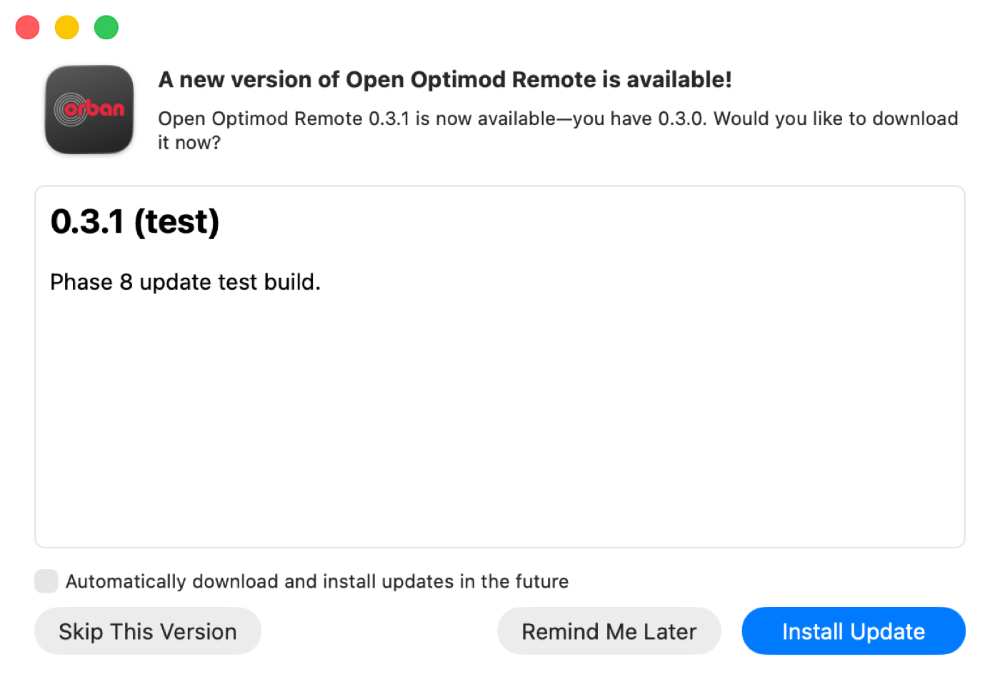
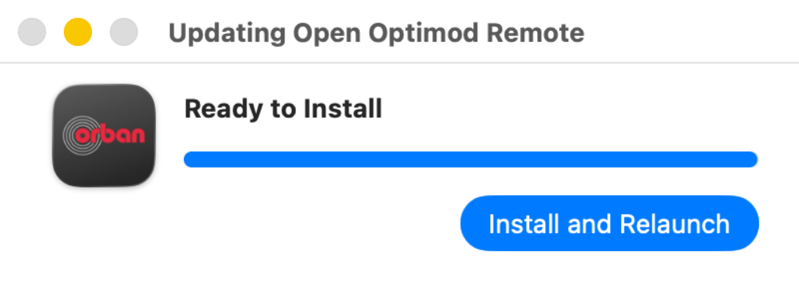
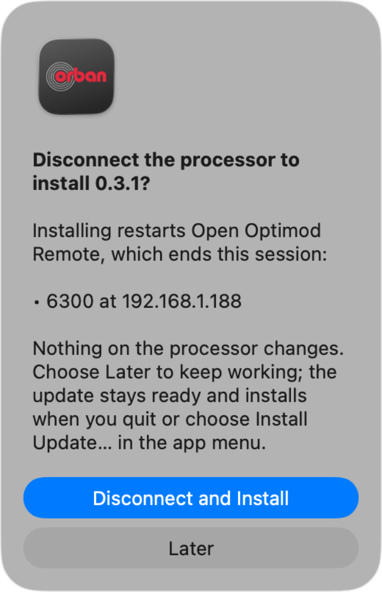
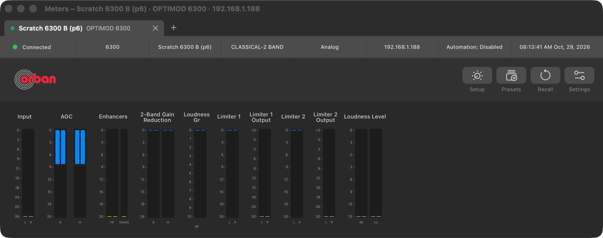
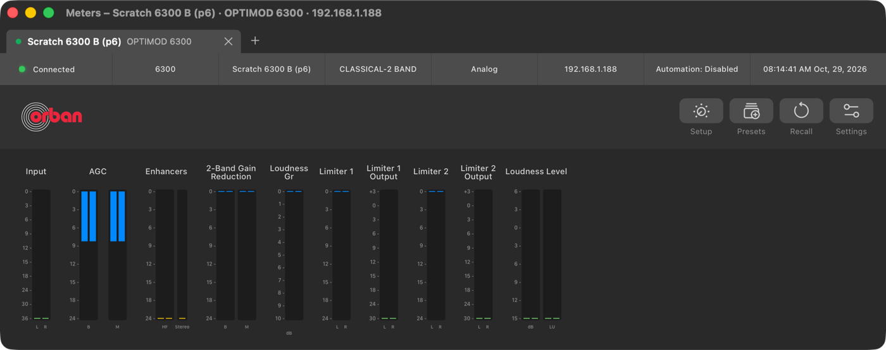
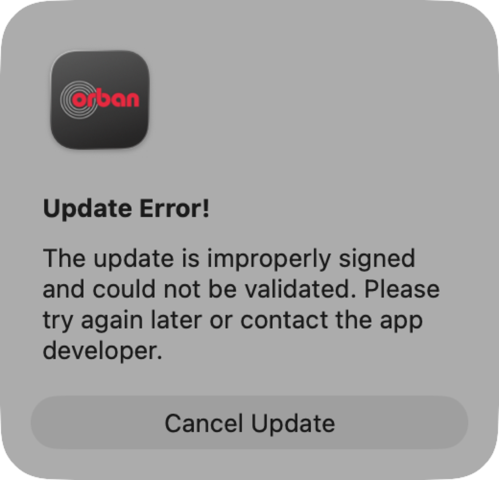
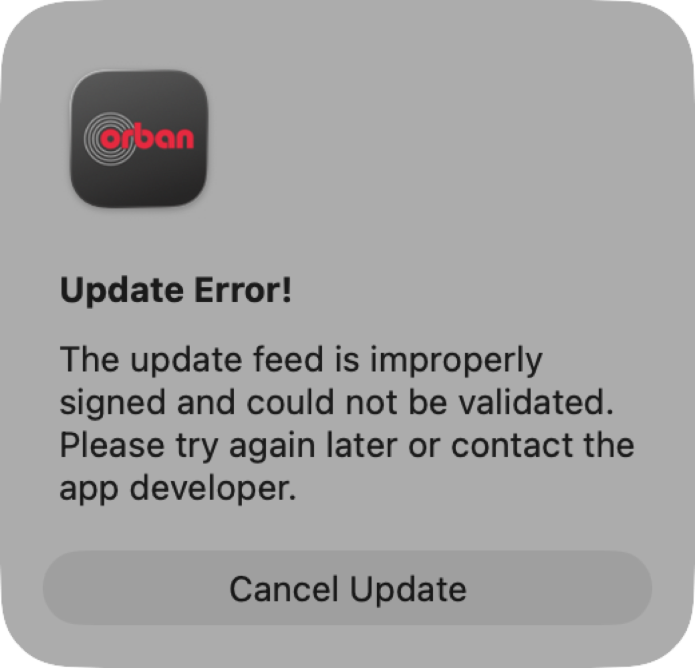
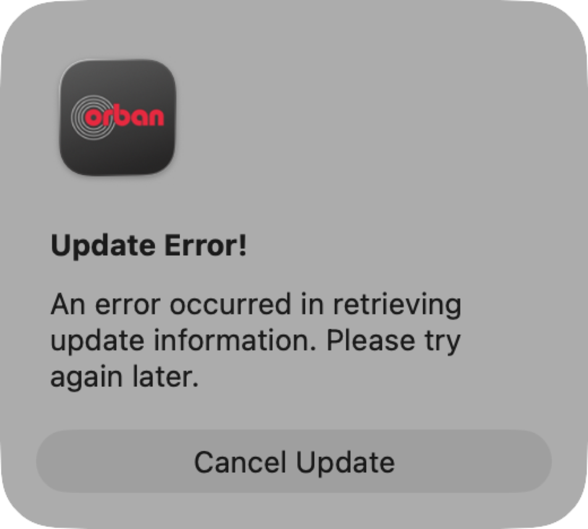
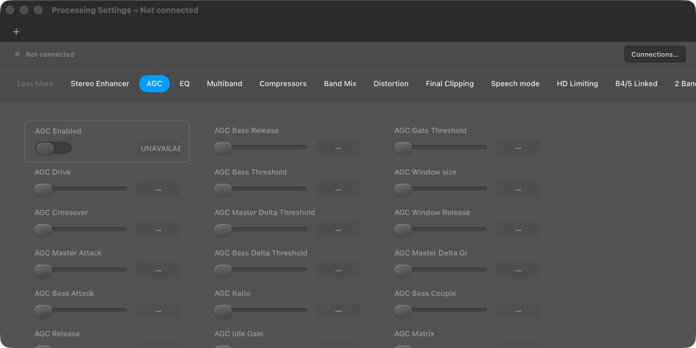

# Phase 8: distribution, signing, notarization and signed automatic updates

> **Evidence status:** run on 29 October 2026 on the development Mac (macOS 26) and the Mac mini (macOS 26.6.2, a separate machine). Update tests used Developer ID–signed test builds with their own bundle identifier (`org.openoptimod.remote.p8test`), their own data directory and port 15701, connected to the virtual 6300 on original firmware 4.1.1.19 (192.168.1.188, no audio, no writes). The owner's installed app, its preferences, saved connections and credentials were not used; their checksums and preferences were compared before and after (identical). Nothing was published.

## What was built

| Part | Implementation |
|---|---|
| Updater | Sparkle 2.10.0, downloaded once by `build-macos.sh` and pinned by SHA-256; embedded in `Contents/Frameworks`, XPC services removed (the app is not sandboxed), signed inside-out with hardened runtime and timestamp |
| Trust | one EdDSA key: public half `SUPublicEDKey` in Info.plist; private half only in `~/.config/open-optimod-remote/sparkle-ed25519.key` (0600, no keychain, never in the repository). `SURequireSignedFeed` + `SUVerifyUpdateBeforeExtraction`: the feed and each archive must be signed by that key |
| Feed | `https://raw.githubusercontent.com/marktunzi/open-optimod-remote/appcast/appcast.xml` (a branch holding only the signed appcast, created at the first release); archives are assets of the version's GitHub release |
| Checks | automatic once a day, and **Check for Updates…** in the app menu |
| Sessions | an update never ends a processor session by itself. If any processor is connected or reconnecting, *Install and Relaunch* asks **Disconnect and Install / Later**. Later keeps the update ready: it installs at Quit (Quit already ends every session cleanly) or via **Install Update 0.3.1…**, which appears in the app menu only while an update waits and asks the same question. Disconnect and Install ends every session as Disconnect does, waits until the service reports none, then installs |
| Preserved data | the update replaces only the bundle; connections, credentials, error log (Application Support) and preferences, including window positions (the bundle identifier's domain), stay where they are |
| Release script | `release-macos.sh VERSION BUILD [NOTES.html]` builds into `dist/release/VERSION/` (the dev build in `dist/` is not touched): Developer ID + hardened runtime + timestamp on every Mach-O, notarized and stapled app and DMG, Gatekeeper checks, the update zip of the stapled app, the signed appcast, a check that the key matches `SUPublicEDKey`, and `SHA256SUMS`. It publishes nothing |
| Test isolation | test settings (`OPEN_OPTIMOD_PORT`, `OPTIMOD_DATA_DIR`, `OPEN_OPTIMOD_WINDOW_CONTROL`, `OPEN_OPTIMOD_UPDATE_FEED`) can come from the app's own preferences, so a test build with its own bundle identifier keeps them across Sparkle's relaunch without reaching the installed app. The error log now follows `OPTIMOD_DATA_DIR` too |

## Results

| Gate item | Result |
|---|---|
| Release candidate 0.3.0 (build 4) | PASS: `dist/release/0.3.0`; app and DMG notarized and stapled, `spctl`: *accepted, source=Notarized Developer ID*; update zip EdDSA signature verified; DMG SHA-256 `914522ac…fe7c3bb` |
| Separate Mac (Mac mini, macOS 26.6.2) | PASS for Gatekeeper: the DMG copied over with a browser quarantine flag; `spctl` accepts DMG and app as *Notarized Developer ID*; `stapler validate`, `codesign --verify --deep --strict` and `syspolicy_check distribution` pass. **Launch not completed**: macOS holds the first open of a downloaded app until someone clicks *Open* at that Mac (the process waited in `dyld_start`); it is installed at `~/Applications/oor-p8/` there for that one click |
| Automatic check at launch | PASS: 0.3.0 found 0.3.1 and showed its release notes (01) |
| Update while a processor is connected | PASS: download and EdDSA check, then *Install and Relaunch* asks *Disconnect the processor to install 0.3.1?* naming *6300 at 192.168.1.188* (02, 03) |
| Later | PASS: the update waits (`pendingVersion 0.3.1`), same app process; the session stayed connected and live for over a minute (unit: one logged-in client; meters clock running) (04) |
| Install Update… | PASS: asks the same question again (05) |
| Disconnect and Install | PASS: session ended cleanly (unit: no session, no refused connection), 0.3.0 quit and 0.3.1 build 5 was running about 1 s later, still signed by Developer ID TF64FC48B5; it reconnected to the 6300 at once (06). The same path also passed twice by hand: two real clicks on *Disconnect and Install* during the runs (07:54:31 and 07:58:40) each installed and relaunched 0.3.1 within 0.5 s |
| No processor connected | PASS: *Install and Relaunch* installs at once without a question (in one run the scratch unit had been closed, so nothing was connected) |
| Settings after the update | PASS: `connections.json` and `credentials.json` byte-identical, test settings kept, all 5 saved window frames identical. A plain quit/relaunch also keeps frames exactly |
| Tampered archive | PASS: one byte changed in the zip → *The update is improperly signed and could not be validated*; 0.3.0 untouched (07) |
| Tampered feed | PASS: the download URL changed in the signed appcast → *The update feed is improperly signed*; nothing downloaded (08) |
| Feed unreachable | PASS: *An error occurred in retrieving update information*; app keeps working (09) |
| Owner's installation | PASS: Application Support checksums and the `org.openoptimod.remote` preferences identical before and after the runs |
| Unit tests | PASS: `UpdateCoreTests` (active-session detection from `/api/sessions`, an unreadable answer counts as *not idle*, question text, feed override, launch overrides from a preferences domain), `LauncherCoreTests` |

## Found and fixed during the phase

- A delegate method was spelled `untilInvoking:` instead of Sparkle's `untilInvokingBlock:`; it compiled with only a warning and would never have been called, so the session guard would have been skipped. Fixed before any update test.
- The first test runs set test settings with `launchctl setenv` and backed up and restored the installed app's preferences. That reached the owner's configuration, and the error log ignored the data directory, so one test entry landed in the real `errors.json`. That entry was removed, and the preferences were restored and verified identical to the backup. Testing now uses a separate bundle identifier and its own preferences domain only.
- The update question ran inside a main-queue block, which holds the main queue while it is open. It now starts from a run-loop block.
- *No route to host (os error 65)*: the network path was fine (ARP, ping, route on en0), and the unit never saw a TCP open. The same backend binary connected in 0.6 s when started from a shell, and failed only when started by the newly Developer ID–signed app. Cause: macOS Local Network privacy for the new code identity; it worked once allowed. **Every user will see this prompt on first launch** (the Info.plist text explains it).
- Processing Settings' *Not connected* strip was a brown development banner; it now follows the Figma design (status strip, grey lamp, one button) (10).

## Not verified here

- First launch through the Gatekeeper prompt on the Mac mini (needs one click on that Mac).
- The public feed: the `appcast` branch and GitHub release are created only at the first published release (Phase 9, after approval). The update path above used the same signed appcast and archive format served locally.
- Phase 6 combinations that were unverified stay as recorded in the Phase 6 document.

## Screenshots

