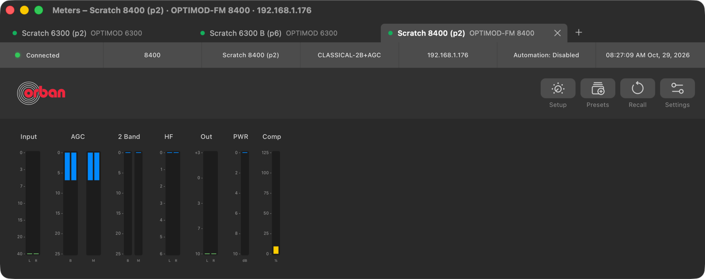
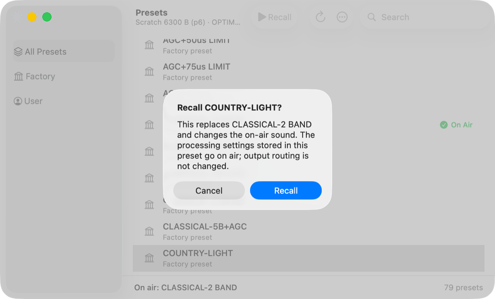
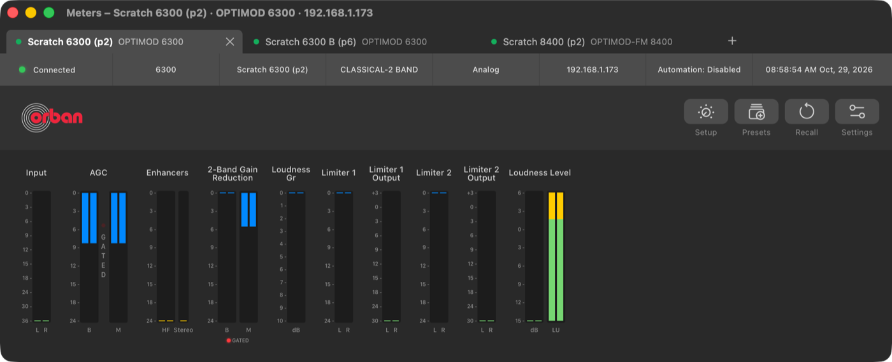
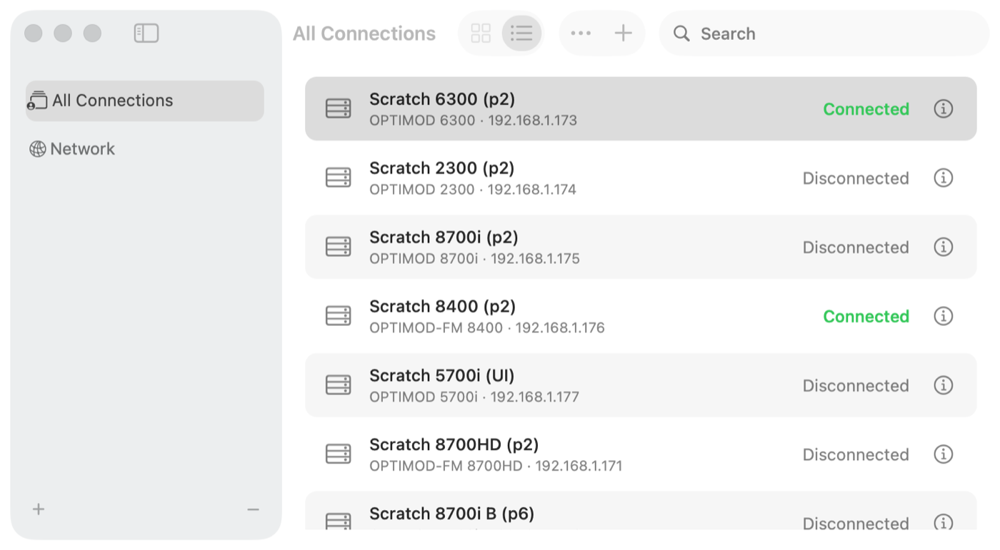

# Phase 9: platform QA of the 0.3.0 release candidate

> **Evidence status:** current candidate is **0.3.0 build 11** (`4a6f268`, see below). The matrix was run on 29 October 2026 on release candidate **0.3.0 build 9** (commit `168144a`, Developer ID, notarized; DMG SHA-256 `9274b4ad…e0e1`). Real-app tests used an identical twin of that commit with its own bundle identifier, data directory and port (`org.openoptimod.remote.p8test`, 15701), connected to three virtual units running original firmware without audio devices: 6300 4.1.1.19 at .173 and .188, and 8400 3.0.5.7 at .176. The owner's installed app, preferences, connections and credentials were not used, and their checksums were identical before and after. Nothing was published.

## Suites on the candidate source

| Suite | Result |
|---|---|
| Rust (`cargo test --workspace --release`) | 151 passed, 1 failed: `one_meter_port_serves_every_8400_by_its_address` needs UDP 16540, which the soak app held at the time (it passed before the soak; re-run below) |
| Clippy `-D warnings`, rustfmt | PASS |
| UI (`node --test`, `tsc -b`, build) | 75/75 PASS |
| Swift test programs (10) | PASS, including `UpdateCoreTests` and `ConnectionsWindowTests` |
| Documentation audit | PASS |

## Real-app matrix (candidate twin)

| Item | Result |
|---|---|
| Three processors at once, two of the same model (6300 ×2) and the 8400 (UDP meters) | PASS: three tabs, three sessions, three TCP connections, one login per unit (01) |
| Preset recall in one tab | PASS: COUNTRY-LIGHT recalled on 6300 .188 after the confirmation sheet (02); its revision went 1 → 2, while 6300 .173 (CLASSICAL-2 BAND) and the 8400 kept revision 1. Restored to CLASSICAL-2 BAND and read back |
| Update check against the candidate's own signed appcast | PASS: *Up to date* (0.3.0 build 7/9 vs the feed's same build) |
| Gatekeeper on a separate Mac (Mac mini, macOS 26.6.2), quarantined DMG of the candidate | PASS: DMG and app *Notarized Developer ID*, stapled, `syspolicy_check distribution` passes |
| Connections window, selected row | Fixed during this phase: the green status and the info button vanished on the blue selection; now white (04) |
| Transient *No route to host* on one unit after a quick disconnect/reconnect | Seen once on .173 (ARP and ping fine moments later); the next Connect succeeded. Not retried automatically, by design |

## Fixed during this phase (owner's review)

- **Release safety:** a single service guard (`require_writes`) now also covers parameter changes, automation and passcode files, Setup open/save, preset-file restore and applying a preset file. Before, these checked only the access level. The original 5500 (1.2.8.24) was briefly made read-only here; on the owner's instruction (29 October) its full control is back, with its own opcodes and profile, covered by scripted-unit tests ([5500 control](2026-10-29-5500-full-control.md)). Its firmware acceptance stays in Phase 10.
- **Gate lamps on every model:** they were drawn only for the 5700i. Each client registers its meter controls as `push INDEX; push "o_name"; call`. The extractor now reads the `o_gateIndicate*` lamps from that table, and on the 5700i it gives exactly the firmware-proven 62/63/38. Per client: 6300 69/70, 8700HD and 8700i 62/63 (HD 38), 5500i and 5500 36/37, 2300 38/39 (03). Not covered: the 8400, whose client is a different program, and the 8700i's ITU-412 lamp (111), because its group is not established. Whether these lamps light correctly needs live audio.
- **Meter captions:** lane, channel and unit labels now share one 8 px baseline (they were 6 px on three heights), and units are centred under the bars.
- **Processing Settings *Not connected* strip:** now follows the Figma design.

## Open questions recorded for Phase 10

- **6300 Loudness Level dB vs LU (owner's question):** the bars use different channels, exactly as the client registers them: dB = `o_LoudnessLevelL/R` (61/62), LU = BS.1770 `o_ST_BS1770LdnsLvl_1_l/r` (65/67). The client also has a short-term pair (66/68). Both share one tick scale here. The scratch units have no audio, so their values say nothing (LU pegged at 255). This needs a live-audio comparison with the original 6300 client.
- Gate lamps lit-state on the 6300, 8700HD, 8700i, 5500i and 2300 (static mapping; needs live audio).

## 8-hour multi-session soak

Not a Phase 9 gate any more: the owner stopped it (29 October, "we gaan geen 8 uur testen"); endurance moves to the final acceptance. The run on the build-10 twin (10:38–11:55, 76 one-minute samples, three sessions: 6300 .173 and .188, 8400 .176) was stopped at 11:55:

- Memory and handles: app RSS 135 → 162 MB, service 23.5 → 27.8 MB, service file descriptors 21 → 24; no growth trend over 77 minutes is claimed from this.
- The two 6300 sessions stayed connected throughout (one login each).
- **The 8400 session was lost six times between 10:40 and 11:08** (*not answered for 20 seconds*, once *Broken pipe*); each time the automatic reconnect brought it back, and it stayed up from 11:08 to the end. The virtual 8400 ran at about 230 % CPU next to the two 6300s; the cause was found in Phase 10: the app gave up after 20 s while the unit, slowed and dropping segments under host load, still held the session (fixed: 35 s, keepalive every 2 s); the *Broken pipe* is the unit ending the session itself. See [8400 session stability](2026-10-29-8400-session-stability.md).

## Release candidate build 11

Built 29 October 2026 from `4a6f268` (after the #18 fixes) with `release-macos.sh 0.3.0 11`: Developer ID, notarized and stapled (`spctl`: *Notarized Developer ID*; `stapler validate` OK), signed appcast. DMG SHA-256 `6b996313…d880`, ZIP `dab73329…2f46`. Build 10 is kept in `~/werk/oor-p8.noindex/rc-b10`. Nothing was published.

Suites on `4a6f268`: Rust 94 + protocol tests PASS (including `one_meter_port_serves_every_8400_by_its_address`, re-run with UDP 16540 free), clippy `-D warnings` and rustfmt PASS, UI tests and build PASS, the ten Swift test programs PASS, documentation audit PASS.

Changes since build 10: the 5700i runs over PC Remote alone when its status port does not answer (#18, closed), every change waits for a complete sync, and the Connections sidebar icons sit inside their selection.

## Screenshots

