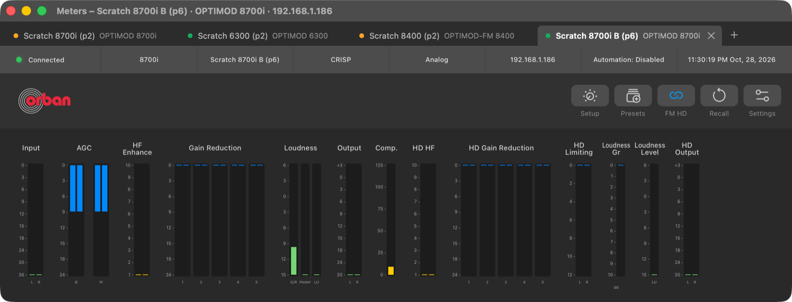
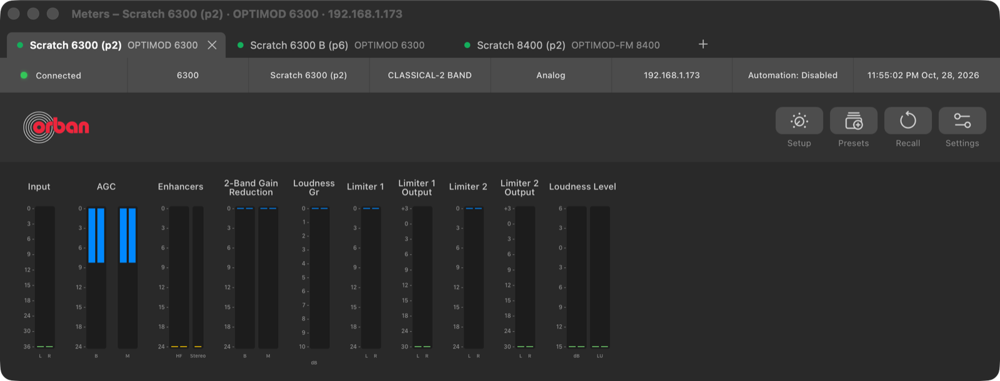
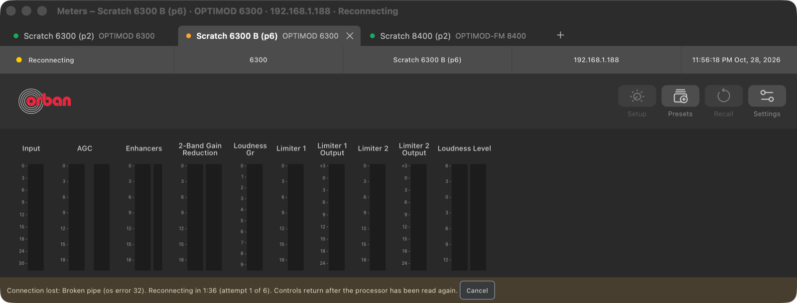
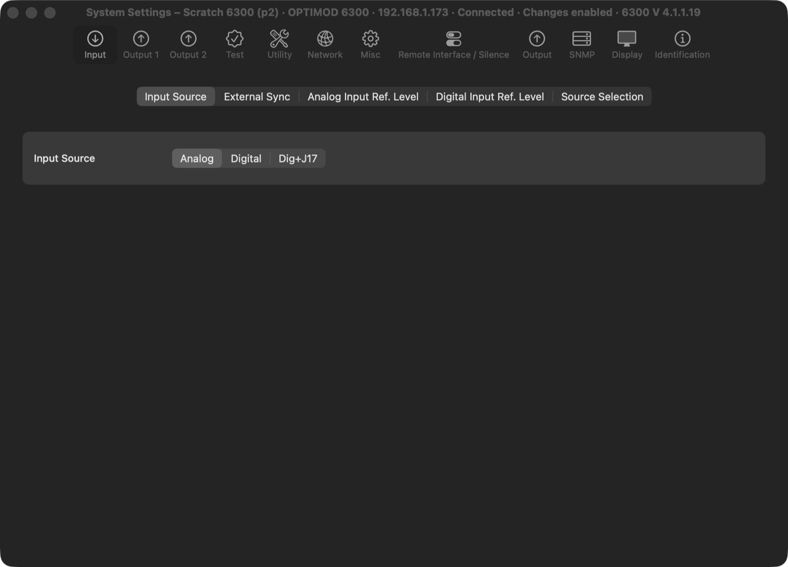
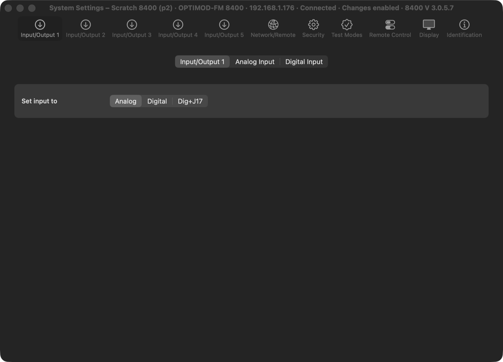
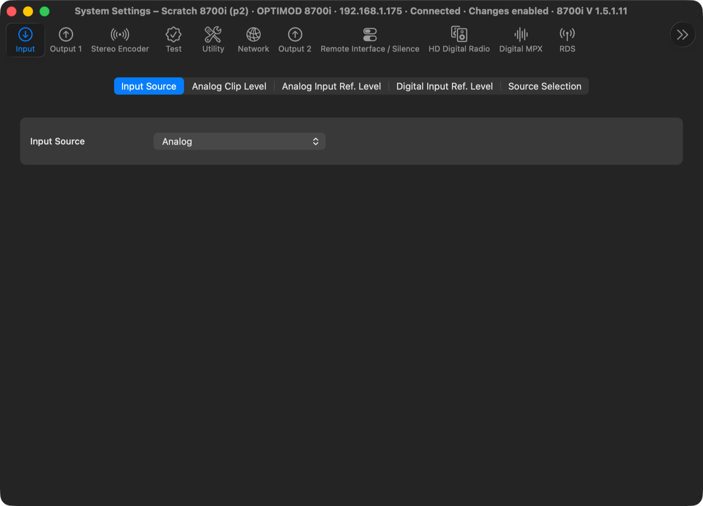

# UI Phase 5 close-out and UI Phase 6: concurrent processor sessions

> **Evidence status:** run on 28–29 October 2026 in the real macOS app (test build on port 15701, isolated data) against virtual units running original firmware, without audio devices: scratch 6300 4.1.1.19 (192.168.1.173), a second 6300 made from its backup (192.168.1.188, own IP and MAC), scratch 8400 3.0.5 (192.168.1.176), scratch 8700i 1.5.1.11 (192.168.1.175) and a second 8700i from its backup (192.168.1.186). The only write was on the second 6300 (Contrast 1 → 2 → 1, confirmed by readback). No physical processor and neither 8700HD was touched.

## Phase 5 close-out: the remaining clients' Setup pages

| Model | Before | Now |
|---|---|---|
| 5500i | already done (M2, 10 client tabs) | unchanged |
| 6300 | grouped profile fields | the client's Setup sheet (6300PC.exe 0x44c190): Input, Output 1, Output 2, Test, Utility, Network, Misc, Remote Interface / Silence. Its Stereo Encoder dialog exists but is never added to the sheet. |
| 8700i | grouped profile fields | the client's sheet (8700iPC.exe 0x460400): Input, Output 1, Stereo Encoder, Test, Utility, Network, Output 2, Remote Interface / Silence, HD Digital Radio, Digital MPX, RDS, RDS Alternate Frequencies, Dante Input, Dante Output, Streaming Audio. The Xponential page of that sheet holds processing fields. |
| 8400 | grouped profile fields | the client's PEG System screens: Input/Output 1–5, Network/Remote, Security, Test Modes. The analog and digital rows of an Input/Output screen are separate sections (the client draws them under their own headings with the same row labels). The Quick Setup wizard only repeats fields of these screens. |

Cause of the missing 6300/8700i pages: the extractor's disassembly stopped at the first undecodable byte, before their binder calls; the complete pass made for the 5500i finds them. Reported fields that no client page places (for example the 6300's DO1/DO2 dither) join the client's page for that subject in a named section, never a second tab with nearly the same name.

## Phase 6: what changed

| Area | Before | Now |
|---|---|---|
| Service | One global session: one snapshot, profile, meter stream, command queue. | One session per processor (saved connection, or `host:<address>`), each with its own owner task: snapshot, profile, meters, command queue, pending operation, reconnect, activity counters. Windows reach it under `/api/d/<device>/…`; the browser keeps the unprefixed session. |
| One processor, one session | — | A processor (address + PC Remote port) is held by one session: a second connect is refused before any login, also while the first waits to reconnect. A session connects only its own saved connection. |
| 8400 meters | Each session bound UDP 16540 itself (a second 8400 could not get meters). | One shared listener; each packet goes to the session of the unit that sent it; the port is released when the last 8400 disconnects. |
| Windows | One processor at a time; connecting another closed the windows. | Figma-style processor tabs above Meters and Processing Settings (name, model, status dot, close, +); choosing a tab only changes what they show. System Settings, Presets, Automation, Security and Diagnostics are one native window per processor. One `/api/sessions` read a second follows every processor. |
| Connections | Connect = disconnect the other first. | Connect / Disconnect per processor; others stay connected. A tab's close button disconnects that processor only, after a confirmation. Quit ends every session (`/api/disconnect-all`). Window › Show Next / Previous Processor (Control-Tab). |
| 8400 keepalive | A keepalive answer later than 4 s ended the session. | Ended only by a closed connection or 20 s without an answer, as for the PC Remote models. |

## Runs

| Gate item | Result |
|---|---|
| Three mixed sessions (6300, 6300 B, 8400) at once, including two of one model | PASS: three sessions, three session IDs, one login each |
| 100 tab switches, then 3 minutes | PASS: session IDs unchanged, 1 login per processor, 0 writes, exactly one meter reader (the selected tab), meters live on every session (6300 polls 5597/5247, 8400 4217 UDP frames through the shared listener) |
| Duplicate connection | PASS: a second connect to .173 (browser session) and to .176 (another device key) refused before any TCP: *already open in another tab* |
| Cross-device write | PASS: Contrast on 6300 B 1 → 2 (readback) and back; the same request sent to 6300 A's session refused (session changed), A stayed at 1 |
| One processor failing | PASS: 6300 B's unit stopped → its tab *Reconnecting* with the countdown, 6300 A and 8400 kept their sessions; unit restarted → B reconnected on its own with a new session, A and 8400 untouched |
| Same model twice (8700i .175 + .186) | Both connected; with four emulated units the Mac ran at load 24 (units at 0.22–0.46× real time) and two sessions timed out on the unit side while the other two stayed connected. Run again with two 6300s at 1.0× real time: PASS |
| Phase 5 pages in the app | PASS: 6300, 8400 and 8700i System Settings show the client pages above |
| Regression | 83 orban-web + workspace Rust tests, clippy, fmt, 74 UI tests, UI build, 9 Swift test programs: PASS |

Rig findings (not app defects): a unit copied from another keeps that unit's MAC in `flash/bin/mac.bin` (the two then answer for each other's address), and the Mac keeps an ARP entry for a reused address; the copies got their own MAC and a fresh address. An 8400 whose session ends without message 14 stops serving PC Remote until it restarts (known since Phase 2).

## Screenshots

