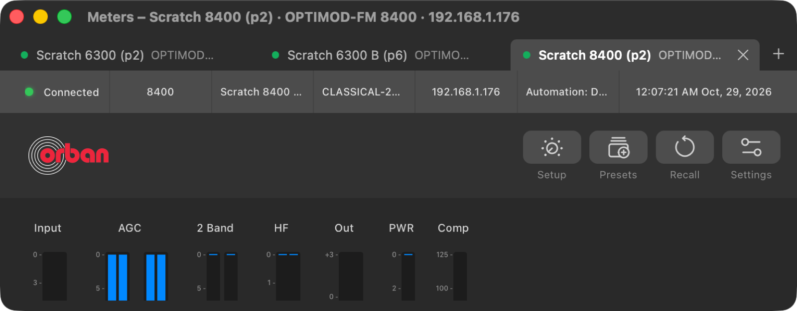
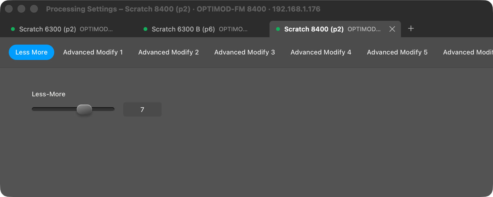
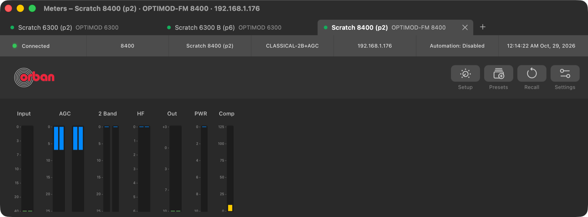
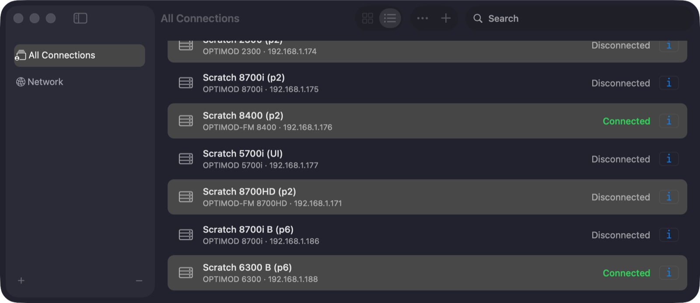

# UI Phase 7: native polish of the multi-processor chrome

> **Evidence status:** run on 29 October 2026 in the real macOS app (test build on port 15701, isolated data) with three virtual units on original firmware connected at once (6300 .173, 6300 .188, 8400 .176), no audio devices, no writes. The Figma instrument content (meters, processing pages) is unchanged; this phase covers the native chrome around it.

## What changed

| Area | Before (Phase 6) | Now |
|---|---|---|
| Title bar | the window colour (#4c4c4c) above a #2c2c2c tab strip | the tab strip's colour, one band (Mark's request) |
| Tab width | fixed 120–280 pt per tab; many tabs pushed the + button out of a narrow window | tabs share the bar between 112 and 300 pt; below 112 the strip scrolls sideways, the selected tab stays in view and + stays visible |
| Keyboard | tabs reachable only through Window › Show Next / Previous Processor (Control-Tab) | also by full keyboard access: each tab takes focus (focus ring), Space/Return chooses it, Delete closes it; tabs are radio buttons with name, model and state for VoiceOver |
| Disconnect failure | written to the Error Log only | also a sheet on the window |
| Connections window | the list scrolled under the transparent toolbar: row text ran through "All Connections" | the list starts below the toolbar's safe area (as Presets already did) |

## Runs

| Gate item | Result |
|---|---|
| Meters at its minimum (760 → 768 × 300) with three tabs | PASS: tabs shrink and truncate, + in view, no overlap; meters scroll, never scale |
| Processing at its minimum (900 × 360) | PASS: tabs and page bar fit, page bar scrolls |
| Reference width (1133) | PASS: full tab names and models |
| Connections with three processors connected, list scrolled | PASS: three rows *Connected*, no row under the title |
| Accessibility | PASS: System Events lists three radio buttons with their names; AXPress on the first switched Meters and Processing to that processor |
| Restore | Meters and Processing reopen at their saved place per window kind and keep it when another tab is chosen |
| Sessions | 3 connected throughout, no extra logins from window or tab actions |
| Regression | 9 Swift test programs (new: tab width), Rust and UI suites unchanged since Phase 6 |

Not changed on purpose: the Meters and Processing windows stay dark in light mode (the Figma instrument); the native windows (Connections, Presets, System Settings, Tools) follow the system appearance and macOS 26 materials of the standard controls.

## Screenshots

